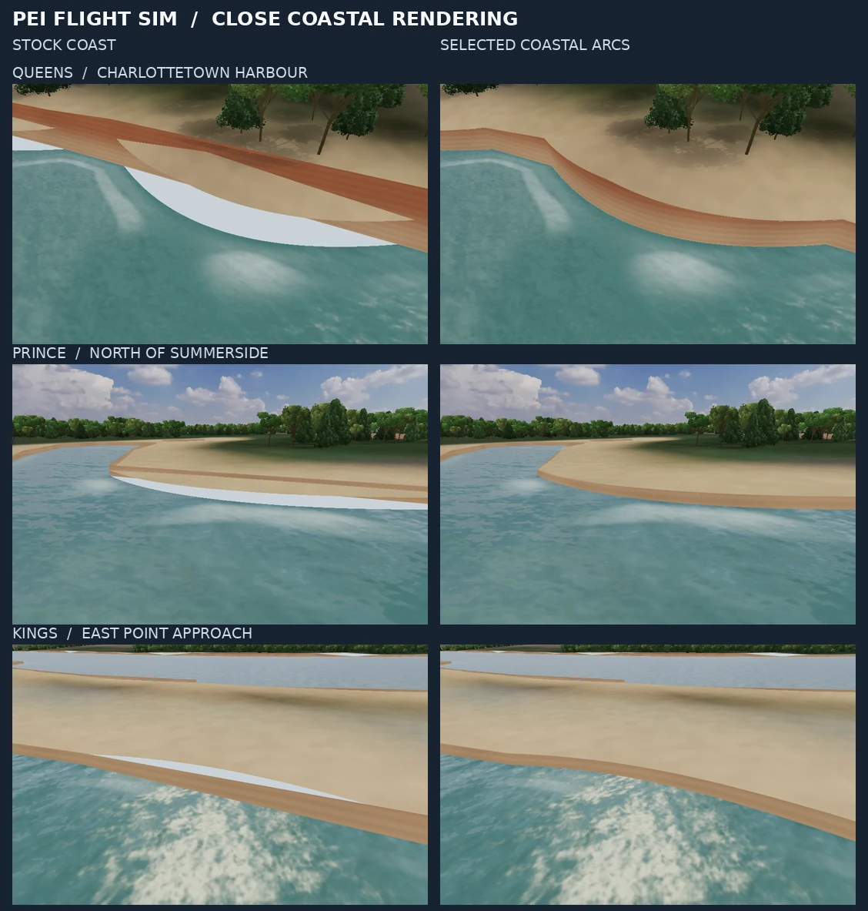

# Selected coastal arcs

Append `?legacyShoreArcs` to preview a rendering repair for visible holes
where the older shoreline wall crossed the wrong part of the land/water
contour. Default rendering is unchanged. This does not change the coastline
data, water level, terrain mesh, elevations used by flight, or navigation.

The land and sea both read a bilinear signed-distance field. Some of its
47 m cells have curved zero crossings, but the old renderer connects only
the two cell-edge crossings with a straight wall. From a low angle the
land and water shaders can both discard a ray before it ever reaches that
wall, exposing the sky through the coast.

The preview selects only non-degenerate, two-crossing cells whose original
straight wall misses the bilinear arc by at least 1.4 m. It follows the
same contour, preserves both exact endpoints, and bounds interpolation
error to 0.047 m in plan before Float32 submission. The top and bottom
span the active rendered land surface and fixed sea plane. Nearby adjoining
walls keep their plan coordinates and blend back into their old end heights.
Distant chunks retain the exact stock triangles and the original ownership
visibility rule.

The purely geometric province-wide prefilter found 979 strict cells before
site exclusions. Surveyed East and West Point terrain owners, the independent
Basin Head bank and its join collar, and loaded water insets are excluded.
Ambiguous saddle and zero-corner cells are left entirely to the stock path,
including when they adjoin a corrected arc. Keeping those adjoining walls
avoids uncovering a separate grazing-view seam near Summerside. This preview
does not establish coverage for every coastline, angle or visual defect.

The [geometry and scope gates](legacy-shore-arc-scope.json) record the
unmodified local shoreline previews and stock far visibility. All 507,600
pixels in the protected East Point frame matched. At West Point the near
survey remains excluded; the earlier scoped C camera changed only five
antialiased horizon pixels, by at most six RGB levels, and added no sky holes.

## Matched scenes

The three practical close-flight cameras show one example in each county.
In the diagnostic version, **only** the sky is made magenta. A colored
gap below the visible shore is exposed background, not beach, tidal water or
foam. The development comparison holds the camera and background time fixed.
It does not measure a hardware frame-rate gain or certify terrain realism.

| Close camera | Sky pixels in the same central window, stock → preview | New sky pixels in the full frame |
| --- | ---: | ---: |
| Charlottetown Harbour (Queens) | 8,157 → 0 | 0 |
| North of Summerside (Prince) | 2,700 → 0 | 0 |
| East Point approach (Kings) | 2,276 → 0 | 0 |

**52,918** previously exposed pixels were covered across the full frames. Details and submitted geometry counts are in the [render gate](legacy-shore-arc-render-gate.json).



## Replay

```sh
npm run check
node tools/verify-world.mjs
python tools/qa/legacy-shore-arc-frames.py --checkout . \
  --chromium /path/to/chromium --out /tmp/pei-shore-arc-frames
```

This replay uses Playwright, NumPy and Pillow for camera setup and pixel
counts. See the [saved camera and source anchors](legacy-shore-arc-poses.json).
