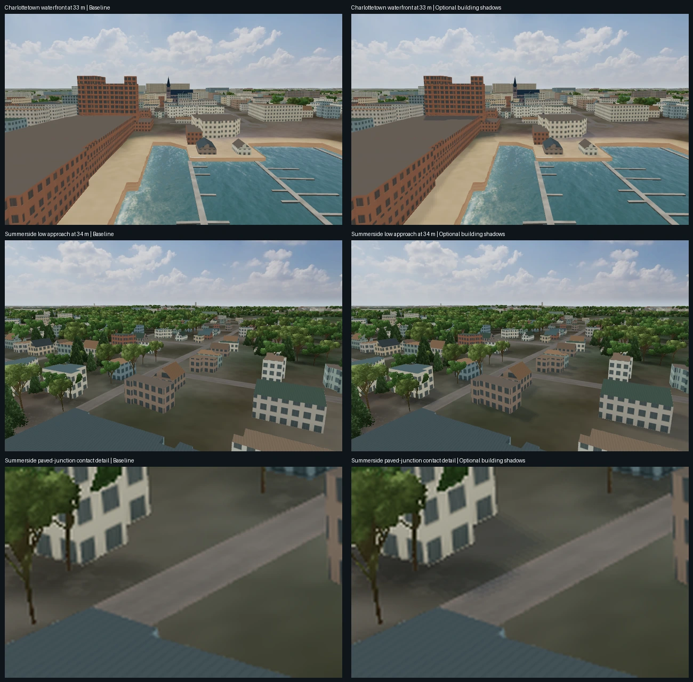

# Optional terrain, road and building shadows

Append `?buildingShadows` to the simulator URL (or `&buildingShadows`
if it already has a query string). Refresh without that flag to return
to standard rendering. This is an **opt-in scenery preview** until it
has broader GPU testing. It does not require new downloads or data from
the player.



The fixed daylight uses a local light-space depth pass over the same
streamed building triangles visible in the simulator. The field is
about 740 m wide and follows the aircraft in stable texel increments.
Terrain, paving and untreated nearby roofs and walls can receive the
same shade. Water and sky stay independent. The [surveyed Souris
shell](souris-daylight.md) keeps its own exact local material and does
not cast a second time. No new shadows are added to aircraft or
vegetation by this feature.

The depth comparison interpolates the receiver plane at each sampled
light texel, not just at the shaded pixel centre. This distinction
matters: an earlier prototype incorrectly darkened 193,978 samples on
an entirely unoccluded simulated roof. The corrected test darkens
zero of those 324,000 samples. An exact sun-ray test with a known
occluder darkens all 11,356 unambiguous shadow-core pixels and none
of the 291,564 protected lit pixels.

## Runtime and limits

- The effect fades out between about 285 and 395 m above local ground.
  A missing or replaced set of streamed casters invalidates stale
  shade, rather than leaving silhouettes behind.
- In three matched local tests (Charlottetown, Summerside and Souris),
  the main draw and triangle counts were unchanged. A shadow refresh
  did up to 5 **additional depth draws** and submitted up to 41,564
  depth triangles. There are no depth refreshes in opt-out mode.
- The local 1,536² render target includes a 9 MiB RGBA8 colour plane
  plus a depth attachment (about 18 MiB combined at four bytes per
  depth pixel). Active receiver pixels can use nine texture taps.
  This is not a user-device performance claim.
- The matched tests verify actual ground, paving and wall responses,
  no unrelated sky changes, no stale shadows after tile eviction,
  and an unchanged 16,758-pixel Souris style-6 control. Integer
  light-texel snapping greatly reduces movement shimmer; coverage
  fades and raster edge cases mean a recenter is not bit-identical.
- This is fixed-sun, local building occlusion. It is not a complete
  scene-lighting simulation, exact real-world material, or a
  photorealism claim.

```sh
npm run check
python tools/qa/building-shadow-receivers.py --checkout . \
  --chromium /path/to/chromium --out /tmp/pei-building-shadows
```

The browser check temporarily adds controlled geometry and locks
paired views; it does not change the shipping simulator. It uses
Python Playwright, Pillow, NumPy and SciPy.

### Same-object caster changes

A streamed building mesh can retain its identity while its submitted geometry,
index or draw range changes. The depth cache now notices those changes as well
as additions and removals. A throttled change disables stale shade until a
refresh; a confirmed owner transition refreshes immediately. An unchanged
owner retains the existing cache and does not incur an extra depth draw.

A direct Three.js / Chromium SwiftShader test of the real depth pass read
2,735 covered depth texels for the stock caster and 1,034 for its replacement
on the **same** mesh. A zero-triangle draw range cleared the map, and restoring
stock reproduced the original depth bytes exactly. This verifies cache
invalidation, not gameplay frame rate or a change to Standard lighting.

```sh
python tools/qa/building-shadow-caster-swap.py --checkout . \
  --chromium /path/to/chromium --out /tmp/pei-caster-swap.json
```
