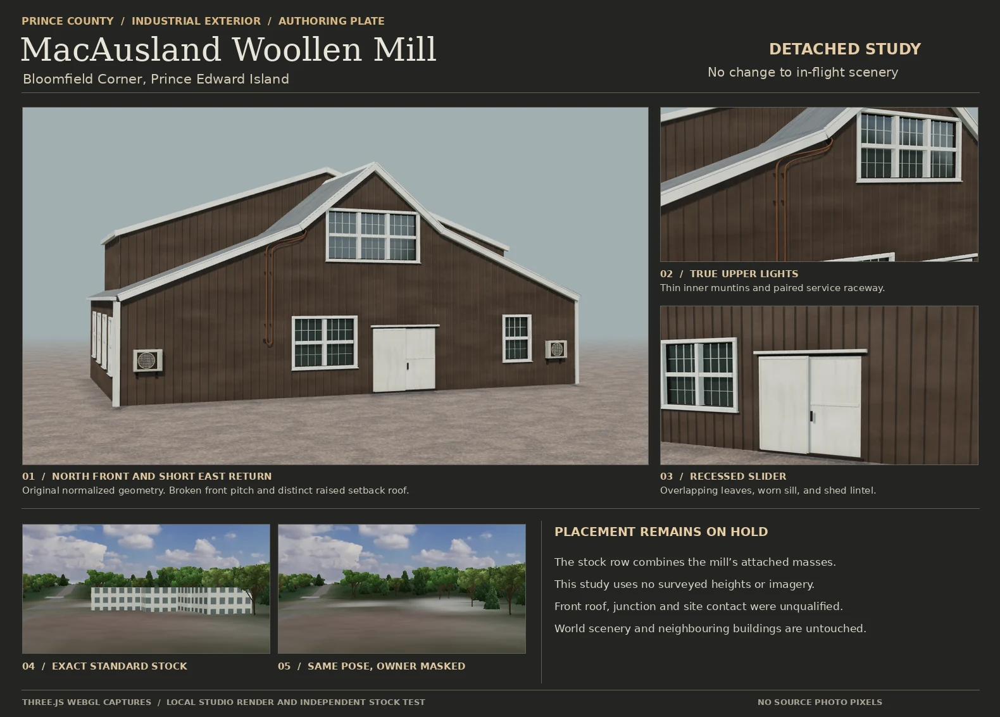

# MacAusland Woollen Mill | Bloomfield Corner

**Detached art study. The building in flight is unchanged.**

The site is the operating MacAusland Woollen Mills at 38317 Western Road (Route 2) in Prince County. Its dark principal volume faces **north into the forecourt**, not sideways onto Route 2. The road climbs on the viewer’s left in front photography. The original 1870 operation and 1949 fire provide historical context; the art depicts observations of the evolved exterior, not a reconstruction of the original mill.



## What the sources establish

| View-only source | Positive identification |
| --- | --- |
| [Mill operator’s history](https://macauslandswoollenmills.com/about.php), [visitor FAQ](https://www.macauslandswoollenmills.com/faq.php), [Tourism PEI](https://www.tourismpei.com/attractions/macausland-woollen-mills) | Industrial identity, working-factory access, and civic address. The Tourism PEI exterior repeats the operator-supplied composition in the 2023 article; it is not a second dated capture. |
| [MacClure, 12 August 2015: front/east](https://www.flickr.com/photos/37266013@N00/22398842496/) and [high sash detail](https://www.flickr.com/photos/37266013@N00/22398842866/) | Sharp upper crown and shallow lower breaks in the near gable; taller setback visible behind; three framed upper bays with four columns and two rows in each upper and lower sash. |
| [Firsthand 2018 visit](https://www.mixmeasuremake.com/the-best-canadian-wool-blankets/), [owner-attributed 2023 publication](https://atlanticbusinessmagazine.ca/web-exclusives/a-153-year-long-yarn-to-tell-of-macauslands-woollen-mill/) and [operator’s front photograph](https://macauslandswoollenmills.com/) | Directional continuity of brown vertical cladding, light folded eaves, repeated lower sash, and adjacent masses that are not one uniformly extruded box. 2023 is the publication date, not a verified capture date. |
| [Firsthand October 2026 publication](https://kareninthewoods-kareninthewoods.blogspot.com/2026/10/days-16-17-18-canadian-maritime-2026.html) | The front image named `20260925_121626.jpg` shows the same roof hierarchy and upper lights and the paired visible service run. It also shows changes in equipment; the plate does not reconstruct an exact equipment year or unpublished wiring. |
| [PEI civic point](https://gis.princeedwardisland.ca/server/rest/services/civic_addresses/FeatureServer/0), [parcel map](https://gis.princeedwardisland.ca/server/rest/services/property_parcels/MapServer/0) and [2020 provincial orthophoto](https://tiles.arcgis.com/tiles/fRRBCludvuolCm5B/arcgis/rest/services/Ortho_2020_3857/MapServer) | Confirms the site plan and the exact 2020 game envelope. The [education sheet](https://www.princeedwardisland.ca/sites/default/files/publications/eelc_pei_historic_places.pdf) is useful for history, but its printed coordinate is about 17.66 km from this envelope and was rejected. |

The separately authored studio mesh has rolled brown steel with physical raised profiles and restrained runoff, genuinely cut and glazed sash, thin internal muntins, an older white split slider with a closed recess, an unbranded paired service elbow and external cooler vocabulary, and two distinct depths of folded roofing. The six observed front bays have **96 actual glass plates**, of which **48** are in the high three-bay unit. The four short east sashes contain another **18** authoring plates; their full subdivision is not established. The studio gravel and reflections are synthetic review aids. Lettering, logos, overhead wiring, cars, canopy and unverified upper side details, the rest of the factory, and all neighbouring properties are intentionally absent.

No third-party photo pixels or vector marks enter the asset. Paint mix, fasteners, glass optical values, wall thickness, dimension, grade, and precise position are authoring choices, not as-built measurements.

## Actual stock verification

At Standard base `c541e42` (#209), the connected packaged owner is `q2023/300`; all **1,567.412278 m²** of its extracted projected envelope lie inside parcel **37440**. The packaged owner includes attached western and link bodies that are outside the art. The other features `q2023/444` and `q2023/516` are different parcels and remain untouched.

Each A/B captures the actual Three.js draw before and after temporarily removing just vertices **[21093, 21303)** of the 40,023-vertex stock tile. The removed span is 22 cap triangles plus 48 wall triangles. An independent draw confirms it. In the four author views, changed pixels stay inside one antialiasing pixel of the owner registration and exact stock pixels return on re-enable.

| Author A/B view | Changed pixels | Stock restored |
| --- | ---: | --- |
| Front | 14,933 | Bit-identical |
| Road quarter | 19,833 | Bit-identical |
| Air north | 6,562 | Bit-identical |
| Air south | 6,035 | Bit-identical |

## Why this cannot replace stock yet

The independent no-height spatial gate qualified **18 of 35** preregistered roles by horizontal support: **12 disconnected roof domains** and **6 ground-control domains**, not elevations. The eligible roof masks cover at most **526.0883 m²** in projected plan, or **33.56%** of the connected owner. **None** of the five authentic north frontage roof/crown domains qualifies. No stock cap triangle falls wholly inside the qualifying masks, and cutting the original caps would cross protected joins. The two independently identifiable north wall triangles are an ownership selector only: removing them does not remove the false cap or solve the site contact.

Native elevations were never opened; the ground and live replacement remain **HOLD**. The independent dry terrain predictions are unchanged game geometry, not validation against elevation or permission to modify scenery.

## Reproduce and audit

From the repo root:

```sh
node --experimental-strip-types tools/art/macausland-mill-study/verify.mjs
python tools/art/macausland-mill-study/render-views.py \
  --out /tmp/pei-macausland-studio --chromium /path/to/chromium
```

The author’s actual emitted Three.js V5 study has **11,304 triangles in 16 named batches**. The verifier checks 570 angular glazing rays, 741 slider rays, 64 upper and lower roof rays, 25 low east-apron rays, 108 envelope closure points, and the rolled rib and two service raceways on emitted triangles. Six fixed viewpoints replay identically with no console error or external requests in the local renderer. These are artifact tests, not proofs of surveyed geometry, photometric accuracy or device performance. The detailed sources, hashes, fixed views and separate evidence audits are in the [study evidence directory](../../tools/art/macausland-mill-study/evidence/).

The independent reviewer reproduced the final emitted geometry, confirmed 456 angular glazing hits (96 front plates and 18 interpretive side plates), 143 closed slider samples, 36 low east apron checks, both roof strata, and conduit clearance. All six independently rendered WebGL views match the six authored captures byte-for-byte. See the [independent V5 receipt](../../tools/art/macausland-mill-study/evidence/independent-mill-v5-result.json).
