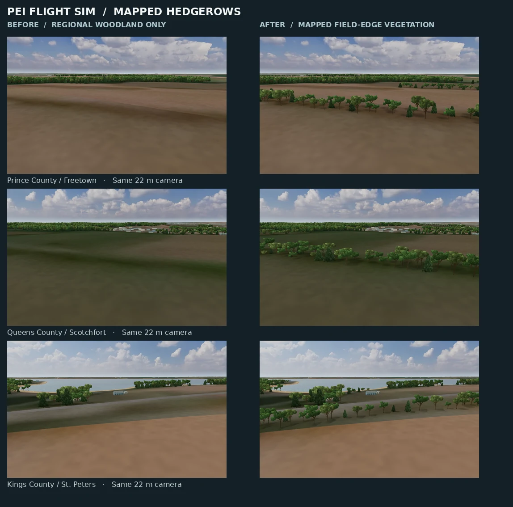
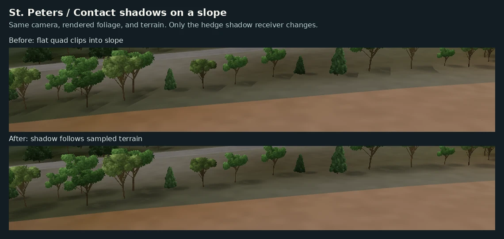

# Mapped field-edge vegetation

PEI's narrow tree belts and shrub windbreaks can be smaller than one
regional land-cover pixel. This optional layer brings them into the 3D
landscape using the [provincial 2020 Corporate Land Use Inventory](https://gis.princeedwardisland.ca/server/rest/services/Hosted/CLUI2020_OpenData/FeatureServer/0).
The province labels the mapped hedgerows as type `AGR/HR`. These are dated,
photo-interpreted outlines, not a survey of individual stems or species.

| County | Source hedgerows | Outlines with modeled centres | Candidate centres |
| --- | ---: | ---: | ---: |
| Prince | 3,681 | 3,594 | 176,453 |
| Queens | 7,196 | 7,085 | 362,929 |
| Kings | 2,642 | 2,572 | 132,794 |
| **Total** | **13,519** | **13,251** | **672,176** |

The generator places deterministic shrub and tree forms only in
hedgerows with at least 70% source woody cover, with enough space for
the model. It preserves the old woodland layer and fills gaps outside
that layer's support. Kind mix comes from the source cover fractions.
33,685 tree centres can use the native [provincial 2020 forest inventory](forest-height-stream.md)
stand scale; other heights, crown shapes and each specific placement
are artistic estimates. There is no new collision geometry.



The placement comparison predates the final ground-following hedge shadows.
The matched St. Peters detail below shows that subsequent correction.



## Grounding and coverage

Centres are checked in native geometry after quantization and against
both the shipped continuous shore field and the original 10 m and
in-game ESA cover classes. Source candidates near permanent water,
wetlands, roads, roof outlines or unknown data are rejected. The
runtime additionally excludes runway clearance and the light-station
survey patches. For remaining regular terrain, decorative roots use
the triangles actually submitted to the renderer, including sewn tile
edges, rather than the separate physics height. The independent
three-county low-flight ray check found all 149 sampled roots physically
embedded at the design offset. The new hedge shadow cards follow the
visible terrain at their corners; legacy woodland shadows retain their
previous rendering path. At St. Peters, diagnostic probes more than
1 cm below the terrain dropped from 3,177 to 42 of 70,875 points.
A few cases can still cut across an interior diagonal; this is not a
full world shadow map.

Hedges append after the existing trees in the same canopy/shadow
batches. The whole player does not instantiate 672,176 unculled trees:
the layer requests only nearby chunks and uses the remaining vegetation
capacity. The three matched 22 m views added 3,139, 1,669 and 1,575
local canopies respectively, with identical draw counts. It fades out near
the draw perimeter and cannot evict original tree instances. The
foliage is still a simplified canopy renderer, not a photoreal or
botanical survey.

## Assets and repeatability

- The asset is split into 217 hashed chunks in seven packs totaling 3,369,928 bytes, each at most 535 kB. Two requests may run at once
  and at most nine decoded chunks are retained.
- At a cold Cavendish departure, four ranges totaling 140,639 bytes or
  one non-range pack of 532,044 bytes supplied the same 1,706 local plants.
  These are optional-layer bytes, not total download size or user FPS.
- A missing or corrupt optional pack preserves the original scenery
  and flight. A changed source-layer pin disables the derivative.
- Sources: provincial land-use and forestry, under the
  [Open Government Licence – Prince Edward Island](https://www.princeedwardisland.ca/en/information/finance/open-government-licence-prince-edward-island);
  ESA WorldCover 2021 v200, [CC BY 4.0](https://creativecommons.org/licenses/by/4.0/)
  ([archive](https://doi.org/10.5281/zenodo.7254221));
  and the existing world shoreline, roads and building geometry under
  the [Open Government Licence – Canada](https://open.canada.ca/en/open-government-licence-canada).
  The asset contains modified Copernicus Sentinel data (2021) processed
  by the ESA WorldCover consortium.

```sh
python tools/geodata/fetch-clui-hedges.py --out /tmp/clui-hedges
/usr/bin/python3 tools/terrain/bake-forest-stream.py --archive EFI2020.zip \
  --out /tmp/forest-stream --native-grid /tmp/dominant-native-20m.tif
/usr/bin/python3 tools/geodata/bake-hedge-stands.py --source /tmp/clui-hedges \
  --world public/world --forest /tmp/dominant-native-20m.tif \
  --cover10 N45W066.tif N45W063.tif --out /tmp/hedge-staging
python tools/geodata/segment-hedge-pack.py --from /tmp/hedge-staging \
  --out public/world/woodland/hedgerows-v1
npm run check
python tools/qa/hedge-browser.py --dist dist --chromium /path/to/chromium \
  --out /tmp/hedge-browser.json
```

The two original 10 m WorldCover tiles can be downloaded from the same
sources listed in [the cover manifest](../../public/world/cover.json).
The native forest TIFF and the two cover TIFFs are pinned; the raw
survey materials are not bundled or streamed to players.

A separate [hedgerow band workshop](../../tools/art/hedgerow-bands/README.md)
records three model styles and a native readback of the original New
Glasgow pair. The revised models remain uninstalled.
