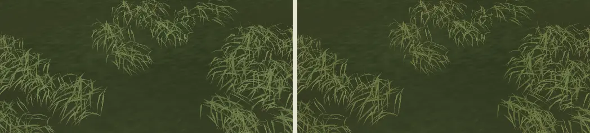

# Keep the scene opaque behind close marsh grass

The original curved grass blades in Standard scenery use alpha to control
multisample coverage at the edges and across the distance fade. Covered
samples now keep the scene's existing alpha, so the page background does
not leak into the marsh. Sample colour replacement, blade geometry, fade,
wind, stock shadow settings, requests and terrain contact are unchanged.



These crops show the same locked Tracadie camera at native scale, with both
canvas images composited over the page's existing background colour. The
fix is to coverage, not a change to foliage colour, density or design.

Fixed 840 × 540 native WebGL replays with the unmodified shaders:

| Camera | Pixels no longer partially transparent |
| --- | ---: |
| Tracadie, 5 m AGL | 53,442 |
| Tracadie approach, 18 m AGL | 3,783 |
| Cascumpec, 6 m AGL | 52,223 |
| Morell, 5.5 m AGL | 59,496 |
| 450 m high control | 0 |

Every matched pair kept the exact raw RGB, submitted triangles and draw
count. Switching back restored the original RGBA and PNG. In a separate
repeat, two different RGB-only shader markers found every repaired pixel
inside the exact visible mesh, with no dilation or pixel tolerance. The high
control made no marsh mask request.

A compiled Standard Tracadie Dispatch flight also confirmed the new
blend on native four-sample alpha-buffer draws. With four samples but an
RGB-only buffer it kept the same foliage path without custom blending.
Without multisampling the original marsh ground still streamed, with no
blade draw. With the stock marsh override neither loaded. Each flight
started, moved and paused normally. This is a draw-state regression check,
not a claim that blades cover visible pixels at the starting Chase altitude.

[Native and compiled evidence](marsh-coverage-alpha/verification.json).
Reproduce the exact role replay with Python Playwright and Chromium:

```sh
python tools/qa/coastal-marsh-alpha.py --chromium /path/to/chromium --out /tmp/pei-marsh-alpha
```
