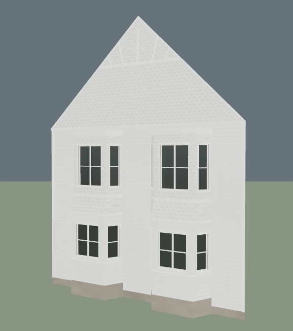
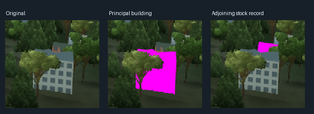

# Matthew House, Souris: southwest exterior craft study

**Detached workbench. Not in the playable scene.** Matthew House at 15 Breakwater Street is a Queen Anne Revival landmark. The old scene draws its principal record as a generic low-detail block. This study develops just the harbor-facing façade: two stacked bays with deep glazing, clapboard, flared shingle work, reconstructed joinery, and an interpretive gable fan. It contains no closed roof, rear elevation or new collision.

## What is measured

The [Parks Canada heritage record and its original photographs](https://www.historicplaces.ca/en/rep-reg/place-lieu.aspx?id=19170) establish the identity and the photographed architectural details. The civic point sits near the driveway; it is not the building center. The original atlas principal record, `q130331/0`, supplies the signed 7-vertex plan and the registration frame. The 2020 aerial view was inspected only to check the position. No reference photo pixels were included or used as a texture.

Direct [Natural Resources Canada CanElevation LiDAR](https://open.canada.ca/data/en/dataset/7069387e-9986-4297-9f55-0288e9676947) includes 596 eligible class-6 returns within that original plan. The observed roof returns peak at 26.548 m CGVD2013. One principal slope had 95 of 97 spatially held returns within 0.15 m. The opposite side and continuous eave remain unresolved, and the modern footprint differs from the older atlas. The displayed peak and eave are representative bounds for a craft study; they are not a survey of the gable or individual joinery. Government of Canada data are credited under the [Open Government Licence](https://open.canada.ca/en/open-government-licence-canada).

## What rendered

The native ownership check used ordinary right rudder in the real Chase camera at Souris Waterfront Pass. The old principal building and adjacent record were marked in separate same-camera captures. The first two views showed 1,145 and 1,823 fully marked principal pixels and 93 and 192 fully marked adjacent pixels, respectively. The late control displayed neither. Every comparison restored the original RGBA image exactly. The detached façade itself rendered as one opaque draw at 2,385 triangles close up or 1,221 at the intermediate tier; the studio ground adds a separate draw.

The fragment stays inside the old principal plan. Adding it over the old closed block would hide it, and removing the old block would leave an incomplete building. A future replacement needs a closed, registered roof and remaining elevations, retained adjacent owners, and a fresh native comparison. The playable application does not import these workbench modules.
