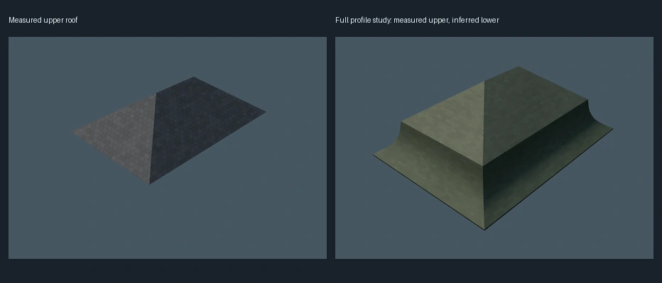
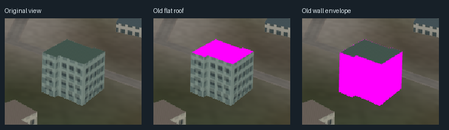

# McLean House Inn: measured upper roof and historic profile study

**Detached, not in the playable scene.** This is the roof of the Second Empire residence at 16 Washington Street, not the Matthew & McLean shop on Main Street. The [Parks Canada register](https://www.historicplaces.ca/en/rep-reg/place-lieu.aspx?id=18476) describes a hipped top and curved mansard profile. The workbench separates the roof that can be measured from the lower profile that must still be reconstructed from the historic exterior views.

## Surveyed upper section

Direct 2020 [NRCan CanElevation airborne LiDAR](https://open.canada.ca/data/en/dataset/7069387e-9986-4297-9f55-0288e9676947) supports four upper planes. In the first-return sensitivity check, the roof-envelope residual over 460 selected upper points was 0.028 m median and 0.091 m at the 90th percentile. That is agreement within the same survey, not independent field accuracy. Spatial strip holdouts and the individual planes had different error distributions. The 23.8 m cut in the workbench is a section through these planes, not an observed eave. The eight-triangle piece is closed at that analytical section. Canada data are attributed under the [Open Government Licence](https://open.canada.ca/en/open-government-licence-canada).

## Illustrative lower section

The lower survey check did not establish the continuous flare or all lower faces. The full roof study retains the exact six visible upper triangles and adds a hand-authored bell curve, a narrow eave shadow line, and procedural dark shingle courses. The [historic front and side photographs](https://www.historicplaces.ca/en/rep-reg/image-image.aspx?id=18476) informed that shape; neither dimensions for the lower flare nor photo pixels were used as textures. Its 88- and 56-triangle detail levels each rendered in one opaque draw. It does not model the building body, porch, dormers, or the west addition.

## Existing flight view

The stock model uses a flat cap. Original roof and wall ownership were marked separately in same-camera captures on the ordinary neutral Chase route. At 215 m and 315 m from spawn, the roof had 330 and 1,290 fully marked pixels, respectively. At 405 m neither owner was visible. Restoring the original shading produced byte-identical RGBA for each view.

The current flat cap would hide most of the measured shape if it were simply overlaid. The playable app does not import these modules. A full placement needs a coherent body-to-roof join and verified handling of the adjacent additions without disturbing the rest of the town.
