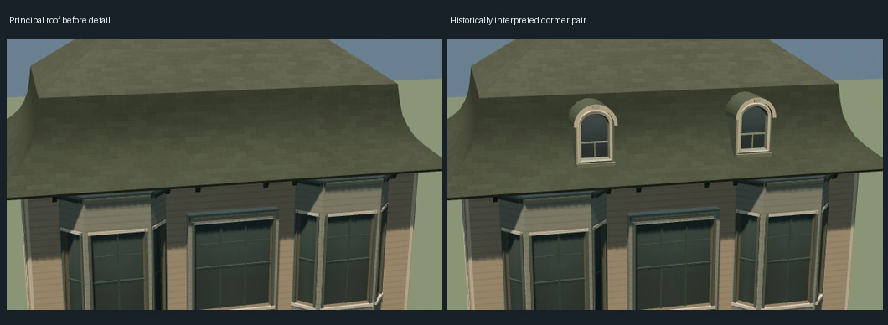

# McLean House Inn: arched dormer detail

**Detached and illustrative. Not in the game.** The [original heritage photographs](https://www.historicplaces.ca/en/rep-reg/image-image.aspx?id=18476) identify the two prominent round-headed dormers. The original modeled meshes add deeply recessed glazing, curved wood hoods, small keystones and surrounding cheeks. No photo pixels are bundled. The locations and joinery measurements are an interpretation of the visible historic appearance, not a survey.

Both dormers attach to the interpreted lower bell. Neither edits or touches the measured upper hip, the [existing detached principal body](principal-assembly.md), or the playable building. The close pair renders in one added opaque draw of 848 triangles; the intermediate pair uses 496. In the same-camera 4× studio comparison, 9,972 RGB pixels changed around the two fixtures, with zero alpha changes and exact restoration when disabled. The figures describe a model workbench, not an improvement already visible in a playable flyby.
