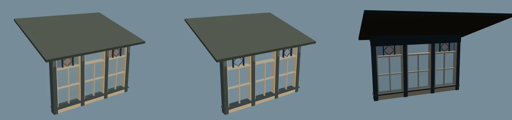

# McLean House Inn: east sunroom cutaway

**A detached architectural study, not a complete or playable porch.** The four corners of an 11.6 m² interior roof patch are retained from the 2020 Canadian elevation survey. The accepted patch is within the old atlas footprint. Its edges are the cut of the study, not measured eaves. The glazing, timber and decorative leadwork are original geometry informed by the [historic registry photograph of the sunporch](https://www.historicplaces.ca/hpimages/Thumbnails/74206_Large.jpg) and the [heritage description](https://www.historicplaces.ca/en/rep-reg/place-lieu.aspx?id=18476). The three-bay façade, pale muntins, and tinted flanks are an interpretation, not a reconstruction of exact joinery or evidence of the present-day condition. No photograph pixels are included.

There are deliberately no rear or side wall closures, floor, steps, or connection to the [principal body](principal-assembly.md). The two pieces still have a visible separation when inspected together in the study frame. The playable building, adjoining shop and ground are unchanged.

The close section drew 526 triangles over two WebGL draws in the native offline capture; the intermediate section drew 382. The glazing adds one draw and 46 non-overlapping triangles; disabling and restoring it at the same camera changed 49,936 RGB pixels, no alpha pixels, and restored the original bytes exactly. The [render receipt](sunroom-receipt.json) records these studio checks, not a new frame rate or an in-game upgrade.

The derived survey patch contains information licensed under the Open Government Licence – Canada.
