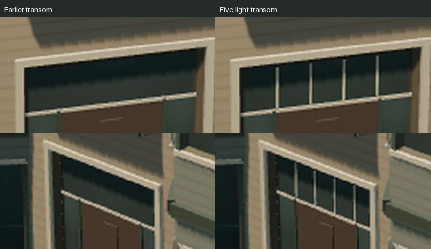

# McLean House Inn entrance transom

**Detached historic study.** The [2009 heritage photograph](https://www.historicplaces.ca/hpimages/Thumbnails/74204_Large.jpg) shows five lights across the transom above the front door. The existing [principal assembly](principal-assembly.md) had a single pane. Four original wood muntins now reproduce the rhythm, without replacing the old glass, entrance framing, hood, lower windows, or roof. The joinery dimensions are interpreted, not measured. No photo pixels are bundled.

The near geometric addition is 80 triangles in the same body draw; the mid addition is 48. With shadows enabled, the two close studio checks submitted the added triangles once for the body and once for its shadow, for 160 frame triangles. No draw call was added. Native captures changed 224 RGB pixels in the frontal view and 159 in the oblique view; restoring the prior model reproduced both frames exactly. See the [native receipt](entrance-transom-receipt.json).

The exterior, current site, approach steps and foundation have not been installed. This study makes no claim about original sill height, the present-day paint or the building’s place in the playable scene.
