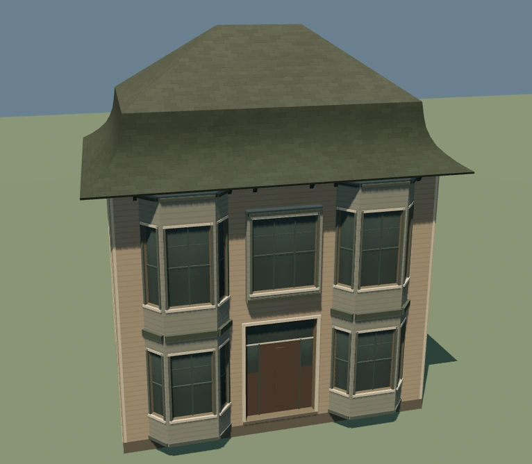

# McLean House Inn: principal assembly

**Detached architectural model. Not yet placed in the flight scene.** This principal volume combines the measured upper hip and the interpreted curved mansard with the twin bay stacks, slate-green trim, clapboard, recessed glass, centered entrance and upper bay documented by the [heritage register](https://www.historicplaces.ca/en/rep-reg/place-lieu.aspx?id=18476). No photographs are used as textures. The side and front design are historical interpretations; the unverified rear is quiet, not a claim of surveyed elevations.

The opaque body and roof render in two draws. The close pair has 2,552 triangles; the intermediate pair has 2,028. The studio adds a ground plane and, in the lit views shown, a separate shadow pass. The feature-level stock flight comparison and surveyed-roof limits remain in the [roof workbench](README.md).

The main front probably faces toward the harbour, but the source photographs do not give a calibrated camera or a surveyed face. Dormers, the west extension and sun porch are not present. Keeping the measured roof in its absolute vertical frame would leave the current display foot about 1.36–1.76 m above the legacy terrain in the existing 27-14 near tile. The studio plane does not resolve that difference. The next real placement requires a supported terrain and foundation join without moving the road, lowering the measured roof, or losing the separate building parts. The playable application still uses the unchanged old stock model.
