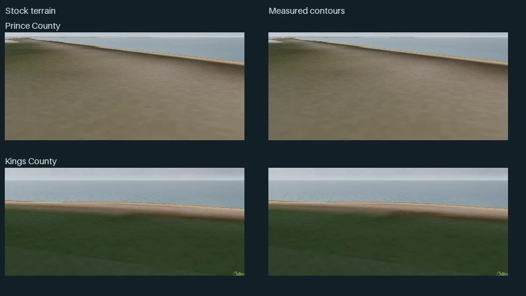

# Measured dune relief

In **Standard**, enable **Measured dune relief**, then choose
**Prince County · dry dune pass** or **Kings County · dry dune pass**.
**Dry dune surface detail** can be enabled separately for close-range sand
material. Queens keeps the stock geometry: the tested Queens candidate
crosses a shoreline that this terrain study does not revise.

Two bounded near-mesh sections use the original measured dune slopes and
low contours instead of the coarser inherited surface. The existing
shoreline, water classifications, roads, building plans, flight controls
and aircraft physics remain unchanged. In the measured interiors, the
rendered surface and ground contact share the exact same triangles.
A nine-metre feather brings the changes into the existing terrain.

## Sources and limits

The geometry uses the Natural Resources Canada [CanElevation HRDEM](https://open.canada.ca/data/en/dataset/0fe65119-e96e-4a57-8bfe-9d9245fba06b)
1 m bare-earth terrain and surface raster. The 2020 elevation data use
CGVD2013; current beach conditions are not inferred. Contains information
licensed under the [Open Government Licence – Canada](https://open.canada.ca/en/open-government-licence-canada).

The independent checks used the original classified point cloud rather
than comparing only to the resampled raster. It is the same 2020 survey
family, not a second survey. In the fully supported region, the
90th-percentile absolute errors of the two-metre-cell ground checks fell
from **1.15 m to 4.1 cm (Prince)** and **0.93 m to 5.6 cm (Kings)**.
These statistics describe the measured cores, not map-wide accuracy.

Every changed triangle was checked across its complete footprint.
The narrowest signed clearance in the simulator's dry mask was 95.3 m in
Prince and 45.0 m in Kings. No changed triangle included mapped
infrastructure, a recorded water point, or an unsupported elevated
surface. Nearby synthetic tree or hedge roots were also checked.
The rest of the visible dune terrain remains ordinary.

## Verification

The [exact Three.js mesh and contact checks](dune-relief-mesh-contact.json)
cast 3,828 rays. Protected positions kept their original ground contact;
all unmodified render points matched within 0.005 mm in those comparisons.
The local fine mesh adds 5,734 triangles in Prince or 4,390 in Kings,
with no extra draw. Ordinary coarse tiers do not use these insets.

[Matched same-scene cameras](dune-relief-render.json) kept all
236,943 projected exterior pixels unchanged across the two tests.
The proof uses the actual replaced triangle lists and the retained
terrain-border seams, not a cross-session image comparison.



- [Official native crop and source pins](dune-relief-source.json)
- [Raw classified ground return checks](dune-relief-native-returns.json)
- [Full changed triangle dry-ground checks](dune-relief-full-support.json)
- [Nearby planted geometry checks](dune-relief-vegetation.json)
- [Protected infrastructure and county scope](dune-relief-infrastructure.json)
- [Packaged controls and corrupt-data fallback](dune-relief-flight.json)

To rebuild a single owner from the pinned source crops, use GDAL, NumPy,
SciPy and the installed project dependencies:

```sh
python tools/geodata/bake-dune-relief.py --county prince \
  --dtm /data/prince-dtm.tif --dsm /data/prince-dsm.tif \
  --checkout . --output /tmp/prince-native-ground.g11.gz
```

The packaged flights flew and paused after 380 m in Prince and 385 m in
Kings with the sand material active. A same-length corrupt Kings grade
response restored stock ground without dropping the separate sand material.
Missing, corrupted or incompatible data leave the relevant county on
stock terrain. The other authenticated county is independent.
