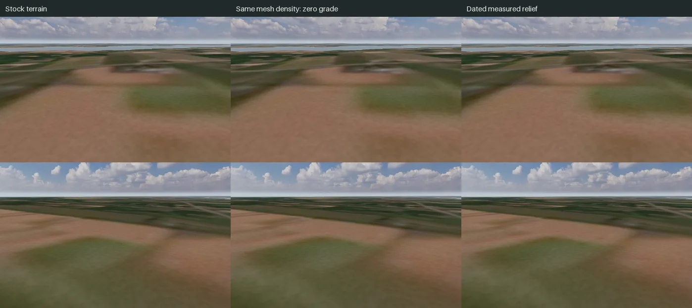

# A measured inland field relief study

**Detached. Not active on a released route.** This study replaces the stock triangulation of a small inland field inset for a drawn comparison only. The 2 × 1-cell inset locally lowers the stock mesh toward the dated 2020 bare-earth surface without adding a ground texture or changing collision. It uses the existing close terrain material and 2025 Sentinel color. There is no reason to change the working landscape based on this study alone: the improvement is modest at natural viewing scale, and ordinary departures do not give it a useful close view.

The [Natural Resources Canada HRDEM record](https://open.canada.ca/data/en/dataset/957782bf-847c-4644-a757-e383c0057995) provides the original 1 m elevation rasters. Classified first returns from the [same NRCan survey](https://open.canada.ca/data/en/dataset/7069387e-9986-4297-9f55-0288e9676947) corroborate the bare earth; they do not constitute an independent epoch. This authored grid uses bounded, tapered corrections to the dated source. At its 87 highest-support nodes, median absolute difference against the native terrain raster falls from 1.71 m to 0.56 m. That is a local same-survey fit, not a new survey or a validated landing surface.

The retessellated zero-relief control separates rasterization changes from grade. In two 4× matched close WebGL views, it changed no pixel by more than one RGB code value. Only adding the dated relief to that matched topology produced 7,121 and 5,224 pixels above the threshold. Neither view revealed any new sky or changed alpha, and the prior frame restored exactly. The ground-only bracket adds 1,110 triangles to the same draw. It leaves the neighboring [earlier imagery fix](inland-close-field-joins.md) active with the same source and wrappers, and confines RGB changes to the inset and its joining triangles. Vegetation placement, water, roads, and flight surfaces are unchanged. The facing-away control is byte-identical. In a separate neutral Chase flight from a private virtual start, the two nearby spatial windows showed 9,384 and 13,801 pixels above the same threshold; the farther two windows were exact stock when the inset moved out of frame. No released departure is added or modified.

The [receipt](measured-field-relief-receipt.json) separates source fidelity, actual optical evidence and the limits of release. The survey-derived source is used under the [Open Government Licence – Canada](https://open.canada.ca/en/open-government-licence-canada).
