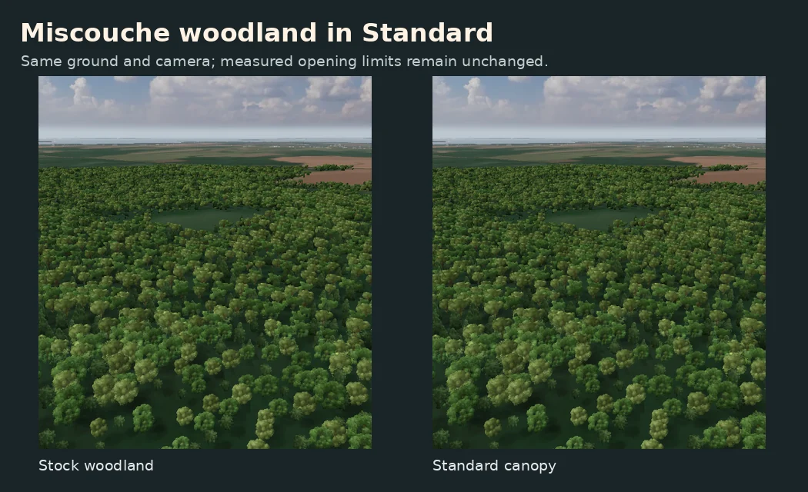

# Miscouche woodland canopy support

In **Standard** scenery, choose **Miscouche · woodland pass** to fly over
the measured dense woodland. Add `?stockMiscouche` to compare the same
departure with the original canopy. The legacy `?miscoucheCanopyStudy`
still runs the earlier explicitly enabled version with its wider altitude
window.
The route is virtual and is not an aviation, navigation, or access guide.

## Evidence and scope

The existing [closure audit](forest-canopy-closure.md) found the dense
public woodlot stand `0560971` more physically closed than
the original billboard canopy. The neighbouring, more mixed stand
`0490312` has a different low-structure profile and is left alone.

This pass adds **215 inferred crown instances**, not 215 measured individual
trees. Candidate centres come from original Three.js forms bounded by the
existing crown model and qualified at a one-metre DSM–DTM scale. The
inferred forms must fit inside the exact public land-use polygon, exceed
the tall-structure evidence threshold, and avoid areas classified as
short structure plus a 2 m margin. The original terrain, tree roster,
roads, mapped buildings, shadows and flight contact do not change.
Crown alpha and interpretation of survey height are not equivalent
measurements.

Sources are the [PEI CLUI2020 public service](https://gis.princeedwardisland.ca/server/rest/services/Hosted/CLUI2020_OpenData/FeatureServer/0),
the [province’s public woodlot plan](https://www.princeedwardisland.ca/sites/default/files/publications/pid.miscouche_pid63644.2025mar.pdf),
and the co-registered [Natural Resources Canada HRDEM 2020 1 m DSM and DTM](https://open.canada.ca/data/en/dataset/0fe65119-e96e-4a57-8bfe-9d9245fba06b).
Contains information licensed under the [Open Government Licence – Prince
Edward Island](https://www.princeedwardisland.ca/en/information/finance/open-government-licence-prince-edward-island)
and [Open Government Licence – Canada](https://open.canada.ca/en/open-government-licence-canada).
No reference photograph, raw point cloud, or private image ships here.

## Checks

The standard matched canopy-only capture in the actual renderer changed
occupied pixels from **30,146 to 35,626 of 57,921** (52.05% to 61.51%).
It did not remove any original canopy pixel or extend outside the exact
polygon. The native coordinate replay found no new overdraw in the
short-structure cells or their 2 m protection mask. The mixed-stand
control stayed byte-identical.

In the real oblique scene, 5,131 pixels within the projected crown region
changed by more than two RGB codes. All 236,482 pixels outside the
independently projected crown bounds and a two-pixel guard stayed exact.
The full overhead scene also matched all 231,162 pixels outside the
projected bounds. The existing clearings stay visible; this is not a
replacement for three-dimensional individual trees on a low overflight.

The qualified cohort adds one instanced draw and **430 triangles** in the
tested view. It has a short fade and only draws within 740 m, above the
upper crown envelope, and on an MSAA-capable renderer. No distant
departure requests its module. Its art depends on the real registered
stock instance roster, not only the arrival of the height tile. A late
EFI tile cannot overlay an unqualified older fallback roster.
These are matched measurements, not a hardware frame-rate claim.

All four final compiled flights exceeded 75 m, switched to Cockpit and
paused. Only the enabled local study requested the extra module; stock,
wrong-cover and distant controls flew without it. The prior full-size
enabled and stock comparisons both exceeded 275 m. All 370 tests,
TypeScript/Vite production build and world data checks passed.

The [verification receipt](miscouche-canopy-gate.json) records source
windows, the matched frames, and the compiled flight checks. The camera
comparisons can be rerun with `tools/qa/miscouche-canopy-frames.py` using the
registered source polygons and Chromium; `tools/qa/miscouche-flight.py`
exercises the built app.

The [Standard verification](miscouche-standard-gate.json) exercised the
normal and legacy paths, stock, Detail, two wrong-source cases and a distant
departure. No Standard module is requested in Dispatch. The artwork fades
fully out at 330 m in simulator coordinates or 740 m horizontally, without
changing any flight surface. The neighboring mixed stand remained exact.
