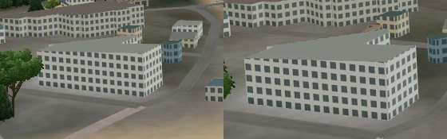

# Montague waterfront warehouse: survey and placement hold

**No player change.** The generic flat-roof shell for the former Poole &
Thompson Warehouse at 18 Water Street remains in place. This study confirms a
visible deficiency but does not establish an installable replacement.

Unscaled crops from the stock Chase camera at 4.30 s (left) and 5.40 s
(right), in Standard graphics. The low river bridge departure requires
the existing `montagueFoundationPreview` option. At the ordinary
360 m Montague departure, the projected roof reaches at most 79 pixels
before accounting for occlusion; it is not a useful substitute for this check.

## What is measured

The [Canadian Register of Historic Places](https://www.historicplaces.ca/en/rep-reg/place-lieu.aspx?id=9051)
describes a long, three-storey historic warehouse with a shallow roof. The
provincial footprint and signed in-game building record overlap over
715.34 m². The provincial footprint alone includes another 229.55 m².
The historic building, current attachments and stock outline are therefore
not interchangeable. Reference photographs are not reproduced here and
were not used as textures.

The [dated NRCan PEI elevation survey](https://datacube.services.geo.ca/pgstac/api/collections/hrdem-lidar/items/PEI-Prince_Edward_Island_2020-1m)
was read at preselected 1 m surface cells, spatially separate validation
cells and four narrow classified-point windows. The paired planes fit both
interior roof flanks, but their RMSE improvement over the better simple
model was **0.123 m** on 55 held raster cells and **0.108 m** on 107 held
classified half-metre bins. Both miss the frozen **0.20 m** threshold. This
is evidence for very shallow opposing interior slopes, not a surveyed
central ridge or a replacement for the surrounding roofs.

Ground was tested independently at the same coordinates in paired 2020
surface and bare-earth cells and the current rendered terrain. Qualified
ground north, east, south and west differed by median **−1.37, −1.48,
−0.84 and −2.31 m** (survey minus rendered ground). All four sectors failed
the datum gate. The existing dry, buried walls do not resolve these
different vertical offsets. Do not shift the building wholesale, move the
shore or retune thresholds to make this roof pass.

## Visibility precheck

The stock draw was isolated on the actual compiled player during a natural
flight at 1200 × 760. At 4.30 s and 5.40 s it covered **1,884 / 4,497**
exclusive roof pixels and **7,787 / 14,648** exclusive wall pixels.
At 8.10 s the owner still submitted its draw and the warehouse was fully
off-frame. Pixels outside the isolated roles and alpha did not change;
restoring the stock draw restored each complete frame exactly. This is a
visibility check of the existing shell, not an after image.

The [measurement receipt](montague-warehouse/verification.json) records
source identities, prelocks, control counts and capture hashes. Reopen
placement only with a ground datum and an independently supported historic
roof-to-annex join.
