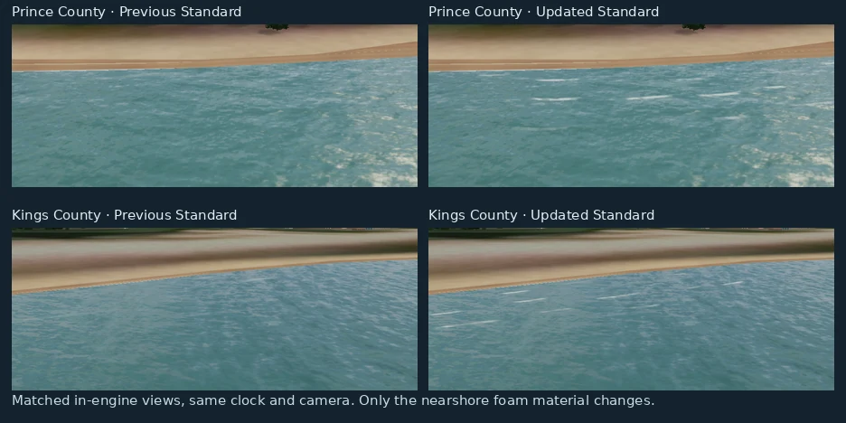

# Open-shore foam in Standard

In **Standard**, choose **Prince County · open shore pass** or **Kings
County · coastal ridge pass** for an offshore departure near one of the
two reviewed reaches. When the low flight camera approaches either reach
and the currently loaded Cover grid matches the verified source, short,
separated breaker groups fade in. Elsewhere the existing Standard broken
foam remains. No scenery download is added.

Compare with the previous water rendering using `?stockNearshoreFoam`.
The earlier explicit **Nearshore surf** study under **Optional scenery
studies** (or `?nearshoreFoamStudy`) keeps its original visibility and
resolution envelope. A stock flag overrides both. The Detail profile
and other shoreline compositions retain their existing look.

## Where this acts

These are the exposed Prince County western reach (near 46.92493,
−63.98527) and the Kings County north coast reach (near 46.43849, −62.78141).
The two oriented scene rectangles are 1,130 × 250 and 1,060 × 238 m. Their
perimeters feather into existing optics over 45 m along the coast and 24 m
across it. The material only acts on water with a signed Cover offshore
distance under 32 proxy metres, and never past a 420 m eye distance. A
review at 0.5 m tangential spacing found one crossing and one connected
seaward body in each approximation. The fit to a scene tangent is not a
surveyed map of real surf zones.

The approximate distance is from the already shipped 2021 Cover green
channel (Statistics Canada census cartographic boundary source, Open
Government Licence – Canada; see the existing Cover attribution).
Exact four-tap interpolation is only an optical coordinate in the narrow
branch and avoids a stair-step travel phase on backends that round the
filtered 8-bit sample. The existing ocean colour, reflection, ripple
spectrum, inherited wet discard, ocean Y, geometry, shore curtains and
the simulator ground/collision are unchanged. No asset request, photo,
water-depth estimate, tidal forecast, wind, or navigational claim.

Instead of changing the opacity of a shoreline-length periodic stripe,
independently phased, asymmetrical packets have actual gaps in their
tangential direction. A short, partially perforated wake and very sparse
inner wash fade in the same advancing material coordinates. As detail
shrinks the existing scene pixel derivatives reduce fine aliasing. The
motion and scale are authored; this is not a wave simulation.

## Standard QA

[Production flight and image checks](nearshore-standard-gate.json) separate
which material is selected in an ordinary flight from what its shader
actually changes in matched rendered frames. The default detail fades
as its shortest crests become too small to resolve, so a high, distant
or lower-resolution view can show the previous foam even on an exposed
shore. Geographic coverage is exactly the two existing bounds, not the
whole coast. This is not a hardware benchmark or a claim of alias-free
water, wave forecasting, or physically modelled surf.

## Earlier explicit study

[Locked native and browser measurements](nearshore-foam-study-fixture.json)
include a stock/broken/study comparison and six phases of the real
Three.js shader in Mesa GLES at four near views. The protected Basin Head,
Quartermaster and distant full views were exact relative to their existing
mode, and the native compiled neutral modes matched their separate prior
shaders. No changed draw or triangle count. The complete Chromium Prince and Kings
replays show visible crest fragments. At the chosen Prince view, the
longest brighter component is 51–53 px instead of 350–355 px in stock,
and the study keeps visibly more foam than the previous broken option.
The lower cover at the Kings sightline is kept rather than forced to
match Prince. Those are image observations, not
a hardware-frame-time comparison or a measure of ocean conditions.

The previous broken and stock appearance can be compared in an instrumented
replay at the same camera, clock and fully settled imagery by using mode
0 (stock), 1 (broken), or 2 (study) on the opt-in World uniform
`nearshoreFoamMode`. This is a QA hook, not three new menu settings.
Ordinary land, sea physics, real-water classification and neighbouring
shoreline are not authored by this effect. Coarse terrain and any prior
visible shoreline geometry artifact remain separate.

In the compiled game, stock and the Dispatch opt-in both flew more than 500 m from the Kings coastal ridge departure, entered Cockpit and paused. They loaded exactly the same normal world asset URLs, including one Cover transfer each. A wrong decoded Cover version kept the preview inactive and preserved dispatch. Full-frame browser controls in Queens and high over the Prince reach were pixel-identical to their inherited stock and broken modes at three clocks. All 330 tests, the production build and world checks passed.

Small apparent shimmer can remain in thin crests during camera roll at low resolution. The reprojected optical test found it decreased at higher resolution. That explicit preview retains its original behaviour and is not advertised as alias-free.
