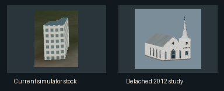

# New Glasgow Christian Church: 2012 front and flank

The [Three.js study](../../tools/art/new-glasgow-church/README.md)
reconstructs the photographed gable, windowed side and steeple without
borrowing photograph pixels. It is not installed in the simulator.
At a normal flying scale the silhouette carries the identity; the
iron thistle and recessed window trim are best inspected close up.

To explore the model, run the repository’s usual local Vite server and
open `/tools/art/new-glasgow-church/`. The three views are keyboard
operable. The same source passed keyboard selection and visual checks
on 1200 × 760 and 390 × 844 headless Chromium viewports, with no browser
errors or off-site requests. See the
[workbench browser receipt](../../tools/art/new-glasgow-church/evidence/workbench-browser.json).

The left crop is the original building in an ordinary Chase flight;
the right crop is the separate historical reconstruction on a neutral
stage from a different northwest view at similar on-screen height.
Neither is resized. This is not a matched in-game swap or a measured
height comparison.

## Why the ordinary building is unchanged

A separate private flight approached the **northwest** front rather
than reusing the public River Clyde departure, which comes from the
other side. The original `q03310/90` source interval was identified
independently by its signed horizontal footprint. The runtime check
observed the original stock owner (9 roof and 22 wall triangles),
not the authored church. At +190.306 and +301.119 m of travel the exact
owner produced 2,847 and 12,876 diagnostic pixels. At +854.988 m it was
fully behind the camera. All three captures kept the original vertex
attributes; there were no changed alpha or out-of-scope pixels, and
restoring the stock draw was pixel-exact.
[Stock flight score](../../tools/art/new-glasgow-church/evidence/stock-chase-score.json) ·
[Horizontal binding](../../tools/art/new-glasgow-church/evidence/stock-horizontal-binding.json)

The [2020 provincial aerial mosaic](https://www.arcgis.com/home/item.html?id=2e9d3e4ce0c548a19cba5327607a4754)
also shows a dark band within the wider mapped building, in an area
that the stock plan excludes. The
[reference measurement](../../tools/art/new-glasgow-church/evidence/2020-ortho-reference.json)
is only image tone inside preselected masks, not a roof material,
addition date, height or footing. The 2012 art is limited to the
observed front and side; the site remains on stock geometry until
the current envelope and ground contact can be verified.
