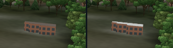

# New Glasgow: pale roof finish

Standard scenery uses a restrained pale tone on one existing roof near
New Glasgow. From **New Glasgow · field-edge pass**, fly southwest in
Chase view and look to the right on the close part of the pass. This
finish is local scenery; it is also visible if you fly past the site
from elsewhere. Add `&stockNewGlasgowRoofTone` to the bookmarked route
to compare the original muted cap. The comparator leaves other scenery
choices alone.

The [2020 appearance and height trial](../../tools/art/new-glasgow-field-roofs/README.md)
supports a broad pale/neutral cue on the cap and did not support a new
roof shape. The original swatch is illustrative, not sampled imagery,
a roof material identification, or a claim about current paint.

The mapped terrain, walls, building position, roof outline and height,
shading model, draw count, aircraft, and collision remain unchanged.
The finish changes only the colour of the six existing roof triangles
for signed atlas row `q03301/13`. It reuses and authenticates the
existing 7,583-byte building response, without an extra request or
image asset. If the existing building range still decodes but cannot
be authenticated for this finish, it keeps its stock colour. Other
scenery profiles are unchanged.

The [paired WebGL flight checks](new-glasgow-roof-tone-flight.json)
separately measured the roof and neighboring walls during ordinary
flight. At +446.890 m and +560.267 m, 98 and 264 pixels changed by at
least eight display codes. The walls, nearby building, and pixels
outside the conservative projected roof stayed exact, with no alpha
change. At +713.373 m the roof clipped fully outside the camera and
the frames matched. The image above is a crop from the second view,
not a standalone scene or a rendering of the published orthophoto.

The [unmodified production build checks](new-glasgow-roof-tone-dispatch.json)
loaded both comparison URLs in fresh Chromium contexts. Only the
roof's resident finish flag changed. Both used the same signed
building range, zero off-site requests, and the same scenery and
aircraft start. These checks are not hardware performance
measurements.
