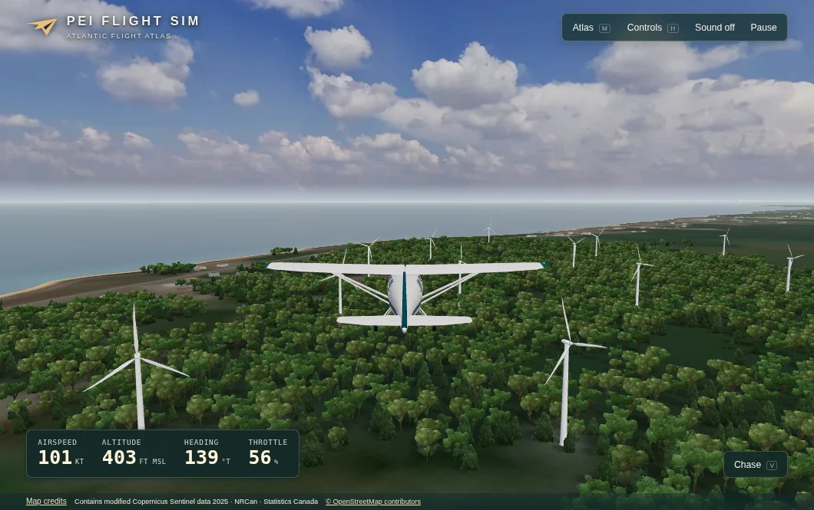

# North Cape wind-farm departure

Choose **North Cape · wind farm low pass** in Dispatch. Standard scenery
automatically shows the [registered commercial array](north-cape-turbines.md) as
you approach. Use `?stockNorthCapeWind` to compare without the turbines or
`?northCapeWind` to see the separate older local shadow study.
The aircraft starts offshore at 122 m above the starting water surface,
heading southeast across the northern shore. The route keeps the established
map, aircraft, controller inputs and ordinary flight model. The original
higher **North Cape** start stays available.

The [cockpit frame](north-cape-departure-cockpit.webp) and chase frame are
from the regular browser application after the pilot selected the route.
In the [matched UI check](north-cape-departure-gate.json), the original scenery
without turbines and the explicit preview with modeled turbines both flew more than
180 m and paused normally without renderer errors. All 16 turbines were
registered with the suffix enabled.

The unit gate advances the regular simulator for 40 seconds with neutral
input and checks the expected path, underlying terrain and a conservative
turbine envelope. It does not guarantee clearance with arbitrary inputs
and is not a real-world aviation or navigation procedure.
