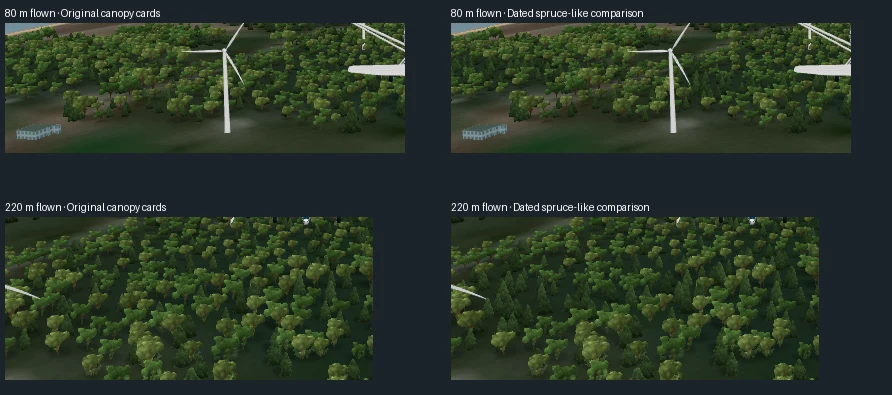

# North Cape: a dated spruce-and-fir comparison

On a local or hosted build, append `?departure=northcape-wind-low&northCapeStandReview`.
Select **Begin flight** and leave the camera in Chase for the first few
seconds of the wind-farm pass. Append `&stockNorthCapeStandReview` for
the same flight without the comparison. This option is off by default and
does not combine with other scenery-study flags.

## Why only these trees?

PEI’s [State of the Forest report](https://www.princeedwardisland.ca/sites/default/files/publications/state_of_the_forest_2020.pdf)
explains that the provincial forest inventory is an interpretation of 2020
aerial photography. Two [mapped inventory stands](https://gis.princeedwardisland.ca/server/rest/services/Hosted/CLUI2020_OpenData/FeatureServer/0)
(40561 and 40563) support spruce- and fir-dominant composition at stand scale.
That is not evidence about individual trees or their condition today. Areas
in or immediately near mapped 2023 Fiona windfall were excluded rather
than reconstructed.

The comparison changes the atlas selection on 59 existing simulator
crowns using the game’s own needle-bearing tree cards. It adds neither
trees nor photographs, and leaves the root locations, canopy dimensions,
original shadows, terrain, coast and flight physics alone. The difference
fades with camera distance and angle. Cockpit, Wide Chase and other
departures keep their original rendering.

## What was checked?

The companion [render receipt](render-receipt.json) distinguishes the
matched image study from moving checks on the integrated Three.js build.
Across seven replay positions, the changed pixels were confined to the
projected tree-card bounds, which were defined before comparison. In the
final three positions the frames were identical. Within the bounds,
alpha changed where the new silhouettes covered or revealed the original
background; this is not an alpha-invariant Standard replacement.

At each measured position, switching the material off and back on in
the same render state restored the image exactly. No measured draw or
triangle count changed. These were repeatable headless browser captures,
not a frame-rate benchmark on physical GPUs.
