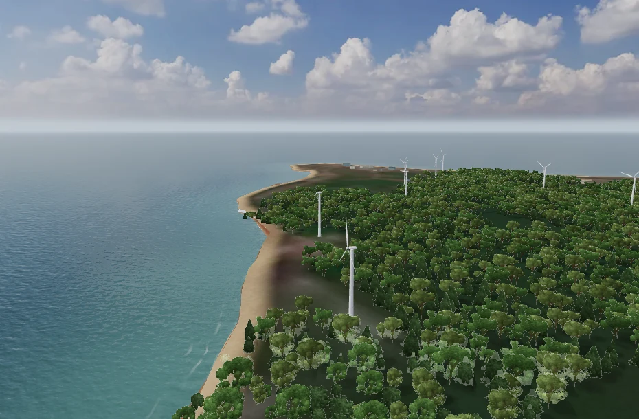

# North Cape commercial wind farm

The 16 registered V47-660 turbines now appear in ordinary **Standard**
scenery at North Cape. Choose **North Cape** or the
[wind farm low pass](north-cape-departure.md); no query flag is needed.
For comparison, add `?stockNorthCapeWind` to hide the array, or
`?northCapeWind` for the separate earlier optical-shadow study with
its shadow receivers on ground and roads. No map boundaries or
aircraft handling change.



The existing [original preview frames](north-cape-comparison.webp) and
[preview graphics gate](north-cape-render-gate.json) include the optional shadows.

## What follows the records

- [Natural Resources Canada's Canadian Wind Turbine Database](https://open.canada.ca/data/en/dataset/79fdad93-9025-49ad-ba16-c26d718cc070)
  records NCW1–NCW16, 50 m hubs and 47 m rotors. The
  [scope and exact workbook receipt](../../data/north-cape/locations.json)
  includes the two eight-unit commissioning phases. The
  [PEI Energy Corporation 2025–26 report](https://www.princeedwardisland.ca/sites/default/files/f755/PEIEC%20ANNUAL%20REPORT%202025-26.pdf)
  independently confirms the operating commercial group at publication.
  This pass excludes nearby Aeolus and research equipment.
- [Independent checks on native 2020 CanElevation returns](../../data/north-cape/registered-returns.json)
  find structure heights above local grade within 2 m horizontally of all 16 source
  points. For 14 points there are returns within that radius and 46–56 m
  above grade. That does not identify the shaft centre, foundation extent,
  or current blade state. Coordinates are not snapped to the vegetation,
  access roads, or an independent map; the latter differs by up to about 12 m.
- The tower, fairing, blades, hardware and weathering are original
  external models; no manufacturer geometry or photos are redistributed.
  Published [Vestas technical specifications](https://ledsjovind.se/ventosum/Vestas_V47.pdf#page=20) reference the tapered tower proportions and nominal 28.5 RPM clockwise (front view). [Larry’s July 2016 photo](https://commons.wikimedia.org/wiki/File:North_Cape_Wind_Farm,_PEI_(27736815083).jpg) ([CC BY 2.0](https://creativecommons.org/licenses/by/2.0/)) served as a historical visual check only.
  The wind heading is scenic and fixed, the rated-clock rotor view is
  illustrative, and this is not a live wind or obstacle-avoidance feed.

## Render and contact

Each mast follows the actual submitted ground facet when terrain detail
changes, rather than floating at the old mesh height. The
[seat audit](north-cape-ground-gate.json) records the base positions and
ground samples at three levels, not a survey of foundation heights.
Instanced mast and rotor meshes are batched at two distances. The same
47 m swept area is retained at both. Independent [runtime alignment checks](north-cape-contact-gate.json) found all 16 mast and 16 rotor instances at the checked native, intermediate and far world levels. In the explicit shadow study, RGB changes on the road and ground use the same live shadow phase. Standard does not install either receiver. The [normal compiled departure](north-cape-flight-gate.json) enters flight and pauses with all 16 registrations, with no JavaScript or renderer errors. The original satellite image, roads,
terrain triangles, foliage, collisions and flight model stay in place.
Shadows are local optical projections on existing ground and road material.
They fade at distance and do not create a physics surface.

This is a model of the measured array, not a finished North Cape
landscape. Forest, roads, low-resolution surrounding ground and smaller
structures retain their previous scenery and fidelity.

## Standard streaming check

The array begins loading inside a horizontal prefetch band around the group.
It checks the known dimensions, terrain extent and decoded cover revision
and all 16 dry anchors, then requests a local art module. The module is about
4.1 kB minified (1.9 kB compressed); it adds no world imagery or texture
request. A distant departure does not request that module. A late completion
cannot attach art while away, and leaving the outer band disposes of all
local meshes without refetching the module when you return. The existing
7.8 km station visibility limit and close-detail transition stay in place.

The [matched renderer and compiled flight receipt](north-cape-standard-gate.json)
records +4 instanced draws and +34,648 triangles in the selected low view,
and +4 draws and +24,512 triangles in the seaward view at 470 m.
The Queens control stayed pixel-identical. The absolute numbers are scoped
to those matched frames, not hardware frame-rate claims. No terrain, road,
or shadow variation was needed to show the array in this first Standard pass.

The compiled low pass showed all 16 stations after one local art request.
No such request occurred in the distant Charlottetown control, stock control,
or after changing one byte of the decoded cover. A deliberately withheld
explicit art module allowed Dispatch and flight to start before the request
was released, and its late response did not add the study to that flight.
All 367 tests, the production build and world data checks passed.

## Rebuild and compare

```sh
python tools/geodata/extract-north-cape.py /path/to/Wind_Turbine_Database_en.xlsx
npm run check
python tools/qa/north-cape-frames.py --checkout . --out /tmp/north-cape-frames \
  --chromium /path/to/chromium
```

Contains information licensed under the
[Open Government Licence – Canada](https://open.canada.ca/en/open-government-licence-canada).
Sources: Natural Resources Canada Canadian Wind Turbine Database and local
CanElevation verification. See the in-repository receipts.
