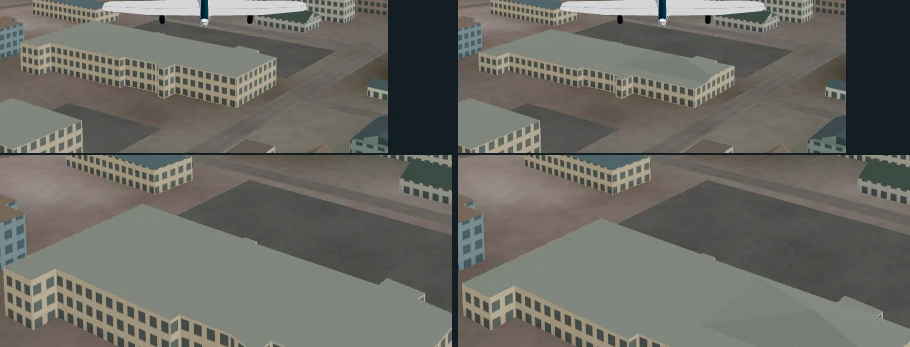

# A measured roof on the O’Leary railway approach

One large building on the eastern part of the normal railway approach now
has a lower main roof and a raised four-plane section instead of a single
generic slab. The original outline, materials, wall bottoms, terrain and
flight path remain in place. This is not a reconstruction of the
building’s current façade, interiors, use or parcel.



## What was measured

The ordered footprint is from [Natural Resources Canada’s Automatically
Extracted Buildings](https://open.canada.ca/data/en/dataset/7a5cda52-c7df-427f-9ced-26f19a8a64d6).
Roof and ground elevations come from its [1 m CanElevation
mosaic](https://open.canada.ca/data/en/dataset/0fe65119-e96e-4a57-8bfe-9d9245fba06b) ([item 10_3](https://datacube.services.geo.ca/stac/api/collections/hrdem-mosaic-1m/items/10_3-mosaic-1m)).
The paired surface/ground window SHA-256 is
`700831dbddfad6d6a0ec2e9a930c5ae67ae01110b0fed4ac37465d2eb38460fb`.
The fitting used 1,459 native roof cells; 283 cells in 24 distinct 4 m
blocks were withheld from fitting and then compared with **actual Three.js
triangles**. The roof’s 90th-percentile absolute vertical error dropped
from **3.355 m to 0.405 m** against the same survey. The measured mesh
covers the inherited 1,958 m² plan. It does not add stairs, geometry outside
the plan, or any texture.

The feature requires the original atlas, exact compressed block and ordered
coordinates, plus compatible Standard rendering, an actual 4× alpha
framebuffer and a matching ground datum. Older
signed railway comparisons keep their previous full building batch, even
if a requested comparison cannot authenticate. A separate footprint with a
1.39 m ground discrepancy did not ship. The existing Access PEI roof color
and museum-area batches are not part of this work.

## Flight checks

The [native A/B](oleary-compound-roof-renderer-gate.json) follows the same
original Chase flight at matched camera and time, at 1200 × 760 with 4×
MSAA. There were 6,604 and 22,328 strong RGB differences in the two main
views, none beyond the projected union plus a two-pixel raster fringe,
zero alpha differences and exact rollback. The two later views were
unchanged. The shared draw submits 64 additional triangles when resident,
with no additional draw or data request. This is not a frame-rate benchmark.

In the [guard replays](oleary-compound-roof-fallbacks.json), the
actual 0× renderer keeps the entire original building even with parking
loaded. With a malformed parking pack, the renderer draws no parking
layer and the measured roof passes the same 4× exterior, alpha and
candidate-to-stock-to-candidate restoration checks.

Contains information licensed under the
[Open Government Licence – Canada](https://open.canada.ca/en/open-government-licence-canada).

## Rebuild

With Python GDAL, NumPy and SciPy available, run from a checkout:

```sh
work="$(mktemp -d)"
gzip -dc data/oleary-compound-roof/candidate-shell.json.gz > "$work/candidate-shells.json"
python tools/geodata/house-roof-samples.py --root . --scratch "$work" --all-groups
python tools/geodata/bake-oleary-railway-roof.py --root . --scratch "$work" --out "$work/roof.ts"
cmp "$work/roof.ts" src/render/oleary-compound-roofs.generated.ts
gzip -dc data/oleary-compound-roof/roof-holdout.json.gz > "$work/held.json"
node --experimental-transform-types tools/qa/oleary-compound-roof-rays.cjs \
 /path/to/prior-build-checkout . "$work/held.json" "$work/rays.json"
```
