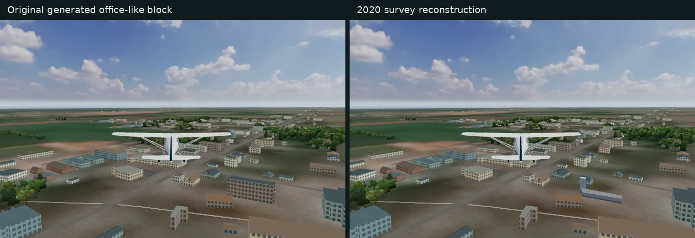
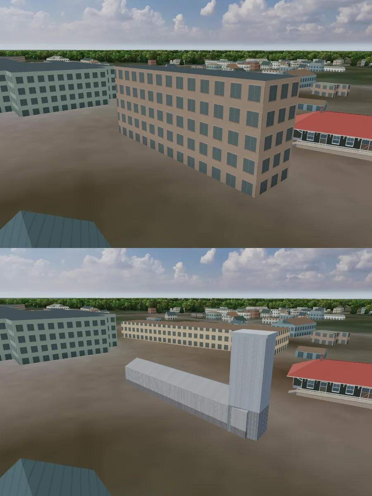

# O’Leary | Railway-side industrial building study

On **O’Leary railway station pass**, Standard can show the surveyed
shape beside the station: a low gabled agricultural shed and a compact
tall head rather than the old office-like block. Wait for **Surveyed
railway-side building ready** in Dispatch before beginning. The route
can start immediately with the original building if the local asset
is not ready. This is a reconstruction of a specific measured form,
not a claim to have rebuilt the town or photographed the current site.

Use `?departure=oleary-railway-low&stockOlearyIndustrial` to see the same
Standard view with the original building. Both neighboring Standard
roof treatments remain enabled. The existing optional station, building
and warehouse profiles also remain available.

Compare the station-only view using `?departure=oleary-railway-low&olearyExteriorStudy`, then enable both with:

```text
?departure=oleary-railway-low&olearyExteriorStudy&diagnostics&qa=%7B%22olearyIndustrial192%22%3Atrue%7D
```

## Where the shape comes from

- The [federal building-footprint dataset](https://open.canada.ca/data/en/dataset/7a5cda52-c7df-427f-9ced-26f19a8a64d6) supplies the original building in the scene. The [provincial footprint lookup](https://gis.princeedwardisland.ca/server/rest/services/GeoLincData/Building_Footprints_2026/MapServer/0) independently agrees with that approximate plan boundary. No parcel or proprietary map image is shipped.
- Paired 2020 Natural Resources Canada [surface elevation](https://canelevation-dem.s3.ca-central-1.amazonaws.com/hrdem-lidar/PEI-Prince_Edward_Island_2020-1m-dsm.tif) and [bare-earth elevation](https://canelevation-dem.s3.ca-central-1.amazonaws.com/hrdem-lidar/PEI-Prince_Edward_Island_2020-1m-dtm.tif) place a compact tall mass and a much lower roof. The source recorded 21 samples at least 12 m above the local ground; the actual model puts a tall roof above 18 of them. Local transitions remain uncertain: three other tall samples and four 9–12 m samples do not support adding specific projections or equipment.
- [Larry’s July 2017 railway station photograph](https://commons.wikimedia.org/wiki/File:Converted_Train_Station,_O%27Leary,_PEI_(35416486124).jpg), CC BY 2.0, is a visual reference for the capped-head and low-shed relationship only. No pixels, background geometry, camera match or textures were derived from it. The folds and neutral finish are original, not measured. No machinery, bins, lettering, current tenant, or surrounding ground surfacing is represented by this change.

Federal source information is licensed under the [Open Government Licence – Canada](https://open.canada.ca/en/open-government-licence-canada).

## Rendering and containment

The study is two opaque Three.js draws with 1,736 triangles. The whole model stays at least 0.169 m within the original outline; its base follows 398 checked positions on two unchanged native terrain facets. It replaces only 19 stock triangles in building row `q20213/192`. The unrelated station remains an independent 14-triangle ownership span within the same stock draw. No dry-ground classification, roads, trail, flight contact, or other buildings change.

The older optional studies authenticate the original 32,049-vertex draw, not whichever indexed version is visible. The normal Standard path instead authenticates its 32,241-vertex batch with both fitted roofs retained. The same mesh can keep either study, both, or the exact stock. Each enabled lane qualifies separately against the unchanged high-resolution ground and only displaces its own stock geometry after its actual WebGL programs link. The earlier station-only/default execution path does not need the industrial study.

## Standard Chase comparison

The normal Standard release consumes the same live signed building
range used by the ordinary streamer. Just one building in that existing
draw is indexed out. The q26 and q47 roofs, q150 warehouse and q431
station retain their exact original vertex streams in the Standard batch.
A closer/smaller replacement can reveal unchanged background occluded
by the stock block; a revealed neighboring pixel is not a new model.

At 20 and 21 seconds on two matched neutral Chase views (660 × 418),
2,156 and 3,774 pixels changed by more than two RGB code values. There
were no changes in alpha or outside the union of the old and new
projected triangles, and the original rendered frame returned byte for
byte. This cost two draws and 1,717 net triangles with both new surfaces
visible. At 23 seconds both replacement draws were culled and the whole
image was exact. The model does not change ground contact.



See the [Standard native receipt](oleary-industrial-standard-receipt.json)
for the poses, scene counts, and image hashes. The normal browser run used the authored lease on the first frame after readiness; a held module released after Begin and a separately missing module both kept the original building with all six ordinary building tiles still loaded.

## Earlier close-view study

Two fixed, reciprocal 42 m cameras test the same scene and lighting with the industrial study toggled off and then restored. Any nonzero RGBA changes are counted, and all pixels outside the pre-registered old/new building envelopes are compared exactly. A thrown live condition and an explicit veto each reproduce the same stock industrial frame without disabling the station.

| View | Changed pixels | Protected pixels | Protected pixels changed |
| --- | ---: | ---: | ---: |
| Groundward | 124,143 | 406,310 | 0 |
| Raised reciprocal | 104,605 | 428,514 | 0 |

The [numerical receipt](oleary-industrial-native-summary.json) records the frozen cameras, protected pixel counts, and exact frame digests. Both frames show no alpha changes, and restoring the art reproduces the first PNG byte for byte. Net cost in these scenes is 1,717 triangles and two draws, with no render-target pass. These tests do not establish device FPS or photorealism. The raised view can legitimately expose bits of the unchanged station that the larger stock industrial block had obscured.



In a separate native test, intentionally breaking just the industrial roof shader left its cladding program linked and its roof unlinked. The app kept the stock industrial model and the authored station. The retained 32,007 index entries and complete PNG matched the ordinary station-plus-stock-industrial fallback exactly; the invalid shader is test-only and not part of the shipped source.

The unmodified compiled app completed a 1,061.73 m sightseeing flight from the O’Leary dispatch with both studies active, reached the signed station approach within 265 m, switched through Cockpit and Wide chase, and paused normally. All six requested building tiles were ready at the approach, with no reported GL or scenery-layer errors. This used the ordinary controls, not a locked comparison camera.
