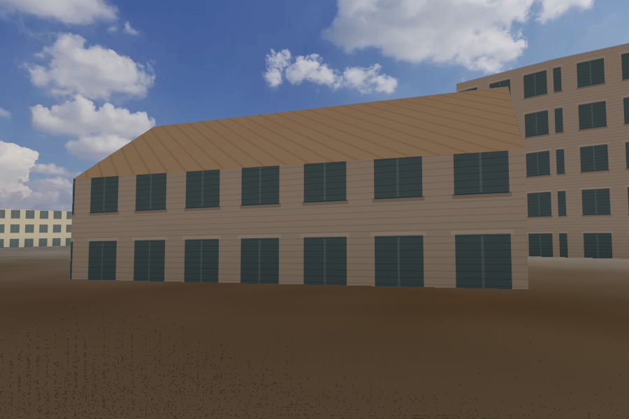
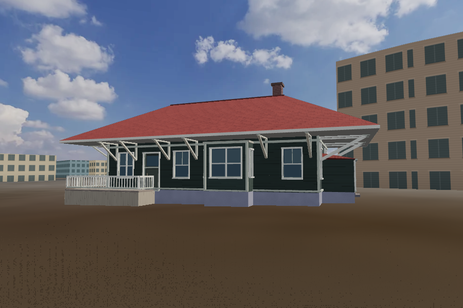
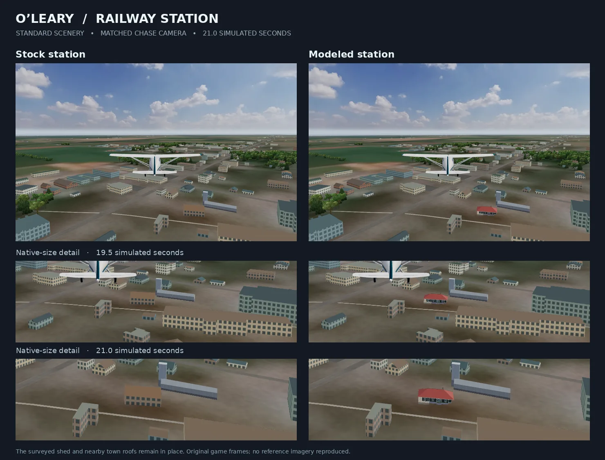

# O’Leary Railway Station

Choose **O’Leary · railway station pass** in Standard Dispatch. Wait for
**O’Leary Railway Station exterior ready** and select **Begin flight**. In
Chase view, fly the default course from the northeast. The original station
model now replaces the generic shell at 513 Main Street on this flight.
The separate surveyed railway-side shed, the town’s measured roof changes
and the original ground, roads, Confederation Trail and flight contact
stay in place.

Use `?departure=oleary-railway-low&stockOlearyStation` for the former
station alone without disabling the surveyed shed. The existing explicit
`?olearyExteriorStudy` and its `&stockOlearyExterior` comparison are
still available and retain their own legacy behavior. The fictional low
pass starts 65 m above the sampled simulator ground; it is for virtual
sightseeing, not real navigation or architectural survey.

## What the references support

The [Canadian Register of Historic Places, record 20441](https://www.historicplaces.ca/en/rep-reg/place-lieu.aspx?id=20441)
identifies this building as the third station on the site. It was built in
1913–14 to an Intercolonial Railway standard design. The register describes
the one-storey mass, deep hip canopy and timber supports, wood clapboard,
the square east station-agent's bay, a smaller north projection, paired
west freight access and a raised platform along the west, south and part
of the east. The two labelled east/north and west images in the
[official photo gallery](https://www.historicplaces.ca/en/rep-reg/image-image.aspx?id=20441)
are by C. Stewart for the Province of Prince Edward Island, 2013.
The [July 29, 2017 view of the converted station](https://commons.wikimedia.org/wiki/File:Converted_Train_Station,_O%27Leary,_PEI_(35416486124).jpg)
by Larry from Charlottetown (CC BY 2.0) is a separate dated observation.

Those sources informed the shapes and relative placement, not a measured
takeoff. The muted reddish roof, dark paint, pale timber and short stack
are qualitative readings of the dated views. They do not establish an
original 1914 scheme, exact color, current cladding or the full south
elevation. The register reports a new cement foundation and rebuilt
platforms after the municipality bought the station in 1983, and window,
some door and heat-pump changes in 2013. Therefore the deck treads, sash,
detailing and material aging are authored, not a claim about the number
or form of historical or current features. No modern signage, route
markings, memorial furniture, or occupied interiors are recreated.

The artwork is original TypeScript geometry, vertex colors and procedural
materials. No reference photographs, maps, screen captures, scanned
surfaces, imagery-derived colors, traced lines or pixels are in the art.
Later public aerial/civic information was used to resolve the mapped
building only, not to derive its roof shape or textures.

## Scene and comparison envelope

- The existing 111,961-byte packet submits 6,122 triangles in five local
  opaque materials. The station is the only changed model in the matched
  Standard comparison. Other departures do not fetch the station packet
  for this default path.
- It can replace only 14 stock triangles of q20213/431, after checking the
  packet, the complete native building draw buffers and the matching
  untouched near-terrain tile. All 541 sibling records retain their original
  geometry and attributes. The original rough platform/civic path beyond
  the replaced owner's envelope remains stock.
- Roof-course albedo, roughness and normal, painted-board grain, pale timber,
  apron and cement are material effects. They smooth out both with
  distance and when the patterns approach one pixel. They do not add new
  textures, a lighting pass, or geometry to the existing trail/ground.
- The geometry seat was tested against 102 points on the actual simulator
  ground. Height and footprint constraints are scene metres only. Neither
  those measurements nor a matched WebGL capture establishes exact or
  recent real-world measurements, or player-device frame rate.


## Matched in-game views

| Stock shell | Original station exterior |
| --- | --- |
| [](oleary-station/east-north-platform-stock.webp) | [](oleary-station/east-north-platform-on.webp) |

[West freight side](oleary-station/west-freight-south-on.webp) ·
[Raised view of the hip roof](oleary-station/near-raised-roof-on.webp) ·
[Independent visual review and current visual limits](oleary-station/independent-visual-review.md).

The review used five fixed cameras. At the close roof view, thousands of
pixels changed when only the roughness and normal treatment was switched,
with albedo held fixed. At 164 m the wall-and-roof silhouette remained visible
and the close material treatment produced no tested pixel difference. Ground
and nearby buildings still render with the existing atlas's approximate scene
detail. The optional station is not evidence that the village is photorealistic.

[Exact mapped owner](oleary-station/independent-horizontal-review.md) ·
[Locked cameras](oleary-station/independent-camera-lock.json) ·
[Pixel/material metrics](oleary-station/independent-native-material.json) ·
[Protected scope](oleary-station/independent-signed-scopes.json) ·
[The actual near terrain mesh and permitted seams](oleary-station/independent-stock-grade-rim.json).

## Readiness and fail-stock behavior

The station's geometry is held outside the scene until all five original
material programs link against the running Standard scene. Only then can it
replace the 14 signed stock triangles. Renderer, lighting, terrain and
owner leases must remain valid before it attaches. An independently tested
broken roof program, a same-sized damaged art packet and the explicit stock
veto all preserved the identical old building and matched stock frame.
The stock veto requested neither the station art nor its runtime module.
The [native program proof](oleary-station/native-program-guard.json) and
[independent renderer check](oleary-station/independent-program-gate.json)
describe these controlled checks. The native visual capture used the same
art and material programs as the production guard; its equivalent active
roof frame was byte-identical after adding the off-scene link check.


## Same ordinary flight, with and without the station



The [native comparison receipt](oleary-station/standard-flight.json) uses
the original simulated route, Chase camera and aircraft inputs. The
station's original 14 triangles and the modeled station are compared within
the same rendered tick. The existing surveyed shed remains active in both
views. The shared building draw keeps the exact six attribute streams
and removes only the two signed, disjoint source spans while each measured
model is visible. Restoration returns to the exact original Standard scene.

The initial distance-blind projection check was intentionally held: it
counted the omitted old shed shell, plus a few pixels where the original
station was actually nearer than the measured shed. The independent
four-sample render check distinguishes true occlusion from overlapping
projections. Replacing the foreground station reveals part of the existing
shed in that narrow area. The shed loses no visible samples, and the
fully visible shed pixels, signed geometry, materials and nearby roofs
remain unchanged. See the original HOLD and the separate depth check in
the receipt.

If the station packet is still pending when you begin, or if its bytes or
materials cannot be verified, the original station remains for that flight.
A missing station does not invalidate a surveyed shed that was ready when
you began. The paired native frames are visual evidence from software WebGL,
not a device frame-rate measurement.

To check ownership from a checkout with the normal world assets and
`npm ci` completed:

```sh
mkdir -p /tmp/pei-oleary-ownership
node --experimental-strip-types tools/qa/oleary-standard-station-ownership.cjs /tmp/pei-oleary-ownership
```

## Earlier explicit-study flight playback

The [compiled player witness](oleary-station/compiled-player.json) uses the
real dispatch and no substituted camera. It flew from the northeastern
start to within 261 m of the original station coordinates with the
asset active, received one authenticated art response, switched to Cockpit
and Wide chase, then paused. It is a simulator launch check, not a claim
about a real flight. The WebGL visual and controlled fault checks above
are separate tests on the same linked materials.

```sh
npm run check
python tools/qa/oleary-exterior/compiled-flight.py --dist dist --chromium /path/to/chromium   --out /tmp/oleary-flight-proof
```
