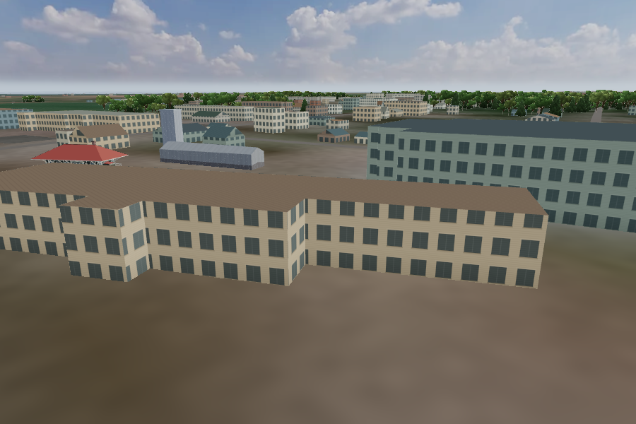
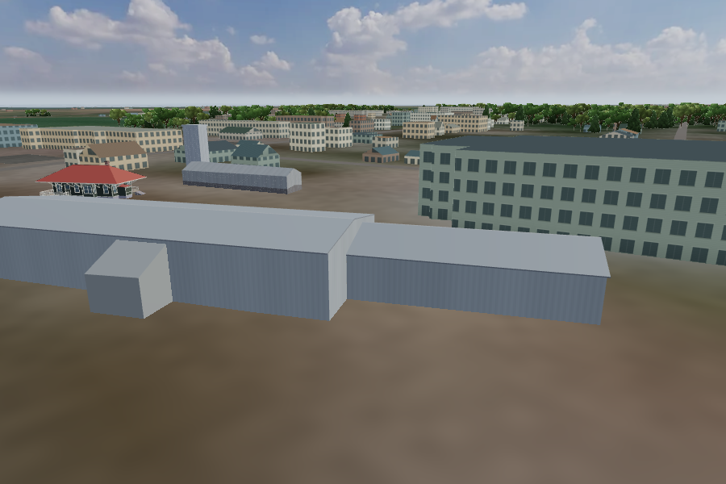

# O’Leary | Railway-side stepped warehouse

The optional O’Leary pass can replace one more office-like stock block with two low, stepped gabled sheds and a small closed side projection. The adjacent station and its separate tower-and-shed study retain their own, independent geometry. This is a dated reconstruction of the major masses, not a model of the whole property or a verified current facade.

Use Standard and open the O’Leary flight with all three options:

```text
?departure=oleary-railway-low&olearyExteriorStudy&diagnostics&qa=%7B%22olearyIndustrial192%22%3Atrue%7D&olearyWarehouseStudy
```

Append `&stockOlearyWarehouse` to restore only the warehouse stock model. The station and tower-and-shed remain selected. The plain departure and older preview links have not changed. The warehouse is not enabled in Detail.

| Existing stock envelope | Original seated model and surface finish |
| --- | --- |
|  |  |

## Survey basis and limits

- The existing federal building row `q20213/150` and the [provincial footprint layer](https://gis.princeedwardisland.ca/server/rest/services/GeoLincData/Building_Footprints_2026/MapServer/0) identify the same plan envelope. The model is not an identification of its tenant or use.
- Paired Natural Resources Canada 2020 1 m [surface](https://canelevation-dem.s3.ca-central-1.amazonaws.com/hrdem-lidar/PEI-Prince_Edward_Island_2020-1m-dsm.tif) and [bare-earth](https://canelevation-dem.s3.ca-central-1.amazonaws.com/hrdem-lidar/PEI-Prince_Edward_Island_2020-1m-dtm.tif) elevations support two shallow roof ridges at different levels. In the two-level source fit, the withheld 170 high and 56 low roof samples had P95 absolute errors of 0.189 m and 0.129 m, respectively. These are source fit errors, not a claim about the finished model or modern changes. The small projection is a conservative closed mass from the same dated elevations.
- The [source summary](oleary-warehouse-source.json) records the qualified roof regions and common offset before the geometry is fitted to the existing game ground. Terrain, the railway trail, nearby parcels, colliders and navigation are unchanged. Exact cladding, hardware, openings, signs and branding are unknown; the low-frequency folded finish is original procedural artwork, not a copied pattern or measured material.
- Federal elevation and footprint data are under the [Open Government Licence – Canada](https://open.canada.ca/en/open-government-licence-canada). No source imagery is included.

## Render verification

The same-scene [geometry comparison receipt](oleary-warehouse-native.json) recorded **108,151** changed pixels at the raised reciprocal camera and **472,520** at ground level, with zero changes outside the registered old/new projected scope and zero alpha changes. The original 32,049-vertex tile retains the two neighboring actors. The optional warehouse removes 28 stock triangles, contributes 140 across four opaque draws, and requires no separate texture or off-screen pass. The [surface-only receipt](oleary-warehouse-sheet.json) independently measures the new wall treatment, with at most six RGB codes of change in the raised frame and no pixels changed outside the verified wall scope.

The compiled-player test uses the ordinary O’Leary departure to check all three actors, the warehouse-only stock comparison, and refusal of the warehouse program while the two neighboring actors still render. The fixed evidence above was captured before the hosted compiled-player gate and does not predict hardware FPS. Neither it nor the hosted gate establishes present-day photorealism.
