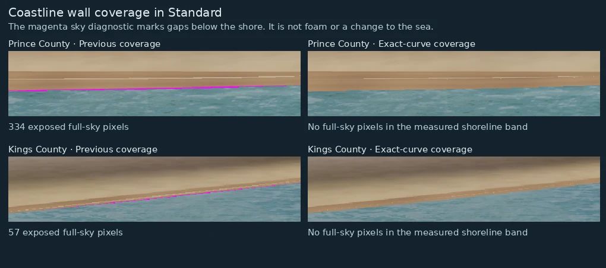

# Two exposed-shore coverage repairs

In Standard scenery, the **Prince County · open shore pass** and **Kings County · coastal ridge pass** pass two cells where the sky was visible through the coastline. Add `?stockOpenCoast` to compare the earlier shoreline coverage. That comparison leaves the nearshore foam and the separate [Orby Head repair](orby-shore-closure.md) alone. Detail and other named shoreline and terrain studies retain their existing geometry.

The land and water shaders already share one bilinear shoreline mask. A single straight curtain cut away from that continuous contour by about 0.73 m at each affected cell. The existing broad preview skips changes under 1.4 m; it remains unchanged. Standard now selects exactly two unambiguous cells, checks the loaded Cover identifier, grid spacing and four signed corner samples, and follows the existing zero curve between its original endpoints. All prior curtains are retained. The additions use the current rendered ground height and extend to the fixed sea surface; they are not new shoreline, terrain, collision water or a new map of intertidal features.



## Verify

[Results](open-coast-closure-gate.json) include identical-camera pairs with a green and magenta background to distinguish actually exposed sky from bright foam. The matched geometry and coast measurements use the same software-rendered camera, not a hardware benchmark. They do not establish a gap-free coast from every angle.

From the project root, use the local Chromium path for the Python Playwright tools:

```sh
npm run check
node tools/verify-world.mjs
python tools/qa/open-coast-frames.py --checkout . --out /tmp/pei-coast-frames --chromium /path/to/chromium
python tools/qa/open-coast-flight.py --dist dist --out /tmp/pei-coast-flight --chromium /path/to/chromium
scratch=$(mktemp -d)
./node_modules/.bin/esbuild tools/qa/open-coast-geometry.mjs --bundle --platform=node --format=esm \
  '--define:import.meta.env.BASE_URL="/"' --outfile="$scratch/coast.mjs"
node "$scratch/coast.mjs"
```
