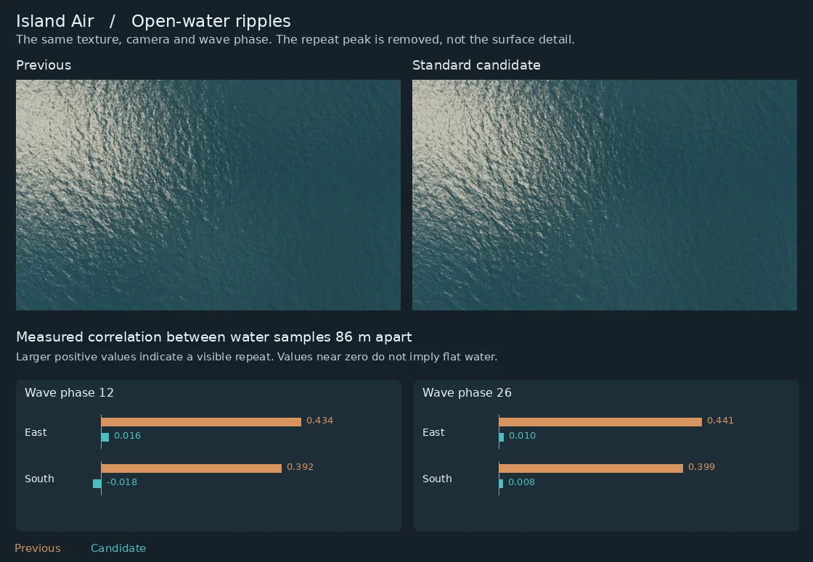

# Open-water ripple variation

Standard's open water varies the sampling positions of its existing two
wind-slope layers. A smooth two-axis offset from the existing procedural
wind fields breaks the fixed 86 m repeat without adding a texture sample,
new artwork, or a draw. It retains the old wave directions, roughness
palette and phase, and changes neither the sea surface nor flight contact.
The effect is bounded to four offshore viewing areas: Northumberland Strait,
Cape Egmont, Cape Tryon, and Panmure Head. It fades toward their edges, near
the inherited shoreline and beyond the close viewing range. It never enables
from shoreline distance alone, since the atlas also uses negative values for
inland lakes.
The signed distance is the simulator's existing mask, not bathymetry or a
claim about coastal conditions.

This pass is available in ordinary Standard on the verified atlas.
`?stockOpenRipples` selects the previous sampling. Detail and named
scenery studies retain their earlier water profile. Try the **Confederation
Bridge**, **Cape Tryon · cliff pass** or **Panmure Head · coastal pass**
departure, then compare from the same angle. The original close breaker effects and independent lake and river scenery are separate.



## Repeat and visual checks

The [matched receipt](open-water-ripples-gate.json) records the in-engine
optical checks and the three compiled route variants. In the Panmure and
Egmont views, all pixels outside the visible offshore sample mask and its
two-pixel derivative margin stayed byte-identical.

In the fixed, downward-looking Three.js view over Northumberland Strait,
the previous luma correlation at 86 m was 0.392–0.441 on the two axes,
depending on phase. The replacement's largest absolute value was 0.018
with the same camera, textures and lighting. More than 79,000 cell pairs
per axis were compared, after removing the broad luma gradient. Local
contrast changed less than one percent at both phases; the improvement
does not come from removing the texture or flattening the water.

An independently positioned 41 m oblique at Cape Tryon found an 86 m
correlation of 0.618–0.657 before and an absolute value at most 0.025 after.
The entire South Lake comparison matched at both phases. A conservative
check of the inherited mask found no enclosed wet cells in the eligible
offshore areas. This is a project-scope test, not a new waterline survey.

At the Strait, 2,379,797 matched samples of successive 1/30 s phase steps
held the 99th-percentile RGB change at two levels. The updated peak rose
from seven to 15 levels; 12 samples exceeded eight. This is not a guarantee
against shimmer from every camera.

The frame geometry, wave-clock, camera and diagnostic masks are identical
within each replay. No camera override, mask or comparison shader is
included in the actual application.

```sh
npm run check
node tools/verify-world.mjs
python tools/qa/open-water-ripples.py --checkout . --out /tmp/pei-ripples --chromium /path/to/chromium
python tools/qa/open-water-domain.py --checkout . --out /tmp/pei-domain.json
python tools/qa/open-water-repeat.py --frames /tmp/pei-ripples --out /tmp/pei-repeat.json
python tools/qa/open-water-ripples-flight.py --dist dist --chromium /path/to/chromium --case standard
```

The optional review scripts use Python Playwright, NumPy, Pillow and SciPy.
The repeat figures are from Chromium with SwiftShader, not real-device
latency or performance figures.
