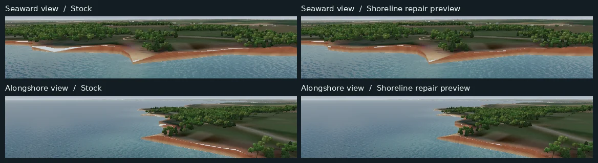

# Orby Head shoreline gap repair

In Standard scenery, use `?orbyCoastClosure&departure=cavendish-low` to enable the preview. The local repair is disabled when the general `legacyShoreArcs` preview is active, including in Detail. It repairs visible gaps in the coastline wall near Orby Head. The captured white streaks were the sky showing through missing coverage, not surf or a light-coloured rock layer.

## What changed

The terrain and ocean shaders use the same bilinearly sampled land/water mask. Its zero line can bend within a coarse cell. The inherited straight wall missed that line in five selected cells containing one corner exactly on zero. The [older general preview](legacy-shore-arcs.md) skips those cells. This preview leaves the original wall in place and adds coverage along the same zero line between the same two endpoints, seated between the rendered ground and sea. Tested curve segments stay within 4.7 cm of the continuous line **in the simulator’s mask**, not of the real shore.

The selection checks the existing source-generation identifier, raster dimensions and the four actual mask values at each cell. Ambiguous or changed cells stay on the inherited path. The preview does not change any land/water classification, water level, terrain heights, collision surfaces, access routes or planted scenery. It adds no texture or network request. The [Parks Canada trail reference](https://www.parks.canada.ca/pn-np/pe/pei-ipe/activ/sentiers-trails/gulf-shore) provides regional context, not present-day cliff geometry. The independently measured 2020 LiDAR cliff was **not** installed: the protected dry-only area was too narrow to reproduce its slope without introducing false ridges.

## Verification

Both actual WebGL comparisons used the same camera, time and fully loaded imagery tiles. We replaced only the sky’s display colour for a second pass to count pure background pixels showing below the coastline in the same 570 × 85 crop.

| View | Stock | Preview | New exposed sky in crop |
| --- | ---: | ---: | ---: |
| Seaward | 526 | 110 | 0 |
| Alongshore | 110 | 22 | 0 |

The preview reduced exposed pixels by about 80% in both views and did not remove every thin gap. Neither full frame gained any new pure-sky pixels. A separate sky-colour difference test found no new partially exposed antialiased pixels in either shoreline band at any of four thresholds. In the seaward plate, everything above and below the shoreline band was pixel-identical. The active patch added one draw and 526 triangles in both matched views. This is a local render measurement, not a frame-rate benchmark or a corrected provincial shoreline survey.

In the compiled app, the existing Cavendish low departure passed 500 m in ordinary flight and entered Cockpit and Pause both with and without the flag. Each received one copy of the usual cover raster. A wrong cover-generation identifier left the preview off and the normal dispatch usable. All 313 tests, the production build and world validation passed.
