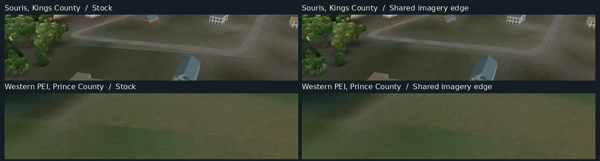

# Close-flight aerial-image tile joins

Enable `?orthophotoSeamStudy` in Standard. The study is limited to the two surveyed image joins below. It is off by default and does not alter imagery away from the joins, terrain, buildings, roads, or flight physics.

## Why the line appears

The same source mosaic is split into streamed tiles. With both tiles loaded, the stock renderer clamps each texture at its own edge. The last pixel on one side and the first pixel on the other are not necessarily the same colour. From low altitude, the seam can show up as a straight line through a field. The existing missing-tile fade is a separate safeguard and is unchanged.

At each tested join, the renderer copies two rows from each of the original, already uploaded textures into one 640 × 4 strip. Both owners sample the same decoded pixels across their shared boundary. The study checks the published image IDs, exact received SHA-256 values and image grid before using the strip. There are no new imagery downloads, added draws or meshes, or GPU readbacks in the rendering path. Each live strip uses 10,240 bytes of base-level RGBA pixels. It is retired before either source texture is released or leaves the near terrain tier.

The strip is deliberately close-only. It blends out as the image footprint grows, leaves tile corners to the existing renderer, and never tries to invent a missing neighbour. Some scenery studies that replace or substantially modify the same terrain path are incompatible. [World data and attribution](../WORLD.md) describes the unchanged 2025 Copernicus source.

## What was measured

Separate fixed shared-source WebGL bench captures measured the RGB8 contrast across the edge. Terrain, sun and source-pixel positions were held constant. Lower values mean a less conspicuous line.

| Join and view | Stock median / p90 | Shared edge median / p90 |
| --- | ---: | ---: |
| Souris, north view | 17.11 / 23.35 | 1.17 / 2.39 |
| Souris, reciprocal view | 18.89 / 24.03 | 0.95 / 1.75 |
| Western PEI, north view | 13.07 / 19.32 | 1.00 / 1.85 |
| Western PEI, reciprocal view | 14.16 / 19.14 | 0.91 / 1.77 |

The scoped joins are tiles 27-13/27-14 near `46.361818, -62.281606` and 5-2/5-3 near `46.941818, -64.017376`. The four matched full-game views retained the same meshes and draw counts. A distant full-game frame was exact at all 268,800 pixels. The isolated four-tile corner control found all 9,961 qualified pixels unchanged, including when a diagonal tile was missing. These are visual comparisons, not a device performance benchmark.

In the full app, each tested reversed arrival order stayed stock until both source textures were verified and uploaded, then both sides enabled together. Moving away and returning released and rebuilt just one strip for the renewed pair. Corrupting one source produced the ordinary missing-tile fallback with no seam patch.

The compiled Kings County field departure travelled over 500 m, entered Cockpit and paused in both modes, with the same usual detail assets. Standard without the flag and Detail loaded no study module. The 315-test suite, production build and world checks passed.
