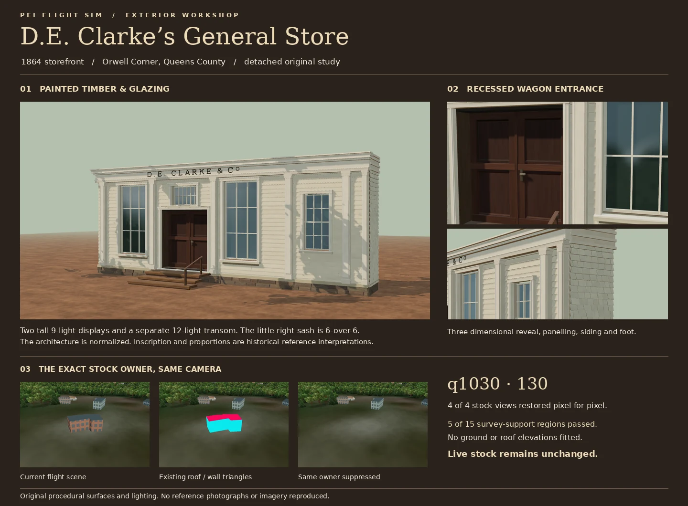

# D.E. Clarke’s General Store, Orwell Corner

**The 1864 storefront is an offline art study, not a live scenery replacement.** This protects the attached dwelling and the other historic-village assets from being swapped with the wrong body or floated on an uncertain terrain seat.

| Work | Result |
| --- | --- |
| Positively identify the stock owner | **q1030 / ordinal 130**, the joined store/dwelling outline near the wooded lane. The four captures isolated 25 contiguous stock triangles and restored the same pixels. A separate review checked the owner against dated views and protected the other parcel candidates. |
| Recreate documented facade features | Original worn cream clapboards, cut shingle return, sculpted pilasters and entablature, broad recessed carriage doorway and two tall displays. Two 9-light displays, a 12-light transom and a 12-light small sash give **42 separate glass panes**. |
| Keep the representation honest | Normalized exterior study with illustrative colours, stroke lettering and stairs. No roof, terrain, interiors, measuring claims or flight-side changes. |
| Why hold live placement? | Only **5/15** independent survey-support roles were sufficient in the pre-registered XY check. The incomplete roof junction/eave and ground evidence do not justify opening numeric survey heights or putting either roof body in flight. |

[Workshop, source citations and reproduction](../../tools/art/orwell-clarke-store-study/README.md) · [Independent registration](../../tools/art/orwell-clarke-store-study/evidence/independent-stock-owner.json) · [Independent studio checks](../../tools/art/orwell-clarke-store-study/evidence/independent-studio.json) · [Pre-fit hold](../../tools/art/orwell-clarke-store-study/evidence/independent-native-xy-hold.json)
