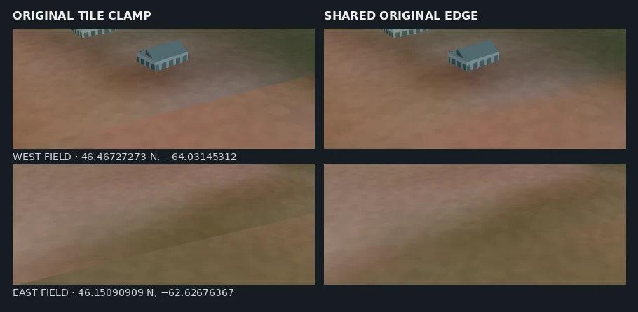

# Two field-image joins in western and eastern PEI

These two low-flight improvements use adjacent signed image samples instead
of letting each tile clamp to its own last texels. They remove a short,
straight sampling step without repainting either field. Tree lines and
nearby roofs remain unchanged in the native comparisons.



| Local reference (lat, lon) | North → south source tiles | West-origin source columns | Median RGB8 edge step, forward / reciprocal |
| --- | --- | --- | --- |
| 46.46727273, −64.03145312 | `5-11` → `5-12` | 326–346 | 14.29 → 2.13 / 17.92 → 2.09 |
| 46.15090909, −62.62676367 | `23-17` → `23-18` | 132–152 | 15.68 → 2.32 / 17.23 → 2.04 |

Intervals are half-open, with two-texel end tapers and a 2.5-texel
cross-edge width. The change does not remove longer field boundaries,
prove cadastral lines or add ground resolution. The [stock network and
footprint check](outer-field-aerial-joins/existing-geometry-context.json)
found no intersections in either narrow effect rectangle. The closest
signed building footprint beside the western strip is approximately 10.75 m
away and its observed pixels stay exact.

The [native comparison](outer-field-aerial-joins/render-checks.json) checks
both views of both strips, high and out-of-window frames, exact restoration,
and the relevant pixels during a moving Chase. In the moving views, only a
small part of the foreground changes before the strip leaves the screen.
No visible pixel outside the identified ground role, alpha byte, draw count
or triangle count changed. The camera and aircraft use the original
rendering and controls. This is not a hardware benchmark.

The [compiled-player proof](outer-field-aerial-joins/compiled-player.json)
crosses each strip with ordinary controls and switches to Cockpit and
Pause. The two [technical corridors](outer-field-aerial-joins/virtual-corridors.json)
are isolated verification positions, not new menu entries or navigation.
The existing bilateral source verification still restores stock when a
donor is missing. The stock comparison is `?stockInlandOrtho`.

## Replay

```sh
python tools/qa/verify-eastern-aerial-sources.py \
  --window edge-5-11s --window edge-23-17s
python tools/qa/tracadie-frames.py --checkout . --cohort inland \
  --views edge-5-11s,edge-5-11s-reciprocal,edge-23-17s,edge-23-17s-reciprocal \
  --chromium /path/to/chromium --out /tmp/pei-outer-joins
```

Use the same view names with `-high`, `-outside` and `-flipped` for the
independent controls. [Exact image and cover authentication](outer-field-aerial-joins/source.json) ·
[Atlas screening](aerial-join-screen.md) · [World data and attribution](../WORLD.md)
