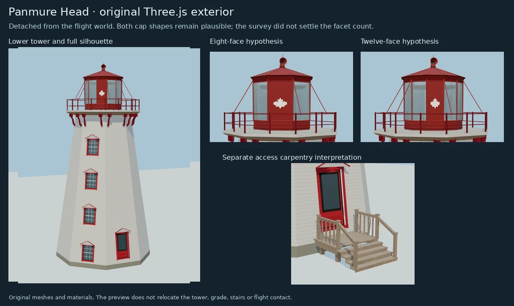

# Panmure Head lighthouse: detached exterior study

This original Three.js model is a **standalone artwork study, not a live scenery replacement**. It reproduces the broad tapered tower, main gallery, red lantern housing and interprets the visible shingles, openings, metalwork and stair carpentry. Two lantern layouts remain side by side. Neither is presented as an as-built model; the lamp is not operational.

## What is supported

An independent check used a 2020 Natural Resources Canada LiDAR swath. Complete measurement pulses were withheld before fitting the art. The reviewer checked the frozen Three.js meshes against the unaffected samples.

| Role | Held geometry check | Limit |
| --- | --- | --- |
| Tapered wall | 37 held returns, 0.215 m p90 residual | Six of eight sectors, not all windows or wall details |
| Gallery | 24 held returns, 0.045 m p90 residual | Four sectors; sparse evidence at its outer edge |
| Main cap | 20 held core returns, 0.136 m p90 for the eight-face model and 0.131 m for the twelve-face model | About 5 mm separation; one swath cannot establish a facet count or hidden trim |

The [federal heritage record](https://www.pc.gc.ca/apps/dfhd/page_hl_eng.aspx?id=14872) and [provincial heritage register](https://www.historicplaces.ca/en/rep-reg/place-lieu.aspx?id=19723&pid=0) describe the historic tower. Gordon Leggett’s [2021 front view](https://commons.wikimedia.org/wiki/File:2021-08-23_01_Panmure_Island_Lighthouse,_PEI_Canada_-_front.jpg) and [side view](https://commons.wikimedia.org/wiki/File:2021-08-23_02_Panmure_Island_Lighthouse,_PEI_Canada_-_side.jpg) are appearance references. No photograph, aerial tile or measured point cloud is packaged with the model, and no textures were traced or transferred from those images. The mesh, materials and approximate fittings are original.

## Why it is not in the flight map

The ground preview fits the previously unread bare-earth returns at the base, but its parent raster can contain the same survey flight. That is not an independent sensor check. It also leaves existing flight contact roughly 2.1–3.2 m lower than the rendered grade. Its highest adjustment is 3.07 m, above the simulator’s validated 2.5 m generic correction limit. The slope that would reconnect the core to its surroundings is still unresolved. The actual compass alignment and access details also remain unverified. The current game keeps its old building and ground at this site.

The [standalone study and replay](../../tools/art/panmure-detached/README.md) contain both original alternatives. [Aggregate validation](../../tools/art/panmure-detached/proof/aggregate-evidence.json) contains only statistics and source fingerprints. It includes no held point positions, ground asset or site placement instructions.
