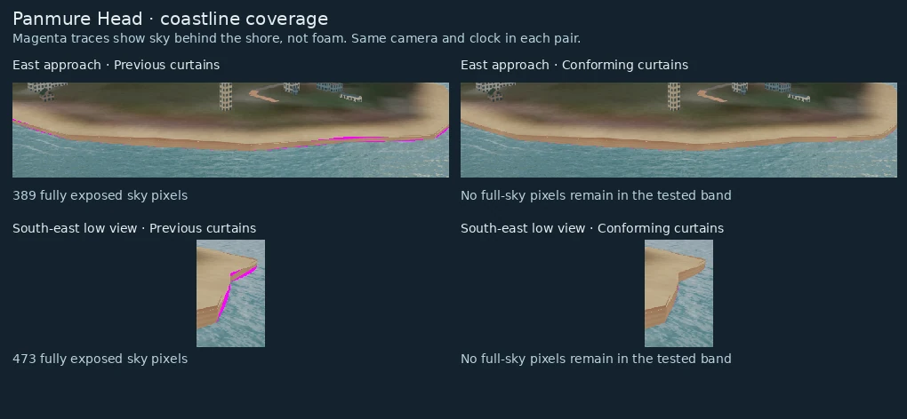

# Panmure Head coastal pass

Choose **Panmure Head · coastal pass** in Standard. The virtual flight starts over the water east of the headland, about 78 m above the starting surface. It is a sightseeing view, not a route for real aircraft. The historic lighthouse remains the existing approximate atlas building; this change does not install the new artwork or alter the ground at its base.

Five selected cells on the east face of the headland showed the rendered sky below the shoreline. The existing straight curtains missed bends in the signed Cover contour by about 0.72–1.61 m. Four cells have one corner at zero; the fifth has no zero corner. An exact, unambiguous curve fitted the existing mask in all five. Its maximum bound is 4.7 cm against that mask, not against a real shoreline survey. No mesh, collision, sea level, or land classification moves. The original shore curtains are preserved and one additional near draw fills only the witnessed gaps.

Add `?stockOpenCoast&departure=panmure-head-coast` to keep the route and compare the previous coverage. Detail and the independent shoreline studies keep their coverage. Standard’s separate Orby repair stays active when only this comparison flag is used.

## Evidence

The same-camera [render and flight checks](panmure-open-coast-gate.json) compare magenta and green sky to distinguish real openings from coastal foam. The east approach, south-east low view and north-east foreground lost 389, 473 and 1,574 fully exposed sky pixels, respectively. Some partially exposed pixels remain. Nothing outside the measured bands changed, and protected views at Georgetown and Basin Head stayed pixel-identical. No increased exposure was detected across these captured views. Sites away from Panmure are not implied to be gap-free.



To rerun, build the project and point the replay at a local Chromium with Playwright available:

```sh
npm run check
node tools/verify-world.mjs
python tools/qa/panmure-shore-same-frame.py --checkout . --poses docs/qa/panmure-open-coast-poses.json \
  --out /tmp/panmure-frames --chromium /path/to/chromium
python tools/qa/panmure-shore-flight.py --dist dist --out /tmp/panmure-flights --chromium /path/to/chromium
```
