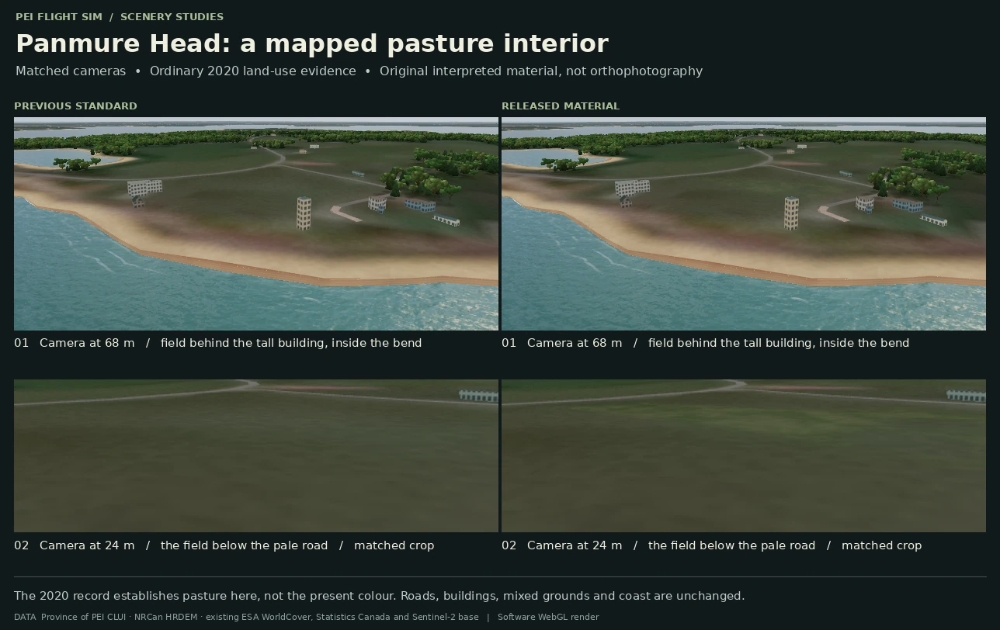

# A pasture on the Panmure Head approach

Select **Panmure Head · coastal pass** in Standard. As you approach the headland from the east, a small part of the field inland of the lighthouse has a muted green-and-straw response instead of the undifferentiated brown ground. The change is local and deliberately modest. Compare the same route with `?departure=panmure-head-coast&stockPanmurePasture`. It changes the light reflected by an existing terrain surface; it does **not** add a lighthouse, a building, a fence, rows of crops, individual blades, or terrain relief.



## What is known, and what is painted

- **Field location and historical use.** The [Province of PEI Corporate Land Use Inventory, 2020](https://gis.princeedwardisland.ca/server/rest/services/Hosted/CLUI2020_OpenData/FeatureServer/0) records field `1760020` as agriculture, entirely pasture (`AGR / PAS 10`). That is a land-use record, not a statement about ownership, the present crop, mowing, grass colour, or appearance after Hurricane Fiona. Contains information licensed under the [Open Government Licence – Prince Edward Island](https://www.princeedwardisland.ca/en/information/finance/open-government-licence-prince-edward-island).
- **A conservative interior.** The [NRCan CanElevation HRDEM Mosaic](https://open.canada.ca/data/en/dataset/0fe65119-e96e-4a57-8bfe-9d9245fba06b) supplies 1 m surface and terrain cells. Every eligible cell must have a qualifying 3×3 neighbourhood of low surface-to-ground differences. The crop stops before the reserved lighthouse-survey region. Building outlines, road widths, land-use boundaries, and the 2021 ESA WorldCover/shore atlas remove more ground before the boundary is feathered. The cover-class input is © ESA WorldCover project 2021, [Zanaga et al., 2021 v200](https://doi.org/10.5281/zenodo.7254221) ([CC BY 4.0](https://creativecommons.org/licenses/by/4.0/)). The ordinary shoreline and roads are derived from Statistics Canada. See [world data attribution](../WORLD.md). Contains information licensed under the [Open Government Licence – Canada](https://open.canada.ca/en/open-government-licence-canada).
- **What that leaves.** The provincial field occupies 29,974.58 m² in the simulation projection. Of that, 10,211 one-metre cell centres have non-zero weight, 3,739 at full weight. The *full support of linear texture interpolation* extends somewhat farther than the non-zero centres: roughly 10,566 m², still contained within the field. All active centres are dry class 30 in the locked game cover; their signed coast distances are 95.13–177.23 m. None of the separately mixed lighthouse grounds, homes, road surfaces or shore is an authorized paint target. This is not a property-boundary map.
- **The look is original.** Broad dry-to-green variation and close, softly mottled surface reflectance are shader artwork. The underlying existing Sentinel-2 true-colour imagery and its real local contrasts remain visible. No Google images, Street View frames, provincial orthophotos, or survey colour samples were copied. No structure, airport, shoreline, collision mesh, or flight behaviour changes.

## Why the released colour is quieter

The first material looked too uniformly green. We shifted some response toward straw tones, reduced the balance toward the synthetic palette from 44% to 36%, and put more of the close variation into brightness rather than saturation. The patch reads as a field from the air, not as a different grade over the whole headland.

In the close 624×420 lock, all 13,691 role pixels and their original RGB values were identical between the two trials. On that **exact same set**, median CIELAB chroma was **11.62 stock → 17.45 first pass → 14.81 released**. On the released frame, 7,955 pixels differed from stock by more than two 8-bit RGB levels; on that subset, median RGB change was +3/+6/−1. In the approach lock, 2,148 pixels met that threshold (median +3/+5/0). There were no changed pixels outside the role at either view. An independent review reprojected 869,553 matching samples across small camera rotations: the largest per-sequence 99th percentile residual was 1.352 RGB code levels and no sample exceeded four. At 274.98 m and 275.02 m the independently matched frames were entirely stock. CIELAB here measures screen saturation, not field condition or real-world colour accuracy. The remaining silhouettes still use the ordinary world models; these images do not demonstrate architectural fidelity or province-wide photorealism.

## Runtime boundaries

The extra shader and data are loaded only in compatible low flight, not in Dispatch, and only when the ordinary local imagery, visible building tile, terrain, cover, roads, pedestrian features, and parking match the survey inputs. No other terrain tile acquires the shader. The exact 640×640 TCI tile and actually uploaded material must agree; a valid but different image is not accepted. Compressed and decoded eligibility bytes, shape and world origin are checked independently. A failed optional check leaves the stock material in place. Loading adds one approximately 9.4 kB uncompressed JS chunk, a 213×236 R8 mask and a 128×128 procedural RGBA texture (with mipmaps, about 135 KiB of additional GPU texels). It adds no triangles or draw calls. No new image, elevation or building download is required.

Distance-to-eye fades the treatment to zero by 458 m; absolute camera altitude also fades smoothly from 180 m to zero at 275 m. These are visual distances within the simulation, not navigation guidance. The same-frame road, mixed grounds, and view away from the field remain identical. The [machine-readable evidence](panmure-pasture-gate.json) includes actual and deliberately faulted ordinary flights. Timing in a software renderer is not a hardware performance benchmark.

## Replay

Use Node 22.12+ for the project and a Python environment with Playwright, NumPy and Pillow for the two browser checks. The Chromium executable is supplied explicitly.

```sh
npm ci && npm run check
python tools/qa/panmure-pasture-flight.py --dist dist --out /tmp/panmure-flight --chromium /path/to/chromium
python tools/qa/panmure-pasture-frames.py --checkout . --out /tmp/panmure-frames --chromium /path/to/chromium
```

For an independent data rebuild using GDAL/OGR, NumPy and SciPy, obtain the single public polygon and the exact two native-grid raster windows, then run the offline rebaker. These files are *not* game textures. The script verifies both source arrays, the ordinary local infrastructure records, and the final R8 hash.

```sh
curl -fsSG 'https://gis.princeedwardisland.ca/server/rest/services/Hosted/CLUI2020_OpenData/FeatureServer/0/query' \
  --data-urlencode "where=fieldid='1760020'" \
  --data 'outFields=fieldid,landuse,cover1,per1,cover2,per2,cover3,per3,cover4,per4,cover5,per5&outSR=4326&returnGeometry=true&f=pjson' \
  -o /tmp/panmure-field.json
for surface in dtm dsm; do
  gdal_translate --config GDAL_DISABLE_READDIR_ON_OPEN EMPTY_DIR -q -projwin 2434248 317139 2434372 316954 \
    "/vsicurl/https://canelevation-dem.s3.ca-central-1.amazonaws.com/hrdem-mosaic-1m/10_3-mosaic-1m-${surface}.tif" \
    "/tmp/panmure-${surface}.tif"
done
python3 tools/geodata/rebuild-panmure-pasture.py --clui-esri /tmp/panmure-field.json \
  --dtm /tmp/panmure-dtm.tif --dsm /tmp/panmure-dsm.tif --output /tmp/panmure-pasture.u8
# SHA-256: 787ffcf201dcaddded604c11423361cfa175545f24e44272a117903f74a06b01
```
