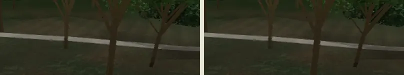
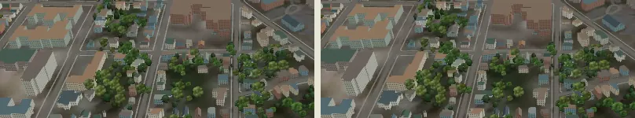

# Keep scene opacity through mapped paths

The existing [Confederation Trail](confederation-trail.md) and [mapped sidewalks](mapped-sidewalks.md)
already use coverage to soften their edges or fade with distance. Both now retain the
scene's alpha under their covered samples. Otherwise the world canvas can let the page
background through the path. The improvement is not another layer or an update to the trail map.





Both pairs show the same native-scale crop over the existing page background. The images
are examples of corrected compositing, not different textures. Measured in native WebGL with four samples:

| 840 × 540 camera | Partial-alpha pixels repaired |
| --- | ---: |
| Hunter River, Queens County trail | 1,384 |
| Prince County trail | 5,613 |
| Kings County trail | 4,992 |
| Charlottetown sidewalks, altitude fade | 11,019 |
| Summerside sidewalks, altitude fade | 3,068 |
| Close Charlottetown sidewalks, outside the fade | 0 |
| High off-scope trail | 0 |

Raw colour bytes, depth settings, draw counts and triangle counts did not change. Every repaired
pixel was inside the relevant mesh's exact two-colour marker, with no extra pixel tolerance.
Switching back restored the old raw RGBA frame. No vegetation, paths, materials or imagery
were added. The optional Basilica sunlight receiver inherits the guarded sidewalk material
without changing its shadow sampling.

Compiled ordinary Hunter River and Charlottetown waterfront flights verified both
submitted draws and their separate capability fallbacks. Native multisampled alpha buffers
use the new blend. A 4-sample RGB-only buffer keeps original blending and coverage; without
MSAA the Trail keeps its original hard cutoff while sidewalks keep their previous draw state.
Neither fallback is presented as a scene-opacity correction. All flights moved and paused.

[Measured results](path-coverage-alpha/verification.json). Reproduce the locked views
with Python Playwright and Chromium:

```sh
python tools/qa/path-coverage-alpha.py --chromium /path/to/chromium --out /tmp/pei-path-alpha
```
