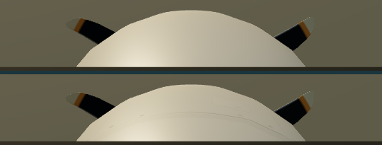

# Survey 01: pilot-view cowling finish

The fictional survey plane now shows the closed engine-access cover,
flush fasteners and cowling joint from the pilot seat. Tone and roughness
vary at the joints, and the thin marks fade below useful screen resolution.
There are no photo textures, open vents or new control functions.

Only the existing pilot-view dome material changes. The stock exterior,
instrument panel, flight model, geometry, visibility and wheel-contact
datum are untouched. A pilot view made directly from the taller exterior
shell was tested and rejected because it obstructed the windshield.

## Reproduce

Run the development server and open
`/tools/qa/aircraft-preview.html?pose=cockpit` at 1160 × 740.
Use `chase`, `windshield` and `prop` for the fixed exterior controls.
The [fixture receipt](fixture.json) compares the same original scene before
and after. The skin changed 2,036 strong RGB pixels, all within the
independently marked original dome; alpha did not change. All three
exterior controls are byte-identical. Draw and triangle counts matched
at each fixed pose. These counts are not a hardware frame-rate benchmark.
