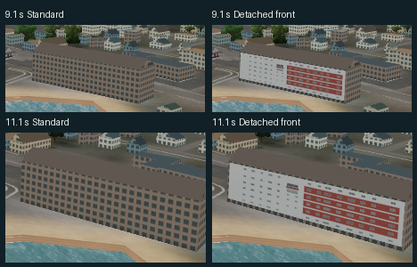

# Portside seaward front: archived study

This is original work on the waterfront at 160 Water Street in Summerside.
It is **not part of the playable build**. The Standard route, default
building, terrain, water and aircraft behavior are unchanged. There is no
preview flag in the player.

These are unscaled crops of actual frames at 9.1 and 11.1 seconds on the
ordinary **Summerside waterfront · low pass**. They are not photographs.
The [detached shader source](../../tools/art/portside-front-study/appearance.ts)
adds the continuous pale front, four muted rust-red fields, a sparser window
pattern and two separated central glazed groups. It changes the apparent
finish of one old long face, not the silhouette, physical windows or whole
structure. A fourth colour pass would not solve the old roof and return.

The [operator](https://www.arsenaultproperties.ca/160-water-street-summerside),
[architect](https://sablearc.com/portside/), and Quintin Soloviev's
[July 2025 southwest aerial](https://commons.wikimedia.org/wiki/File:Summerside,_Prince_Edward_Island,_Canada.jpg)
and [October 2025 southeast aerial](https://commons.wikimedia.org/wiki/File:Summerside,_Prince_Edward_Island.jpg)
establish the broad arrangement from different viewpoints. No source photo
pixels, interior model, or purported survey of individual openings are used.

**Why it stayed out.** The improved front is easier to recognize, but the
original eave, roof and checked short side are still conspicuous on the
ordinary approach. Together they make the finish look applied to a generic
block. Next work on this building should address its separately measured
massing rather than repaint the short sides from an unregistered view.

**Verification.** The [summary and source seals](portside-front-study/verification.json)
cover four natural Chase frames at 900 × 600 with four native MSAA samples.
A private, instrumented app reproduced 3,770, 9,158, 2,816 and 0 strong RGB
changes within the intended face. Alpha, all exterior pixels, and the
restored stock frames matched exactly. The actual zero-gain warm-up rendered
and restored one old indexed draw with identical RGBA. A separate unmodified
private compilation refused the conflicting terminal request, the explicit
stock setting, and a test-induced shader-link failure. Whole images from
independent cold starts were not byte-identical; only the same-frame
comparisons establish pixel locality. The optional host was not added.
