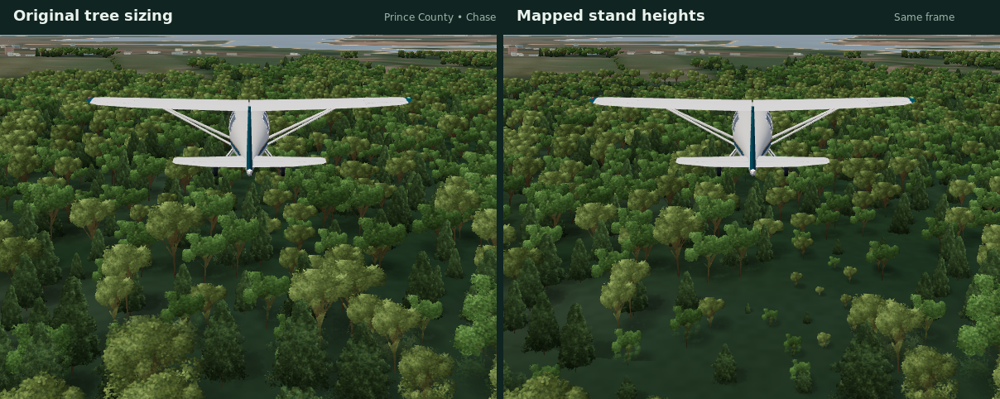

# Mapped woodland heights from the Prince County departure menu

In Standard, choose **Prince County · inland meadow pass** from the departure
menu. The note “Survey-based woodland sizes ready” means the nearby tree sizes
are ready for **Begin flight**. You can begin immediately while it checks;
that launch keeps the original sizing for trees already cached. The menu
preflight never resizes those trees later. Ordinary streaming still applies
when entering new areas. The original menu sizing is also available via
`?stockDispatchWoodland`; that flag does not turn off the established
woodland stream. This is the Prince route, separate from the
[Kings County launch](dispatch-woodland.md).



The image shows the same native frame at about six seconds of simulated
flight. Both panels are unscaled crops with no color or exposure adjustment.
The foreground stand is less even in height, with openings below and between
crowns. The aircraft, background, and lighting used in the two draws match.
The comparison does not show added trees, new species or changed terrain.

## What changed

The existing woodland stream already supplied the signed dimensions for
a bookmarked departure. The same site reached through the in-game menu
could keep the cache's original sizes even after that source became
ready. In the original q409 build, two actual launch histories produced
14,915 matching tree slots in this tile at departure: all 12,984
source-supported slots had the exact old generic height/width in the menu
history and exact signed height/width via bookmark. The other 1,931
slots had no usable height data and both histories correctly kept the
original sizes. No existing tree position, base height, art variant or
light value differed in that matched roster.

This adds a tightly scoped ready-at-Begin handoff for the Prince menu
selection. Only the height and width of existing inferred tree positions
within the signed source tile are eligible. Those positions are
constrained by the original mapped land cover; they are not individually
mapped or surveyed. Existing canopy art, shade policy, draw/triangle count,
roads, terrain, collision, camera and controls stay unchanged. No new
model, texture, shader or download. Missing/altered data, a rejected
render profile or no source ready at Begin leave the original launch path
intact. Bookmarks, existing explicit studies and other road/woodland
programs keep their previous path.

## Source

Contains information licensed under the
[Open Government Licence – Prince Edward Island](https://www.princeedwardisland.ca/en/information/finance/open-government-licence-prince-edward-island).
The provincial [Enhanced Forest Inventory 2020](https://data-princeedwardisland-peigov.hub.arcgis.com/datasets/8a7638bdc09648358e0b6fd14be6117a)
combines airborne and field inventory on a 20 m source grid and estimates
dominant and co-dominant stand heights. It is neither an individual-tree
survey nor a current vegetation or flight-clearance inventory. See the
[existing archive provenance](forest-height-stream.md).

The only source admitted by this menu change is existing height tile
**7-12**. Its archived `heights-03.pack` range is 47309–78870 inclusive
(31,562 bytes of 530,952); decoded 324 × 324 R8 size 104,976 bytes,
SHA-256 `0590eb96ff84ec82282e722c90cbfb83d4dabb3222f4acb3b471ccd4077f222b`.
The runtime accepts the already authenticated decoded tile through the
original woodland reader; the exact range describes this QA transport,
not a new transport requirement. Neighbor tile 7-11 and the independently
placed Miscouche fill and its shared tile data are not changed.

## Matched native render check

The actual Standard Chase flight starts from the normal runway-free
virtual departure and uses its ordinary flight model and neutral controls.
The diagnostic used paced test-clock frame callbacks and omitted some
presentations between checkpoints, then drew both sizes at precisely the
same camera and physics state. This is separate from uninstrumented
ordinary play and is not a performance benchmark. Unmodified scene shaders
produced the comparison images in the actual stock WebGL context with 4×
coverage. Alternate marker draws measured old and new crown/shade coverage;
neutral marker draws and full restored images matched exactly.

| Chase checkpoint | Resized original slots | Pixels changing by >2 RGB codes | Changed pixels outside either role | Changed alpha |
| --- | ---: | ---: | ---: | ---: |
| First captured frame (n1) | 12,958 | 79,557 | 0 | 0 |
| About 6 s (n180) | 10,048 | 312,978 | 0 | 0 |
| About 8 s (n240) | 8,711 | 387,728 | 0 | 0 |

The old and new draws had equal total draw and triangle counts at each
checkpoint. The original renderer/camera state and the scene's covered
positions and protected attributes were preserved. The exact height and
width submission words were independently rederived from the
authenticated source; these are CPU-side words of owners actually
submitted for rendering, not GPU buffer readback. Role masks and an
independent projection checked the coverage of the changed pixels. See
the [matched native and raw summary](prince-dispatch-woodland-native.json)
for image hashes and exact counts.

## Native fallback checks

| Setup | Resized original slots at n1 / n48 | Exact height source verified at n1 / n48 |
| --- | ---: | ---: |
| Begin in the same task as manual site selection; healthy range delivered after n1 | 0 / 0 | No / Yes |
| One changed byte in the original range | 0 / 0 | No / No |
| Explicit previous menu behavior (`?stockDispatchWoodland`) | 0 / 0 | Yes / Yes |
| Actual 0× antialiasing context | 0 / 0 | Yes / Yes |

All eight captures retained a submitted forest and reported zero WebGL
errors. The real 0× context reported zero framebuffer samples; the other
three used the ordinary 4× context. These are independent flight sessions:
the checks compare admission and replacement slots, not pixel equality
across sessions. See the [native fallback receipt](prince-dispatch-woodland-guards.json).

## Ordinary play check

The [uninstrumented production build](prince-dispatch-woodland-production.json)
used the regular Dispatch selector, Begin button, renderer and clock.
The ready flight started with 12,984 resized existing slots and retained
that count at 96.453 m of actual Chase movement. A separate later sample
before Pause found 11,406 as the ordinary visible roster moved. This is
not a fixed tree count for the flight. Starting immediately in the other
session used zero resized slots through 97.054 m even after the authentic
source became ready. Both runs accepted the same decoded tile and paused
normally. Debugger polling times on the local software renderer are
not launch-time, device speed or frame-rate measurements.

## Switching sites and nearby scenery

- With Kings ready, a selection of Prince cleared the old ready notice
  before the next frame; an immediate Begin left the new flight at original
  sizes. The same was verified from Prince to Kings.
- Pausing an active Prince flight and returning to the departure menu
  retired the prepared sizing and cleared the notice. The direct Prince
  bookmark still used the original prewarmed stream without the menu claim.
- The established Kings menu departure retained its original 9,926 resized
  slots at launch, after 97.054 m of ordinary flight, and before Pause.
- The independent ordinary Miscouche route retained all 215 supplemental
  crowns at full gain after 279.854 m, with one existing fill asset request
  and zero Prince/Kings menu replacements. Cockpit and Pause remained
  usable.

These are separate real runs, not a pixel-match across independent flights.
See the [route and coexistence receipt](prince-dispatch-woodland-coowners.json).

From the repository, with Node and the normal development dependencies:

```sh
node --experimental-strip-types --test test/dispatch-stand-height.test.ts test/dispatch-stand-prince.test.ts
node --experimental-transform-types --no-warnings tools/qa/dispatch-stand-roster.mjs --prince
npm run check
```
