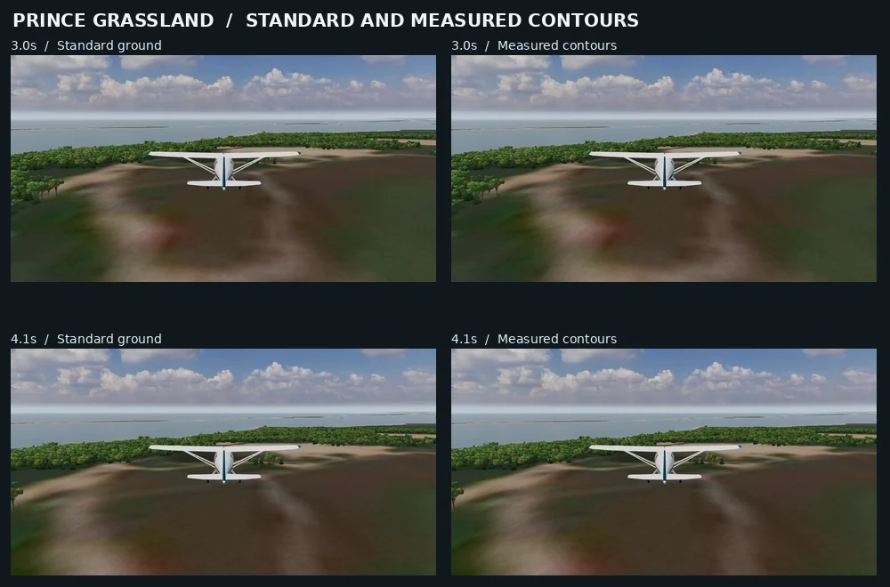

# Measured grassland contours · Prince County

In Standard, select **Prince County · grassland pass** and **Open landscape
preview**. Dispatch shows when the preview is ready. A flight started
before the data verifies keeps the original ground. **Close landscape
preview** returns to Standard for the next flight.

This is a dated, local shape correction on roughly **6.55 hectares** of
existing mapped grassland. It changes the visible terrain and local
simulator ground contact. It does not replace the satellite colour,
shoreline, vegetation, roads, or neighbouring buildings. The measured
appearance is modest at the route’s normal altitude. It is not a claim
about today’s terrain or a real-world navigation aid.

The documented [NRCan 16 m overview](../adaptive-relief.md) supplies the
heights. In a separate check against the [named 2020 NRCan 1 m bare-earth
tile](https://datacube.services.geo.ca/pgstac/api/collections/hrdem-lidar/items/PEI-Prince_Edward_Island_2020-1m),
the core’s 90th-percentile absolute vertical error was **0.46 m**, versus
**2.22 m** for the original mesh. This comparison used 35,817 native
centre samples, with no height offset fit and no change to the preview
after scoring. The 10,831 rim samples improved from 2.03 m to 1.79 m at
the same percentile. These are results on this exact footprint against
a finer product from the same historical survey, not field accuracy
everywhere or a new acquisition. The same
original 112-cell terrain draw retains every triangle outside the 23
selected cells, including the original unsplit perimeter. Contact fades
back to the old sampler **inside** the approved scope, with no changed
contact outside it. Measured visual and contact values can differ in
that narrow feather.

In the [native comparison](render-receipt.json), 62,417, 53,028 and
23,155 pixels changed by more than two RGB code values at three matched
approach points. No pixels outside the actual touched primitives
changed; alpha remained exact; the whole image restored byte for byte.
The later image was identical to stock even though the tile still
submitted the preview geometry. The preview adds 624 triangles, no
extra draws, and no new photographic texture. All flight steps ran,
with software-rendered submissions reduced only between scored frames.
The logged counts are not a hardware frame-rate claim.

Contains information licensed under the [Open Government Licence – Canada](https://open.canada.ca/en/open-government-licence-canada).
