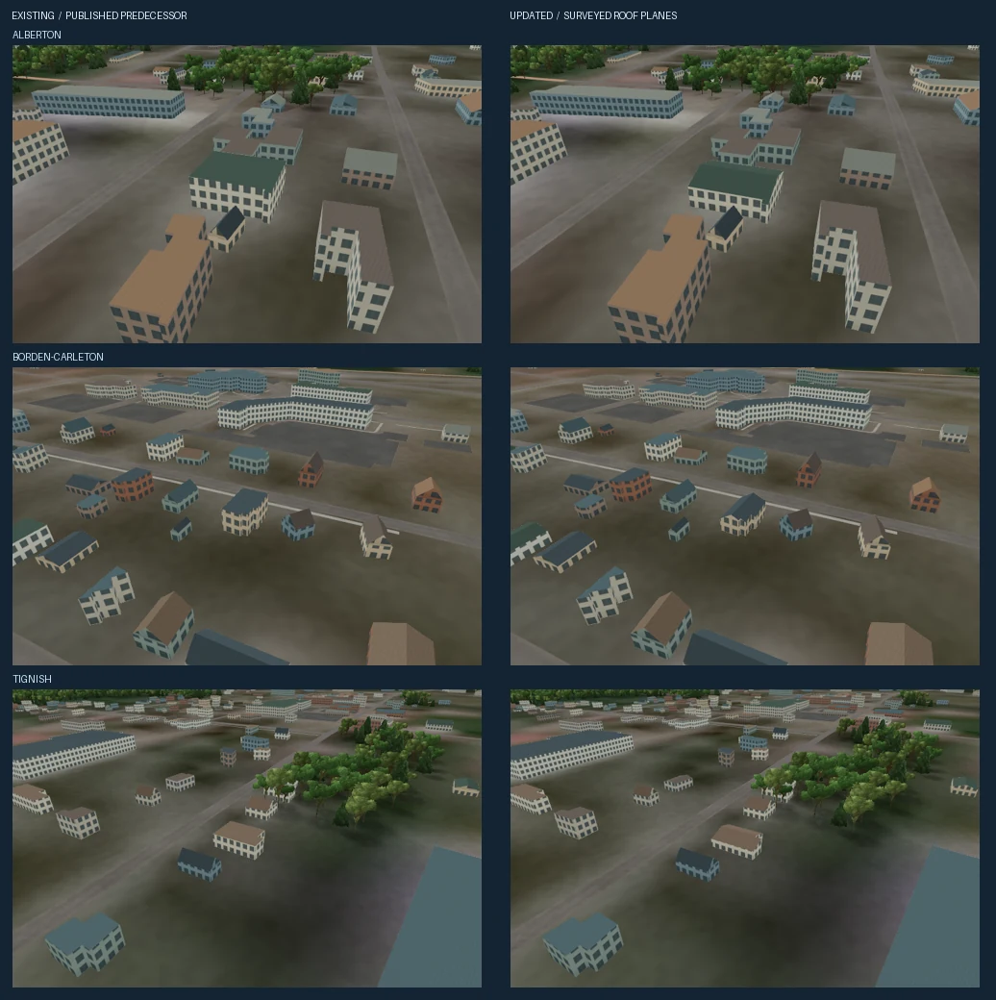

# Surveyed roof silhouettes in Prince County

The Standard atlas adds measured roof planes to **40 existing buildings**
in six communities. This is a roof-geometry pass, not new building
classifications, façades, business names or an as-built architecture
survey. It does not replace roads, ground materials, terrain or flight
contact. The [earlier Kings County models](kings-neutral-roofs.md) are kept.

| Community | Existing roofs refined |
| --- | ---: |
| Alberton | 7 |
| Borden-Carleton | 9 |
| Kensington | 10 |
| O’Leary | 6 |
| Tignish | 7 |
| Wellington | 1 |



## Evidence

The [automatically extracted building plans](https://open.canada.ca/data/en/dataset/7a5cda52-c7df-427f-9ced-26f19a8a64d6)
and [1 m height data](https://datacube.services.geo.ca/stac/api/collections/hrdem-mosaic-1m/items/10_3-mosaic-1m)
are from Natural Resources Canada. The same atlas hash, tile, row, and
ordered outline coordinates are required. A local ground mismatch of
more than 0.8 m keeps the pre-existing mesh. Normal crown and eave joins
stay inside the original footprint; roof planes come from LiDAR, not from
reference photos or a guessed architectural type.

From 144 selected sites, 68 passed native model fitting. Seventeen
lacked enough measured improvement, and eleven failed the absolute
mesh screen. The [actual mesh ray replay](prince-roof-mesh-gate.json)
uses 919 held cell centres from the same survey, excluded from plane
fitting:

| Metric | Existing mesh | Fitted mesh |
| --- | ---: | ---: |
| Median of each model’s absolute p90 | 0.729 m | 0.121 m |
| 90th percentile of each model’s absolute p90 | 1.348 m | 0.265 m |
| Largest individual building p90 | 2.211 m | 0.314 m |

The actual other rows in the eight owning batches keep all 189,810
unaffected vertices exact across all six attributes. The
[matched renderer checks](prince-roof-pixel-gate.json) list the active
textures and building batches, silhouettes, and draw statistics. These
are fixed renderer checks and do not measure device frame rate. All
1,002,427 pixels outside the projected intended changes stayed exact,
with the same draw counts in all three scenes. Independent checks of
71 reachable mixed terrain configurations at O’Leary found no new
footing gap. This roof pass does not repair the existing distant
terrain and footing approximations. The compiled coast-route check
also passed with ordinary atlas controls and no browser errors.

Contains information licensed under the
[Open Government Licence – Canada](https://open.canada.ca/en/open-government-licence-canada).

## Reproduction

The [candidate archive](../../data/prince-neutral-roofs/candidate-shells.json.gz)
pins the exact 144 plans, including orientation seeds. The [registered
sample recipe](../../data/prince-neutral-roofs/sample-plan.json.gz) and
[absolute exclusions](../../data/prince-neutral-roofs/absolute-mesh-exclusions.json)
document the two screening steps.

Starting from a working checkout, with Python GDAL, NumPy, SciPy and the
locked Node dependencies:

```sh
mkdir -p /tmp/prince-roofs
gzip -dc data/prince-neutral-roofs/candidate-shells.json.gz > /tmp/prince-roofs/candidate-shells.json
python tools/geodata/house-roof-samples.py --root . --scratch /tmp/prince-roofs --all-groups
python tools/geodata/fit-house-roof-planes.py --root . --scratch /tmp/prince-roofs
python tools/geodata/bake-kings-neutral-roofs.py --root . --scratch /tmp/prince-roofs \
  --out /tmp/prince-roofs/only.ts \
  --exclusions data/prince-neutral-roofs/absolute-mesh-exclusions.json
python tools/geodata/combine-neutral-roofs.py --out /tmp/prince-roofs/combined.ts \
  /path/to/predecessor/src/render/neutral-roofs.generated.ts /tmp/prince-roofs/only.ts
cmp /tmp/prince-roofs/combined.ts src/render/neutral-roofs.generated.ts
gzip -dc data/prince-neutral-roofs/roof-holdout.json.gz > /tmp/prince-roofs/rays.json
node --experimental-strip-types tools/qa/kings-roof-rays.cjs \
  /path/to/predecessor . /tmp/prince-roofs/rays.json /tmp/prince-roofs/report.json PRINCE
```

To replay the three views, pass `--poses data/prince-neutral-roofs/review-poses.json`
to the shared [renderer capture](../../tools/qa/kings-frames.py) for both checkouts.
