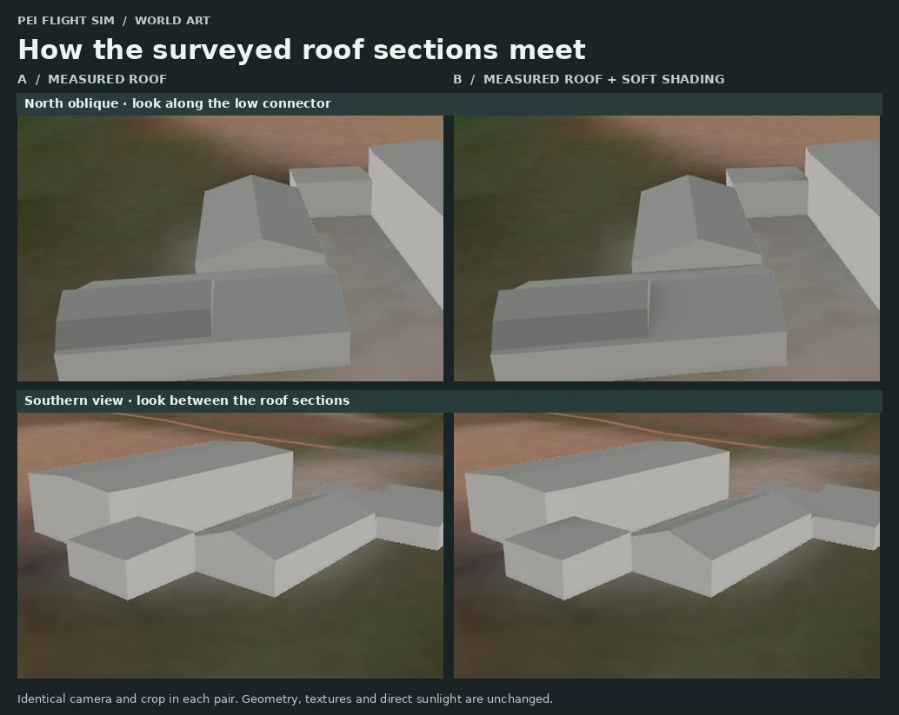

# Where the roof meets a higher wall

The [surveyed roof west of Summerside](prince-survey-roof.md) has a low connector and two sloping faces below taller adjoining sections. From those surfaces, part of the sky is hidden by the building itself. Standard now slightly darkens those **specific places**. The effect is easiest to see on a low, oblique approach. There are no painted dark lines, photographed textures or new building parts.

**Compare:** `?stockPrinceRoofContact` keeps the measured roof but turns off this lighting. `?stockPrinceSurveyRoof` restores the earlier generic flat building. On equipment with too little fragment-uniform space, the normal view keeps the measured roof and skips the lighting. Beyond 290 m from the camera the effect is zero.

## What changed

The offline bake traces 768 cosine-weighted directions from each of 2,198 local sample positions against the **98 existing triangles** of this building. A higher adjoining wall can obstruct the diffuse sky; a clear roof sees no reduction. Obstructions up to 5 m away have full weight and taper to zero at 14 m. The three small lookup grids are local to the receiving roof planes, so light cannot bleed across the measured vertical steps. Only the sky-light term changes; the directional sun, surface roughness, roof colour, walls, street and ground do not.

This is simulated occlusion, not a measured outdoor light level, shadow photograph, roofing material survey or reconstruction of the façade. The original [NRCan 2020 source validation](prince-survey-roof/independent-native-holdback.json) supports the geometry; the lighting comparison uses independent rays against that geometry, not new laser observations.

## Evidence and cost

- **Visibility:** An [independent 1,024-ray check](prince-roof-contact/independent-visibility.json) used 338 locations not used by the baker. Mean absolute error in blocked sky fraction was 0.0043. All 33 strongly blocked locations were detected; all 237 clear positions and all 192 positions outside the receiving planes stayed zero.
- **Pixels:** In the [four locked camera views](prince-roof-contact/independent-frames.json), 363, 637 and 2,963 pixels changed by more than two 8-bit channel levels at the three low views. No pixel outside the three visible receiving planes changed. At 620 m, the entire frame was byte-identical. At 100–102 m, an [independent pass on the same rendered frame](prince-roof-contact/gpu-words.json) also verified all 440 unsigned coefficient words on the GPU against the mounted Three.js material. A genuine local effect, not a province-wide graphical upgrade.
- **Runtime:** No new texture, sampler, triangle, vertex attribute, draw call, or network resource. The selected tile’s material can bind 1,760 bytes (110 aligned four-uint uniforms) and does four lookup reads for an eligible fragment; this is not zero compute. Admission requires at least 192 fragment-uniform vectors. The test renderer exposed 4,096; actual link reflection found 113 conservative vector slots total and zero samplers. No hardware FPS gain is claimed.
- **Isolation:** [Streaming and fallback tests](prince-roof-contact/streamer.json) compare all the position, normal, colour, UV and classification arrays of the full building tile. The [compiled flight](prince-roof-contact/player.json) verifies that ordinary flight, both stock switches, an independent scenery switch and under-budget admission preserve flight controls and the original tile paths. The [linked stock and device-budget check](prince-roof-contact/independent-stock-budget.json) exercises the comparison switch and the actual shader admission threshold.

[Source rebuild and verification](../../tools/geodata/prince-survey-roof/contact/README.md) · [Byte-exact offline re-bake](prince-roof-contact/rebuild.json)
