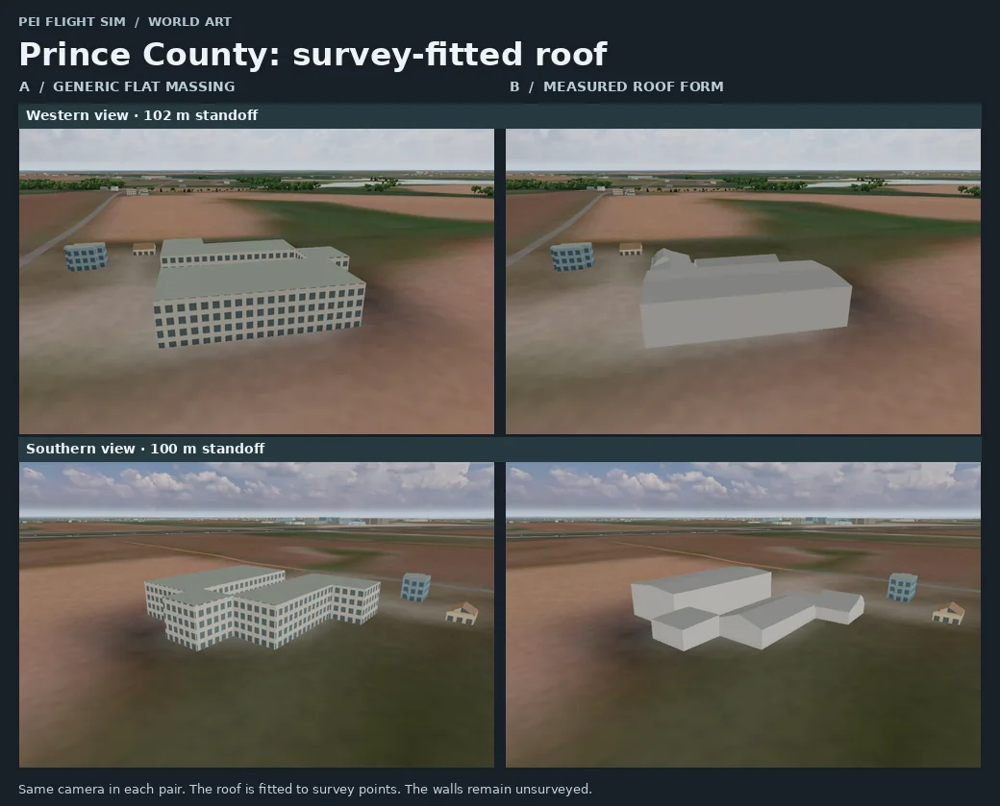

# A surveyed roof in Prince County

The building at **46.448419° N, 63.833858° W** used to be one flat cap over a roughly 2,392 m² footprint, with repeated office-style windows on all walls. The normal Standard view now shows a much taller shallow ridge on the east, a lower gable running at right angles to a cross-wing, a raised roof section on that wing, and a low sloping connector. All of these changes belong to **one existing building record**, west of Summerside. Its use, façade details and present-day appearance have not been verified.

The left and right frames use the same cameras and light. They are **game renders**, not survey photographs. Use `?stockPrinceSurveyRoof` for the old representation. To keep the measured geometry and compare only [local sky shading where sections meet](prince-roof-contact.md), use `?stockPrinceRoofContact`. Other Standard comparison switches remain independent. No preset, public departure, map point, parcel, ownership or address was added.

## What the survey supports

- The source plan is NRCan [Automatically Extracted Buildings](https://open.canada.ca/data/en/dataset/7a5cda52-c7df-427f-9ced-26f19a8a64d6): tile `q0322`, feature 47, all 14 original ordered vertices. The source gives one height range, not a roof mesh or window layout.
- The height evidence is [NRCan’s classified LiDAR point cloud](https://open.canada.ca/data/en/dataset/7069387e-9986-4297-9f55-0288e9676947), PEI 2020. The [exact source manifest](../../tools/geodata/prince-survey-roof/source-authority.json) identifies its object and ten byte ranges (3,048,853 bytes). The tile index uses provincial coordinates; the actual LAS declares NAD83(CSRS) / UTM zone 20N, EPSG:2961. Contains information licensed under the [Open Government Licence – Canada](https://open.canada.ca/en/open-government-licence-canada).
- The fitter used 23,596 distinct class-6 training pulses for the roof. It used one local ground reference from 12,204 class-2 training returns, not a separate height correction per wing. Twelve planar pieces (including a bevel) are clipped to the original concave plan. At roof steps there are real vertical closure faces; existing terrain feet are preserved where an original wall gets a new upper-edge vertex.
- Only the **relative roof shape** was established. No ground-level photograph, Google image or map trace was used. Wall/roof colours are neutral rendering choices. The removal of an invented four-storey window grid is not evidence that the real walls are blank.

## Verification

| Check | Result |
| --- | --- |
| [Unseen survey returns](prince-survey-roof/independent-native-holdback.json) | With the same local ground registration, median / 90th-percentile vertical error across **8,926 withheld roof pulses** went from **3.98 / 6.38 m** to **0.012 / 0.034 m**. Whole laser pulses and 5 m spatial blocks were withheld. All three areas passed separately. This comparison is against the 2020 data, not centimetre-level absolute geodetic or present-day accuracy. |
| [Actual Three.js triangles](prince-survey-roof/actual-triangles.json) | 30 roof triangles instead of 12; all walls and roof together add 58 triangles to the original 7,740-triangle tile. The other 314 features’ position, normals, UV, colour and style/roof attributes are byte-identical. The actual triangles span the measured footprint without filling its open recesses. |
| [Locked four-camera comparison](prince-survey-roof/independent-locked-frames.json) / [two exact GPU owner masks](prince-survey-roof/gpu-owner-masks.json) | Equal draw counts. In the 102 m and 100 m views, 59,610 and 44,328 pixels changed; **zero** changes outside the union of the old and new drawn subject, before mask dilation. At 620 m only 1,336 pixels changed. |
| [Real streamer fault cases](prince-survey-roof/streaming-fallbacks.json) / [compiled flight](prince-survey-roof/player.json) | Geometry shares the existing tile's draw. No new texture, asset download or building request. Unverified readable tile bytes, unsupported mode or missing crypto leave the stock building. A missing required source range remains an ordinary missing tile. The compiled flight uses a QA-only start, not a new departure. |

See the [rebuild guide](../../tools/geodata/prince-survey-roof/README.md), [source regeneration result](prince-survey-roof/source-rebuild.json), and [training-only fit report](prince-survey-roof/training-fit.json). The local model and equal ground reference were frozen **before** checking withheld elevations.
