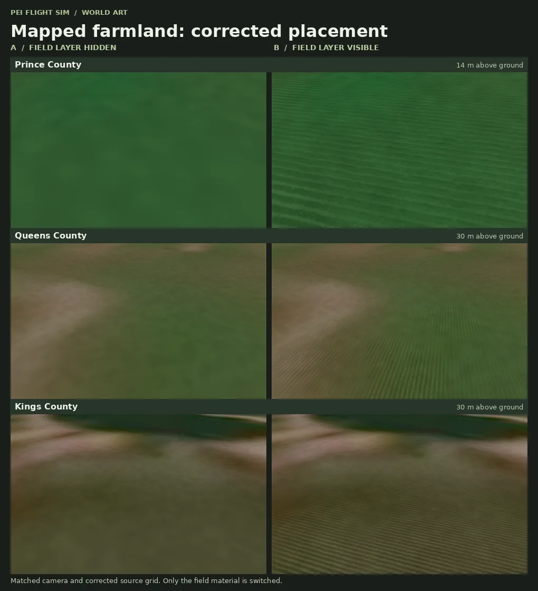

# Expanded farmland

## Fly the mapped Kings County pass

Choose **Kings County · mapped farmland pass** in Standard Dispatch, then **Begin flight**. Bookmark it with `?departure=kings-mapped-farmland-pass`, or add `&stockKingsFieldPass` to compare the same Standard flight without the furrows. Both start 62 metres above the same surface. The route crosses a mapped 2023 field (FID 43994); the earlier Kings **fields low pass** remains unchanged.

The route can warm four authenticated ranges while selected in Dispatch, but never holds the flight button. Its additional shader variant replaces the material on the one original near terrain draw `23-13` N112 during flight. The existing orthophoto, woodland, grass, lighting, geometry and flight contact remain in place. Unrelated departures, Detail, the distant view, and missing or unverified field data keep their normal terrain. The furrows are generic CC0 surface relief applied to mapped field interiors, not measured crop rows or evidence about what grows there today.

The [compiled Standard replay](farmland-v2/kings-standard-native.json) verified four close views and two distant controls, with no visible differences outside the field mask. It also swapped the original terrain material onto the same near draw before opaque sorting in two close views: the disabled candidate matched the real original exactly. The automated browser lane checks both Standard and Expanded farmland and verifies that the explicit stock comparison downloads neither.

## Fly the Queens County fields pass

Choose **Queens County · fields low pass** in Standard Dispatch. This route uses the same small range loader on original near terrain draw `12-13` and can read only three signed ranges from `crop-19.pack`. Its altitude, heading, flight model and surface geometry are unchanged. The isolated comparison switch is `?departure=queens-fields&stockQueensFieldPass`, which does not change the independent Kings County route. The [paired build replay](farmland-v2/queens-standard-native.json) checked four real close views and exact restoration, including missing-data and unrelated-departure controls.

## Optional province-wide study

To compare the broader study, choose **Optional scenery studies** in Standard Dispatch, select **Expanded farmland**, and apply. Its direct flag remains `?provinceFieldsReview`; it is separate from the Standard route effect and the three-site `?cropRowsReview`. The province-wide study can be [combined with Ground vegetation](province-land-surfaces.md).

At the route’s introduction, an isolated check of the Three.js land draw used the new departure’s ordinary Chase camera, unmodified terrain and authenticated v2 masks. At 2, 4, 6 and 8 seconds, 73,884, 59,665, 92,753 and 69,773 of the 960 × 640 frame pixels changed by more than two RGB code levels, with zero changes outside the layer’s support. At 11 and 14 seconds the frames were unchanged. Geometry, alpha and the restored image were exact. This is a [render-side test](farmland-v2/kings-mapped-route-native.json), not a browser loading, hardware benchmark or claim about the whole landscape.

## What changed in v2

The earlier bake calculated its own conversion from longitude and latitude. That put some strips of furrows on woods, built ground and a road shoulder. V2 regenerates the masks from the original field polygons using the simulator’s actual world projection. The mask bake did **not** sharpen an aerial photograph, add field geometry or change the furrow shader. The effect changes colour and lighting close to the ground, not terrain elevations, roads, buildings or flight contact. Surface rows are authored; neither their spacing nor bearing is surveyed.



Each pair switches only the corrected field layer. It is **not** a comparison of v1 against v2. At 30 m the Prince view was subtler than the reference art threshold; the 14 m view resolves the rows. The Queens and Kings examples passed at 30 m. The historical road, forest and built-ground controls were unchanged after correction, as were the two high views at 550 m. See the [independent fixed-camera measurements](farmland-v2/independent-fixed-camera.json).

## Oblique viewing

A pixel stretched along a furrow can still resolve its cross-section. Expanded farmland now uses the pixel’s width **across** the rows for the row contrast, while leaving the image samples, normal relief and grain filtering as before. The licensed scan, field placement, draw count and downloads are unchanged. The separate three-site study is unaffected.

For ground-only 960 × 640 captures from ordinary neutral passes, compare the old and new field-only RGB contributions against the previous shader drawn with the same camera at higher resolution and area-downsampled. With the scan’s fourfold anisotropy and a 4×-per-axis reference, the pooled RMS error of the displayed RGB-code effect dropped **12% in Kings, 34% in Queens and 17% in Prince** in the sampled frames. One early Kings frame was marginally worse (0.009 RGB code RMS). Unaffected pixels, alpha and a disabled layer stayed byte-identical. This is an image-sampling comparison on Mesa software rendering, not a measurement of temporal shimmer or FPS on player hardware.

[Matched-render receipt](farmland-v2/furrow-footprint.json). To repeat the isolated check from the project root on Linux with EGL/GLES 3, Python, NumPy and Pillow:

```sh
node --experimental-transform-types tools/qa/field-footprint-material.mjs kings-mapped-farmland-pass \
  | MESA_SHADER_CACHE_DISABLE=true PEI_AREA_SCALE=4 python3 tools/qa/field-footprint-compare.py
```

Replace the departure argument with `queens-fields` or `prince-fields` for the other counties. Use `PEI_AREA_SCALE=2` for the second downsampling reference, or `PEI_ANISO=1` to exercise the unaccelerated texture-filter fallback.

## Where the material is supported

The corrected map contains **4,767,146 positive samples** at 4 m spacing, or **76.274336 km²** of nominal sample area, in **1,701** original outlines. These are the areas represented by positive cell centres, not measured crop acreage, planting estimates or the physical extent of every visible row.

| PEI county | Outlines by source centroid | Positive 4 m samples | Nominal area |
| --- | ---: | ---: | ---: |
| Prince | 940 | 2,811,064 | 44.977024 km² |
| Queens | 464 | 1,049,960 | 16.799360 km² |
| Kings | 297 | 906,120 | 14.497920 km² |
| Outside any named county polygon in this boundary snapshot | 0 | 2 | 0.000032 km² |

The [county census](farmland-v2/county-census.json) assigns sampled points using the province’s county polygons and reports the two gaps rather than choosing a county for them. Most land remains unaltered. A field can cross a county line; its outline is counted once by its centroid while each sample is counted at its own location.

## How the fields are placed

* Start with Agriculture and Agri-Food Canada’s [2023 field-boundary detections](https://open.canada.ca/data/en/dataset/b3dba669-6611-4cb1-b4be-6c317b9908ad) and [2025 Annual Crop Inventory](https://open.canada.ca/data/en/dataset/89073037-d2fc-4a6d-9ce9-f0b1bcb48745). The official 30 m raster must support class 177 (potatoes) with confidence at least 80 throughout a 3 × 3 native-cell neighbourhood. These are dated classifications, not assertions about what is growing now.
* Return to each original, unsimplified polygon, transform it with the game’s projection and retain a minimum 13.25 m inboard margin for the complete visible sampling footprint. Qualify both triangles touched by the sampler where required, using the simulator’s submitted high-detail stock mesh. Withhold steep areas, unsupported edges, abrupt changes in orientation, overlapping candidates and conflicting terrain owners.
* Check the entire bilinear support against stock crop cover and the physical coastal buffer. Exclude buildings, roads and shoulders, sidewalks, parking, runways, trail beds, nearby protected surface masks and local survey/landmark receivers. These tests qualify only the specified source versions. [Source qualification](farmland-v2/source-qualification.json), [independent geographic tests](farmland-v2/independent-geographic-census.json), [road and infrastructure exclusions](farmland-v2/independent-infrastructure.json), and [Trail and marsh exclusions](farmland-v2/independent-trail-marsh-tents.json).
* Use [Poly Haven’s Farm Furrows](https://polyhaven.com/a/farm_furrows) (CC0) for material detail. This generic scan is **not** an image of these fields. Federal source data is licensed under the Open Government Licence – Canada. See [world data and attribution](../WORLD.md).

## Streaming and verification

Standard without this optional study does not request its directory or relief image. Selecting the study authenticates a **115,861-byte** index and the shared relief scan at startup. Exact terrain, decoded cover, road, building, walkway, parking and protected-owner identities must match before field streaming is admitted. The new versioned directory does not accept the retired index, whether compressed in transit or already decoded by the host. The historical three-site field mask is not needed for this option. In incompatible survey/adaptive, shadow or North Cape wind modes, the expanded field layer stays out.

The 42 packs contain **1,812,413 bytes** across 1,525 sparse 1,024 m tiles. They are not all sent when the feature is selected. At most four tiles occupy the mask array (540,800 bytes), with no increase in terrain triangles. For the cold worst-case four-tile neighbourhood, the measured upper bounds are **14,317 bytes** of exact ranges or **262,747 bytes** if a host returns whole packs. These bytes exclude the index and scan; they are not frame-rate or download-time promises. Edges have two-cell halos; unavailable or corrupt shards do not invent coverage.

[Eight compiled player checks](farmland-v2/compiled-player.json) · [Decode every packed shard and check transfer bounds](farmland-v2/archive-decoder.json) · [verify the v1/v2 cache rollover](farmland-v2/directory-rollover.json) · [rebuild from the official sources](../../tools/geodata/province-fields/README.md).

**Historical only:** [initial renderer and pack review](province-fields-review.json), [original surface treatment](province-fields-comparison.webp) and [older distance-filtering study](province-fields-filtered-check.json) refer to the retired v1 geography. They document the shader’s development, not the positions or coverage of v2.
