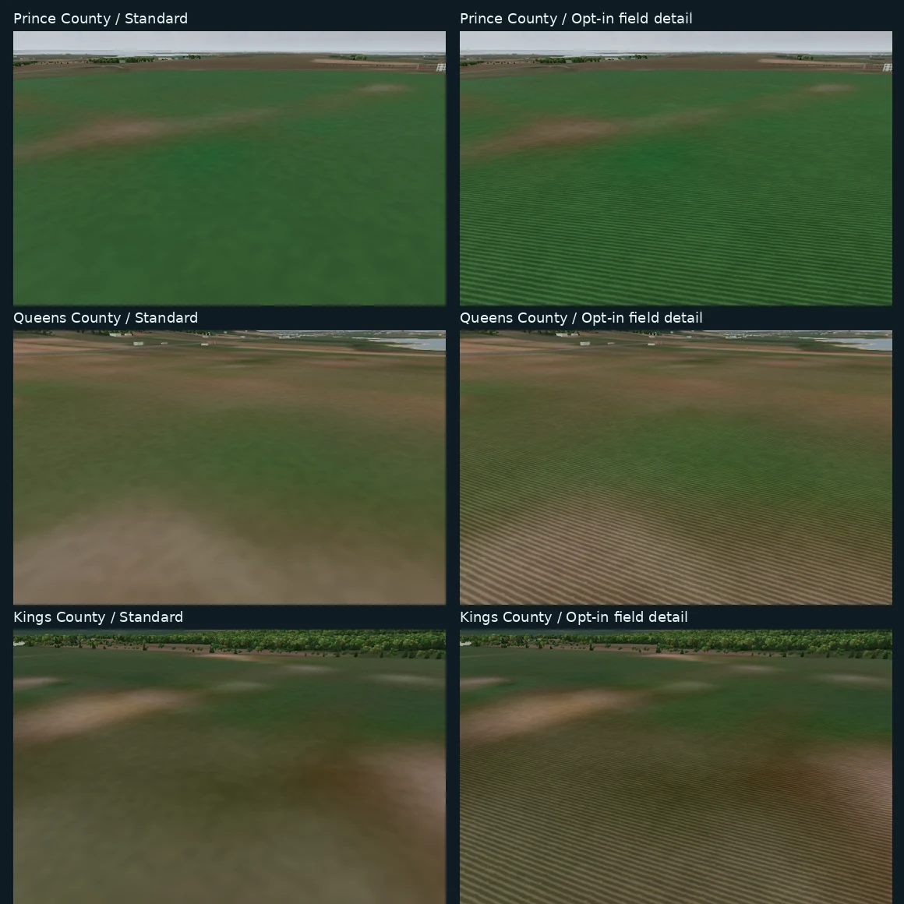

# Island-wide field surfaces

This optional study streams selected field surfaces across all three counties.
Enable it with `?provinceFieldsReview` in a Standard build. The original
three-site `?cropRowsReview` remains available. Both default to off.

The dated visual study refers to automatically detected 2023 field shapes
and a 2025 30 m class raster, not present farming or a land survey. Row
bearing is authored from field outline direction and withheld for steep
or poorly supported locations. Fitted lighting is an optical effect only:
it does not alter relief, aircraft contact, roads, buildings or water.
The generic CC0 Poly Haven scan is not aerial imagery of PEI.

## Coverage

The qualified surface covers **78.86 km²** at 4 m sampling, in **1,573**
mapped field outlines. This is supported mask area, not acreage or an
estimate of actual 2025 production. Most of the island remains Standard
at the ground surface; the full map can already be flown.

| County | Field outlines with support | Mask area |
| --- | ---: | ---: |
| Prince | 888 | 47.23 km² |
| Queens | 418 | 16.94 km² |
| Kings | 267 | 14.69 km² |

## Readiness and isolation

The sparse directory is optional (**111.4 kB** compressed). The whole
field archive is 1.78 MB on disk, not an initial transfer. The largest
qualified four-layer group takes about **15.0 kB** in strict range mode.
A static host that ignores ranges may return its matching geographic
packs instead; the conservative nearby-group bound is about 257 kB. There is
one four-layer mask in working GPU memory (540,800 bytes, excluding the
shared generic furrow material). These are byte budgets, not device FPS.

The browser takes at most four nearby
1,024 m mask layers, checks the exact range / immutable pack, and bounds
all payload sizes. Layer angles are discrete; coverage samples the correct
linear two-cell halos. When a neighbor has not arrived, both sides of a
shared edge use the same readiness floor. At corners all four shares
blend from the same value. Missing and corrupted tiles leave Standard
ground, never take adjacent memory, and don't replace loaded geography.

Opting in checks the optional directory and scan at startup. Standard
does not request them. The layer needs the exact terrain, cover, road geometry and building
atlas, and excludes local overlays. It isn't available with the
adaptive or inland relief, building-shadow, or North Cape wind modes.
That prevents a sharp cut where a different terrain owner takes over.
The Detailed preset enables North Cape wind; use **Standard** for the
expanded field study.

## Verification

Matched actual Three.js images use the same pose and imagery. No draw
calls or triangle counts change at those poses. Protected pixels match,
and the high-altitude frame is identical everywhere. An independent
four-shard probe tests all-ready, uneven arrival, missing/stale layers and
slot reuse through the actual browser shader. A separate unmodified
flight over that junction ran with all four layers and with one exact
range deliberately returning 404.

[Machine-readable geographic and render receipts](province-fields-review.json) ·
[Offline source and exact bake instructions](../../tools/geodata/province-fields/README.md)

## Credits

[2023 field boundaries](https://open.canada.ca/data/en/dataset/b3dba669-6611-4cb1-b4be-6c317b9908ad)
and [2025 inventory](https://open.canada.ca/data/en/dataset/89073037-d2fc-4a6d-9ce9-f0b1bcb48745)
are from Agriculture and Agri-Food Canada, under Open Government Licence –
Canada. Original terrain and sources: [world data](../WORLD.md).
[Poly Haven Farm Furrows](https://polyhaven.com/a/farm_furrows): CC0.
