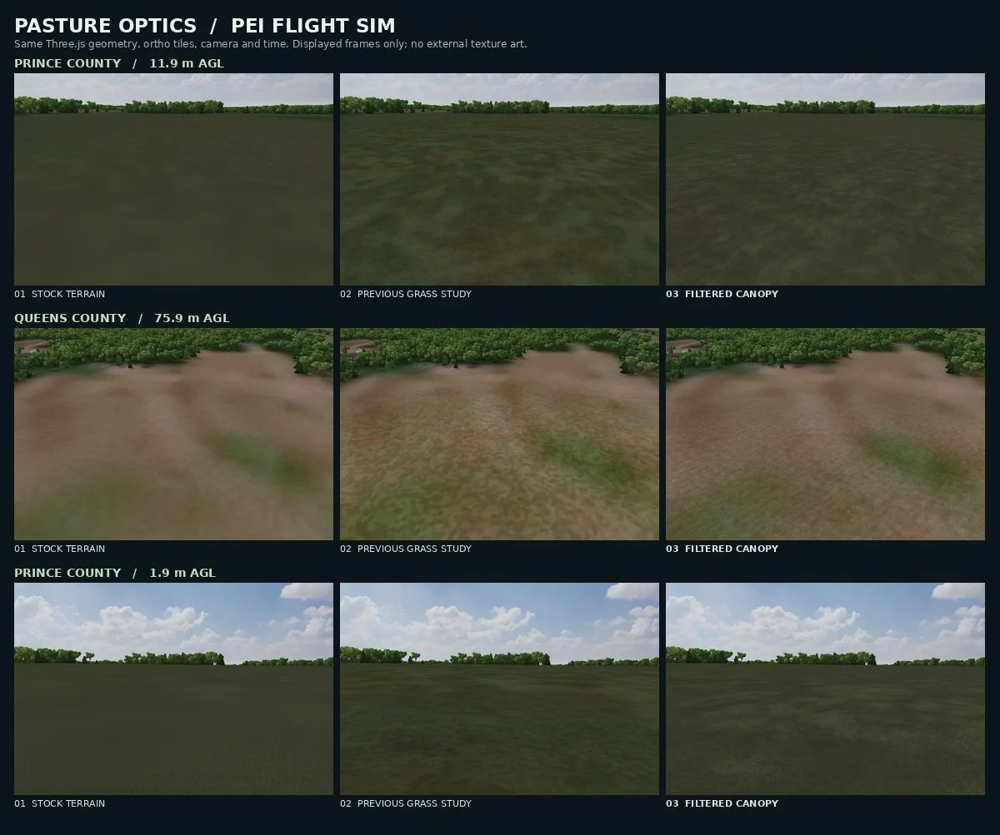

# Source-backed ground vegetation

In **Standard** scenery, open **Optional scenery studies**, select
**Ground vegetation**, and apply. Choose a **grassland pass** in Prince,
Queens or Kings County for a short comparison route. A bookmark can use
`?sourceGrassStudy&departure=prince-grassland`.

This is an optional close-to-medium-range surface study, not a vegetation
inventory or a whole-province texture replacement. It adds original
fibrous roughness and optical relief without generating blade geometry,
altering ground height, changing collision, or recolouring the island's
large-scale aerial image. This is distinct from **Expanded farmland**,
which models a selected cultivated-surface pattern. The two studies, custom
terrain and building-shadow modes are kept apart in this release.

## Coverage

The study covers **41.82 km²** of qualified ground at a 4 m sampling grid:

| County | Verified 4 m sample centres | Qualified area |
| --- | ---: | ---: |
| Prince | 768,949 | 12.30 km² |
| Queens | 1,231,470 | 19.70 km² |
| Kings | 613,467 | 9.82 km² |

The [provincial 2020 Corporate Land Use Inventory](https://data.princeedwardisland.ca/datasets/8cdbb4c526e7438986634b6d431285b8_0/about)
supports the selected grass-dominant polygons; the native
[ESA WorldCover 2021 grassland map](https://doi.org/10.5281/zenodo.7254221)
corroborates the interiors. Parks and former open grass parcels are eligible
only where the data agree. Boundary and interpolation reserves hold out
the shoreline, verified roads, sidewalk and parking meshes, surveyed
landmarks, runway geometry, and the existing building plan. The colour,
grass marks and scale of the surface variations are authored, and do not
identify present species, field mowing, use, or physical blade density.
The layer does not add source photos or satellite pixels.

## Loading and scope

Standard does not request the optional files. The compressed directory is
249,810 bytes. The 3,331 signed shards are in 43 immutable regional
archives, totaling about 2.0 MB on disk, not downloaded together. A strict
range request needs at most 3,864 bytes for one shard after the directory;
on a host that ignores ranges an individual archive is at most 119,056
bytes. Four resident RG8 mask layers account for 540,800 bytes. The
original mipmapped optical material is generated only after verifying the
stock terrain and infrastructure revisions. The shader adds no draw calls
or triangles in the matched tests; no hardware FPS claim is made.

Boundary halos match in all four directions and at corners.
Loading fades with its neighbouring cells. Missing or modified
directories, mismatched source versions, and invalid shard data leave the
original surface in place.

## Attribution

Contains information licensed under the [Open Government Licence – Prince Edward Island](https://www.princeedwardisland.ca/en/information/finance/open-government-licence-prince-edward-island).
Only the grass-dominant agricultural-abandonment and recreation classifications
were selected, not the province's forestry inventory subject to its separate
notice. © ESA WorldCover project 2021. Contains modified Copernicus Sentinel
data (2021) processed by the ESA WorldCover consortium, under
[CC BY 4.0](https://creativecommons.org/licenses/by/4.0/). See
[archive and geometry checks](province-grass-check.json).
