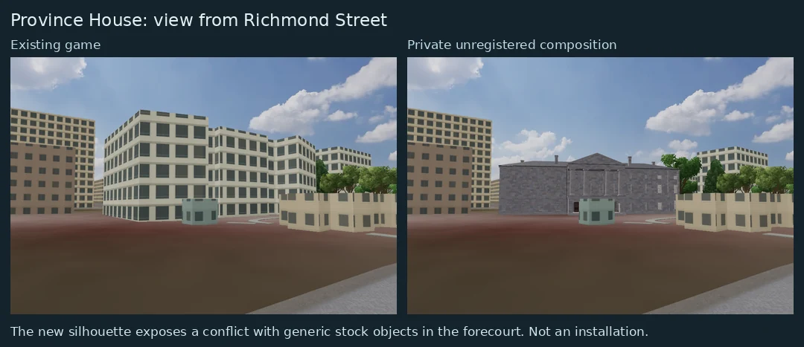

# Province House: south exterior artwork

The [original Three.js and TypeScript asset study](../../tools/art/province-house-study/)
rebuilds the public south elevation with three recessed arches, four smooth
Ionic columns with sculpted scrolls, dressed / rusticated sandstone, and a
shallow slate roof. The left starting image is the study's own unworked
control, **not** a capture of the current simulator.

This is production art research and source, **not a live map replacement**.
Two dated south-facing photos and the historic Parks Canada plan inform
appearance and approximate proportions. The reference images,
footprint coordinates and archival raster are not copied into the artwork.
The current mapped outlines disagree in position by about 3 m, and the
available height survey dates to conservation work. The live map keeps its
current ground and building until better exterior registration is available.

The approach mesh uses **12,953 model triangles vs. 38,321 close up**, a
66% reduction. At the fixed 37 m and 70 m views, the approach mesh matched
most pixels in the close mesh render and preserved the background.
The nominal arcade threshold was tested in actual Three.js; it is not an
as-built measurement.

The detached viewer now packs three maps per stone family into one and
generates the five maps off the display thread. It measures about **18 MiB**
of allocated texture mip levels, down from 54 MiB. The model can render
with average stone colours before the maps arrive; a failed worker leaves
the same geometry on screen. The [matched material replay](../../tools/art/province-house-study/proof/packed/comparison.json) stayed
within four RGB codes in five fixed views, with exact mesh buffers.
Those checks describe the authoring viewer, not simulator performance or
a guarantee across graphics drivers. The figure excludes retained CPU
arrays, geometry, shadows and framebuffers. A separate GPU filter check
across 22 mip and fractional filter levels confirmed small differences in
the packed stone normals rather than exact mathematical equivalence. See the [technical receipt](../../tools/art/province-house-study/proof/report.json),
[paired tier renders](../../tools/art/province-house-study/proof/approach-hero-pair.webp),
and [build instructions and source links](../../tools/art/province-house-study/README.md).

## Town-context placement check

The stock frame masks the actual emitted triangles for the existing Province
House atlas row, not just buildings near the map pin. It covers 120,713 of
614,400 sampled pixels in this view. The separate composition shows how the
arched entry and hipped roof improve recognition, but the exact site remains
unregistered. Two other source rows still obstruct the forecourt. The underlying
elevation comes from a one-metre mosaic and does not prove a current ground or
entrance fit. The composition is not loadable in the game, does not change its
existing scenery and is not a proposal to remove those structures.

[The October 2026 original photograph](https://ruk.ca/content/province-house-no-fence)
and [Parks Canada’s heritage record](https://www.pc.gc.ca/apps/dfhd/page_nhs_eng.aspx?id=580)
help distinguish architectural and forecourt features; neither was used as a
texture. See the [stock measurement and placement hold](province-house-context-hold.json).
