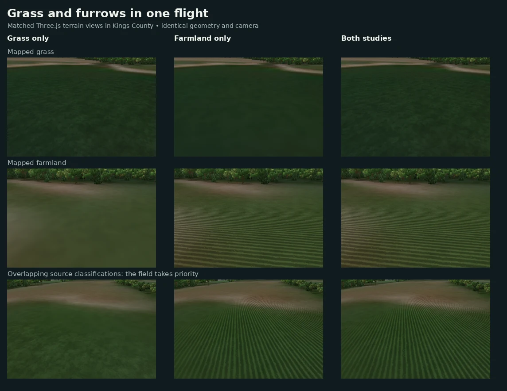

# Grass and farmland in the same flight

In **Standard** scenery, open **Optional scenery studies** in Dispatch,
check **Ground vegetation** and **Expanded farmland**, and apply. Both
still default to off. The **Kings County · grassland pass** starts where
both streams can load their nearby tiles. A direct bookmark can use
`?departure=kings-grassland&sourceGrassStudy&provinceFieldsReview`.

The two dated source masks do not describe conditions everywhere or establish
what is growing today. The grass and furrow marks are original close-range
surface effects; turning either on does not move the terrain, roads,
buildings, water or flight contact.

## How they meet

The authenticated masks use the same 4 m lattice but separate working sets.
Of 3,331 grass shards and 1,465 farmland shards, 942 share a shard address.
Only 4,084 exact sample centres (0.065 km²) carry both coverages.
Checking the 2 × 2 samples used for bilinear filtering gives a conservative
upper bound of 5,933 patches, or 0.095 km² before accounting for duplicate
edge samples and shader visibility. When field opacity is substantial,
furrows win. Partial boundaries fade rather than abruptly switching when
a shard arrives. This is a rendering priority, not a claim about which
survey represents current conditions.

Each stream still has four resident RG8 array slices, so both mask sets
retain 1,081,600 bytes total, before the two authored optical textures.
Each stream limits itself to two in-flight shard loads. The exact directories
are 249,810 and 111,398 compressed bytes. Standard without either option
requests neither. A missing or altered directory does not blank the other
study or keep it from authenticating its own files. The lower-altitude
combined shader still shades the same terrain geometry.

## Matched render and flight

All nine rendered frames held the camera, imagery readiness, mesh count,
draw calls and triangle count fixed. The central patch in the grass view is
pixel-identical to grass alone. Every pixel of the dedicated field view
matches farmland alone. The overlap centre also matches farmland alone;
the grass effect remains visible in the part of that view outside the
dominant field. This is a close-up SwiftShader comparison, not an FPS
benchmark.

The packaged simulator was flown with the ordinary Dispatch controls,
including a separate test for each invalid exact-size source directory.
An invalid study made no shard requests of its own, and the unaffected
study continued its independent stream. The strict byte-range path also
completed a 427 m flight with both streams loaded, using four 206 responses
for the nearby shards after reading the two directories.

[Machine-readable checks](province-land-surfaces-check.json).
The [mask scan](../../tools/qa/province-land-support.py) and
[packaged flight test](../../tools/qa/province-land-player.py) reproduce
the geographic count and archive-isolation checks.

The [grassland](province-grass.md) and [farmland](province-fields.md)
pages describe the inputs, opt-in scopes and individual verification.
