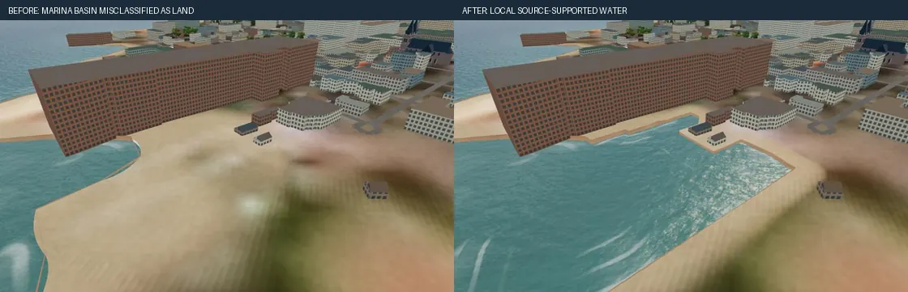

# Quartermaster Marina: the shoreline, before the docks

The previous province shoreline filled most of the real Quartermaster Marina basin at Peake’s Wharf as land, including the full paths of two of the three principal floating piers. Rendering those piers over the existing atlas would have put them on dry ground.

The updated shape follows [the directed OpenStreetMap coastline](https://www.openstreetmap.org/way/251166158/history), rather than inferring water from a leisure-marina polygon. It uses 22 selected positions from version 30 and is closed across the inlet where the previous simulator already had continuous water. The [July 2025 waterfront photograph](https://commons.wikimedia.org/wiki/File:Charlottetown,_Prince_Edward_Island,_Canada.jpg) and [July 2025 aerial](https://commons.wikimedia.org/wiki/File:Aerial_view_of_Charlottetown.jpg), both by Quintin Soloviev, CC BY 4.0, corroborate the open basin. The [CADC project history](https://cadcpei.com/projects/peaks-wharf-and-marina/) and [Canadian Hydrographic Service ATL 108](https://waves-vagues.dfo-mpo.gc.ca/library-bibliotheque/chs-shc-ATL108-eng-202602-41319163.pdf) provide site context. No photograph, depth, berth count or chart geometry is used by the runtime. The older 1987 NHN geometry did not resolve the modern basin.

## What the patch changes

- Within one grid-aligned **333 × 284 m** envelope, a small, optional texture reopens about **12,000 m²** of misclassified water. Its ≈0.74 m texture spacing is not survey accuracy. A conservative **1.22 m inward guard** and filtering tests keep the added water inside the source.
- The existing coastline, sea plane, land-contact heights and original distance field remain authoritative elsewhere. This change can add water inside the selected feature but never turn existing water into land. Land rendering, ocean coverage, touchdown classification and local shore curtains all evaluate the same corrected field. Only affected province contour cells are replaced; the original contours are retained everywhere else.
- The optional **24,853-byte** mask is integrity checked, tied to the correct underlying province atlas and applied before flight. Missing, corrupt or slow reads keep the previous render.
- No docks, vessels, berths, water depth, tides or maritime collision systems are installed by this increment. The surrounding buildings and quay materials remain approximate. **Not for navigation.**

[© OpenStreetMap contributors](https://www.openstreetmap.org/copyright). The [standalone geometry and derivative](../../data/odbl/quartermaster/) are ODbL 1.0 and only contain the local coast geometry. `npm run check` verifies provenance, full bilinear support, water-only contact changes, fallback, the previous water along the whole inlet cut, and both outer and internal curtain stitches.

An independent close camera recorded 141,941 unambiguous former ground
pixels now showing water; all 45,573 open-sea controls beyond the basin
remained pixel-identical. The test found no RGB changes outside the declared
edit footprint. Only the local shoreline curtains changed geometry; all
18,394 exterior curtain triangles stayed exact. In the close view, both
versions used 86 draws; there were 1,222 additional triangles for the new
curtain. Lower flight contact reported water at the corrected plane and
a higher test arrival's complete state remained identical.

The wide camera independently found 812 former dry pixels now rendered as
water. Across both views, all 320,658 sampled open-sea pixels outside the
basin remained identical. A four-hundred-thousand-point contact probe
found 12,053 newly wet locations; each was connected to prior water
inside the supported footprint.
