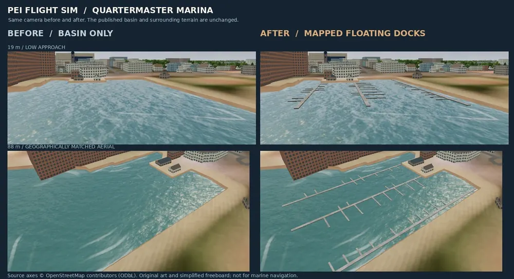

# Quartermaster Marina: floating deck scenery



The prior Quartermaster basin repair made the existing Charlottetown shoreline capable of receiving the marina docks. This release adds three modeled timber decks and thirty smaller fingers at Peake's Wharf (about 46.2315° N, 63.1217° W). It does not re-edit the shoreline, optics, terrain, wave behavior or flight/ground contact. No vessels, marine collision or inferred dry-land ramps are part of this addition.

## What is sourced and what is modeled

- The positions follow [OpenStreetMap](https://www.openstreetmap.org/copyright) [main ways 157136818](https://www.openstreetmap.org/way/157136818), [251161701](https://www.openstreetmap.org/way/251161701) and [251167697](https://www.openstreetmap.org/way/251167697), plus thirty fingers with direct shared original source nodes. The isolated [source and downloadable derivative](../../data/odbl/quartermaster/) are distributed under ODbL 1.0 with on-screen credit.
- [Charlottetown Area Development Corporation's wharf and marina page](https://cadcpei.com/projects/peaks-wharf-and-marina/) and [Canadian Hydrographic Service ATL108, chapter 3 paragraph 155](https://waves-vagues.dfo-mpo.gc.ca/library-bibliotheque/chs-shc-ATL108-eng-202602-41319163.pdf) corroborate the facility and floating docks. Neither is used to model vessel access or water depth.
- [Charlottetown, Prince Edward Island, Canada](https://commons.wikimedia.org/wiki/File:Charlottetown,_Prince_Edward_Island,_Canada.jpg) and [Aerial view of Charlottetown](https://commons.wikimedia.org/wiki/File:Aerial_view_of_Charlottetown.jpg), photographs by Quintin Soloviev (July 2025, CC BY 4.0), are visual references for pale decking and dark flotation edges. No pixels from the photos are in the game.
- The principal axes extend about 140.35, 137.94 and 130.05 m in the pinned source. The browser shows only about 108.96, 136.39 and 109.36 m of those axes, because the baker requires the full modeled deck to be safely on already-rendered water. No shape is invented to bridge a dry end. Nominal widths of 1.8 m for spines and 0.92 m for fingers and freeboard 0.38 m are art choices, not measurements.

## Rebuild and gates

```sh
/usr/bin/python3 tools/terrain/bake-quartermaster-docks.py
node --experimental-strip-types --test test/quartermaster-docks.test.ts
npm run check
python tools/qa/quartermaster-dock-assets.py --dist dist --chromium /path/to/chromium --out /tmp/quartermaster-dock-assets.json
```

The baker uses the same signed Cover interpolation as the game, checking every candidate run at roughly 0.12 m longitudinal interval with cross-deck probes, a 0.10 m lateral safety margin, and at least 0.24 m signed-water clearance. Only directly attached, water-qualified finger footprints survive. Bevels close supported intersections between original axis segments without adding curved end caps. Polygon difference creates a partition of top surfaces with per-way material direction; hull walls follow the union boundary, not individual joints. The output is rounded to a millimetre with topology preservation; microsliver seams below the viewed pixel scale are not marine survey evidence. The three visible hulls share one frustum-culled mesh, 540 triangles and one material; the optional transfer is 4,265 bytes. The dry bank, wharf façades and sheltered water need their own art passes.

The independent optional pack reads in parallel and won't install if it fails validation or the matching shoreline asset is unavailable. Projected dry/unsupported dock ends remain absent. The tests sample real mesh triangles and their wall edges, require stock water contact below every sample, pin the source geometry, and exercise empty/corrupt/stalled pack fallbacks. The production gate checks actual browser request failures and a waterfront departure. Rendering diagnostics include the installed dock ID, counts and mesh triangle budget when `?diagnostics` is present. Use paired fixed cameras looking across the basin at 19 m and over it at 88 m to assess the visible silhouette, material, and scoping. Not for navigation.

Independent projection of the rendered triangles found the optimized and
prior dock silhouettes identical in the low view; overlap was 99.96% in the
higher view. No RGB changes occurred outside the projected dock mesh in
either view. The new version submits one draw and 540 triangles, down from
2,450 in the first mesh. No collision or marine navigation model is added.
