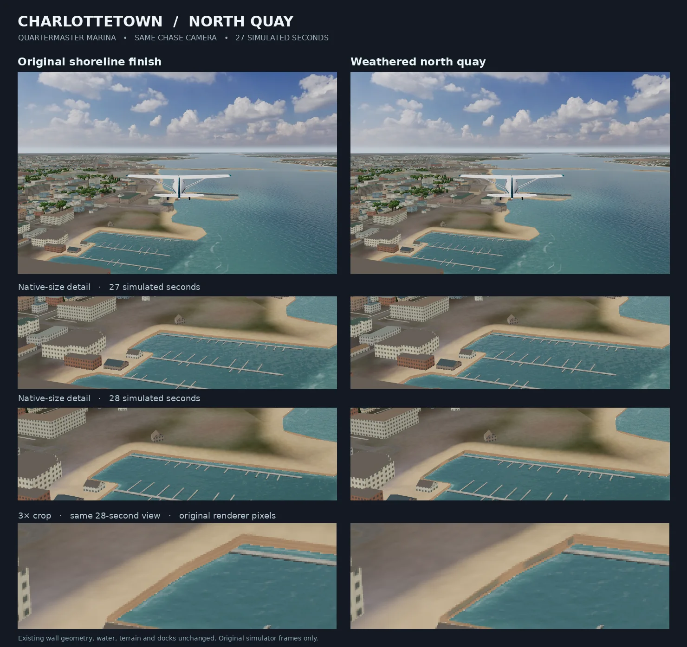

# Charlottetown · north quay finish

On **Charlottetown waterfront · low pass**, the optional north quay study
gives three short pieces of the existing marina face a darker, weathered
finish. It uses the original scenery geometry. It does not add a wall,
raise the apron, extend the boardwalk or move the shoreline.

Use `?departure=harbour-low&quartermasterQuayStudy` in Standard and let the
waterfront load in Dispatch before selecting **Begin flight**. The north
quay comes into the lower-left part of the original Chase view in the
recorded low pass. Remove `quartermasterQuayStudy` for the original finish.
Starting before the finish is ready keeps the prior appearance for the
whole flight. This study is limited to the first Chase pass. Switching
views or opening the map ends the study for that flight. The rest of
Standard scenery keeps its original behavior.

## What the reference supports

The [July 1, 2025 aerial](https://commons.wikimedia.org/wiki/File:Charlottetown,_Prince_Edward_Island,_Canada.jpg)
by Quintin Soloviev ([CC BY 4.0](https://creativecommons.org/licenses/by/4.0/))
shows a dark fixed face below a mixed landing near the mapped pier
roots. Nearby wood decking, a brighter terrace and the park-side rock
bank are distinct. A separate July 18 view shows the other marina and
does not verify this face. The [historical retaining-wall repair](https://www.harboursideengineering.com/project/peakes-quay-marina-repairs)
documents one Peake’s Quay structure; it does not identify every mapped
segment. No photo pixels, guessed beams, pile spacing or architectural
measurements are used in the study.

The finish is confined to eligible existing triangles near three
short portions of the [mapped basin](quartermaster-coast.md).
The outer edge, original face height, water and shore coverage are
unchanged. The neighboring terrace, west wall, rock bank, apron top,
buildings and [modeled floating docks](quartermaster-docks.md) retain
their original behavior. The finish is not a marine survey or
navigation aid.

[Matched native renderer and fallback receipt](quartermaster-north-quay/standard-flight.json).
